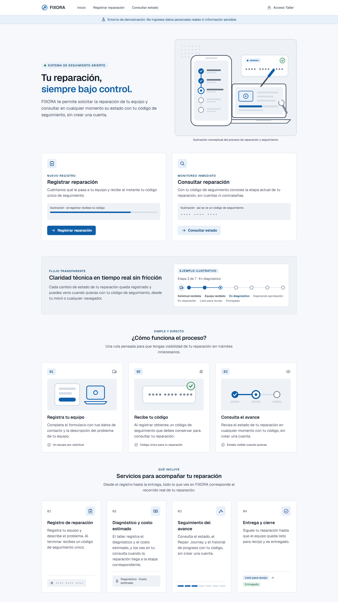
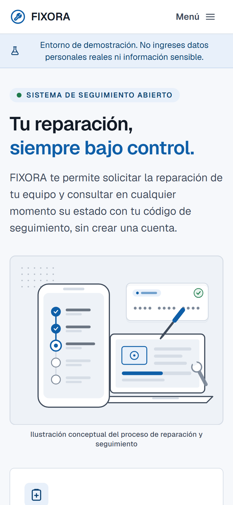
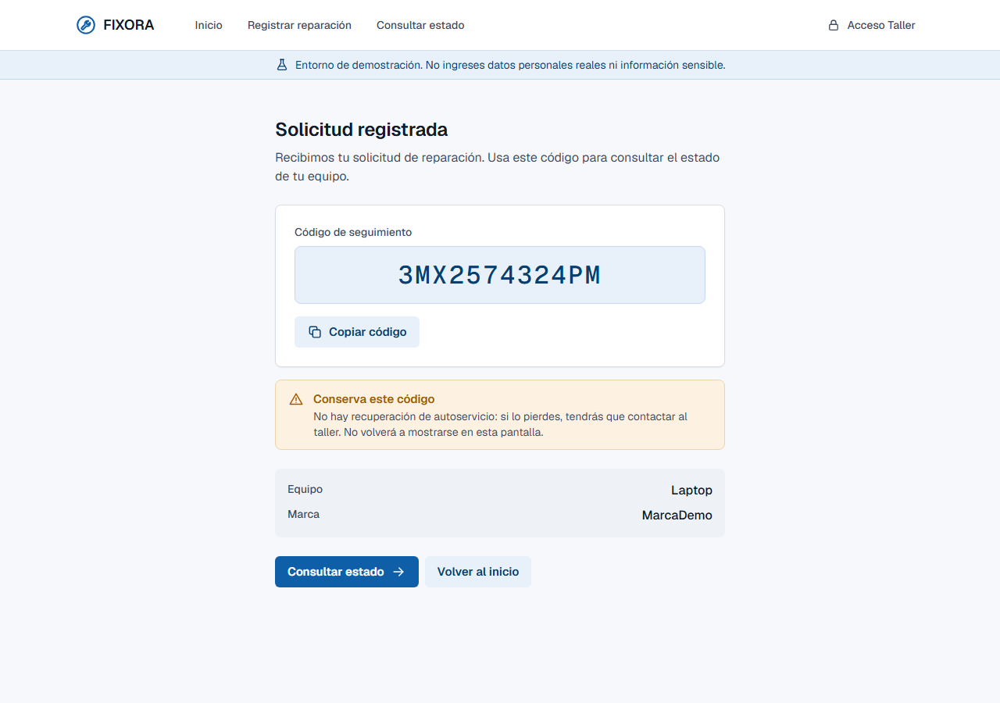
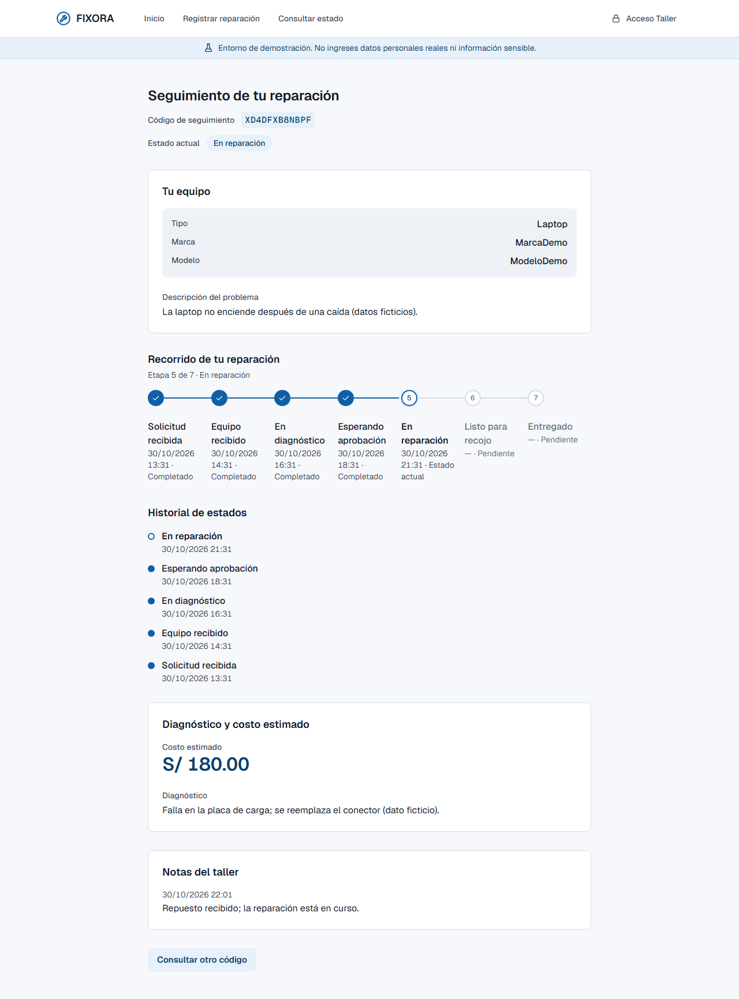
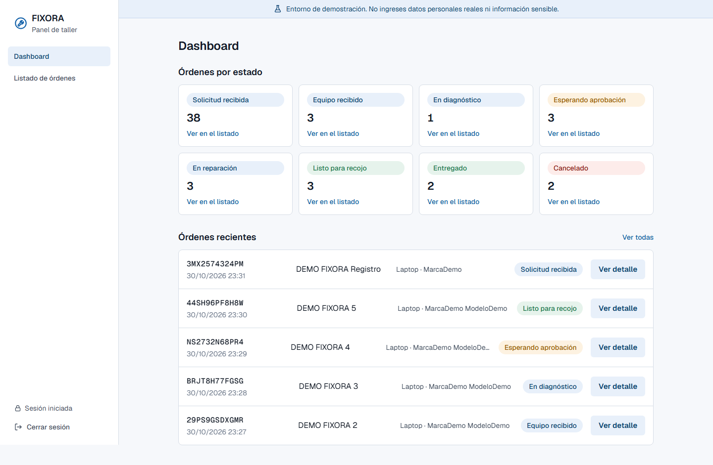
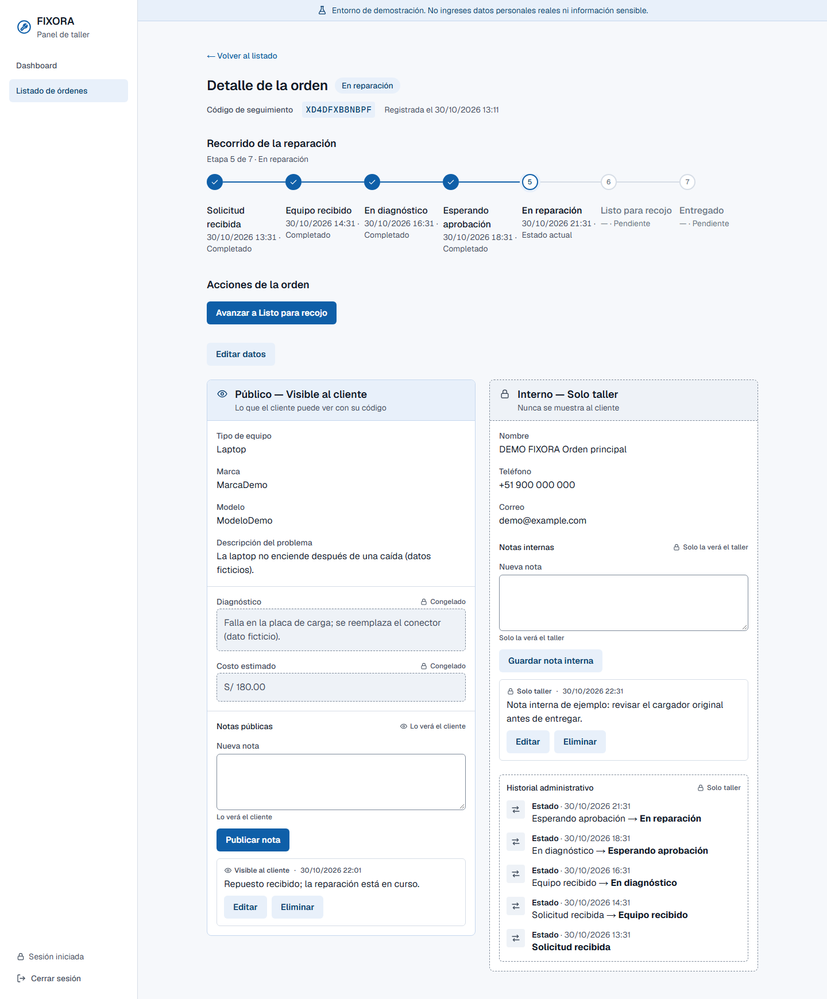
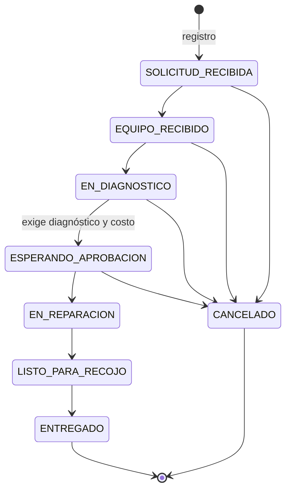
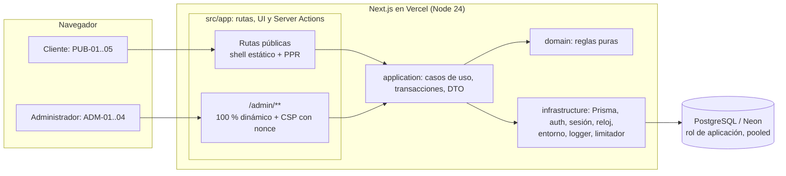

# FIXORA

*Tu reparación, siempre bajo control.*

[](https://github.com/wildtest/fixora/actions/workflows/ci.yml)
[](https://fixora-rho-one.vercel.app)
[](https://nextjs.org)
[](https://www.typescriptlang.org)
[](https://nodejs.org)
[](https://neon.com)

**Demo en producción: [https://fixora-rho-one.vercel.app](https://fixora-rho-one.vercel.app)**

Aplicación web responsive para **pequeños servicios técnicos de reparación de equipos tecnológicos**. Proyecto final de la especialización «Desarrollo de Software AI-First con Claude».

> **Resumen rápido** · V1 completa y desplegada como demostración académica · 8 specs canónicas de OpenSpec, 0 changes activos · 618 pruebas unitarias, 262 de integración y E2E completa en CI · Security Pass sin hallazgos Critical ni High · [Metodología AI-First](#metodología-ai-first) con decisiones humanas en cada puerta.

## Problema y solución

Muchos talleres gestionan las reparaciones por WhatsApp, llamadas, papel o Excel: el taller se desordena y el cliente pregunta una y otra vez por su equipo. FIXORA ofrece un flujo simple: el cliente **registra su equipo**, recibe un **código de seguimiento** y consulta el estado **sin crear una cuenta**; el taller gestiona las órdenes desde una **zona protegida**.

Diferenciadores: **Repair Journey** visual · seguimiento por código sin cuenta · **máquina de estados real** con transiciones controladas · **separación estricta entre información pública e interna**.

## Vista del producto

<table>
  <tr>
    <td width="62%" valign="top"><a href="docs/assets/screenshots/01-landing-desktop.png"></a></td>
    <td width="38%" valign="top"><a href="docs/assets/screenshots/02-landing-mobile.png"></a></td>
  </tr>
  <tr>
    <td colspan="2" align="center"><sub><b>Landing</b> en escritorio y móvil (Production).</sub></td>
  </tr>
</table>

<table>
  <tr>
    <td width="40%" valign="top"><a href="docs/assets/screenshots/03-registro-confirmacion.png"></a></td>
    <td width="60%" valign="top"><a href="docs/assets/screenshots/04-seguimiento-publico.png"></a></td>
  </tr>
  <tr>
    <td colspan="2" align="center"><sub><b>Cliente:</b> confirmación del registro con el código de seguimiento y consulta pública del estado.</sub></td>
  </tr>
</table>

<table>
  <tr>
    <td width="50%" valign="top"><a href="docs/assets/screenshots/05-dashboard-admin.png"></a></td>
    <td width="50%" valign="top"><a href="docs/assets/screenshots/06-detalle-orden-admin.png"></a></td>
  </tr>
  <tr>
    <td colspan="2" align="center"><sub><b>Administración:</b> dashboard y detalle de orden con la separación entre información pública e interna.</sub></td>
  </tr>
</table>

<sub>La landing es del despliegue de Production. El resto proviene de un entorno de pruebas con **datos exclusivamente ficticios** (el código de seguimiento mostrado no existe en Production). Haz clic en una imagen para verla completa.</sub>

## Funcionalidades

### Cliente (sin cuenta)
Landing · registro de una solicitud de reparación · código de seguimiento · consulta del estado con ese código: Repair Journey, historial de estados, diagnóstico y costo estimado (visibles según el estado de la orden) y notas públicas.

### Administrador (un único usuario)
Inicio de sesión · panel con conteos y órdenes recientes · listado con búsqueda (código exacto o nombre) y filtro por estado · detalle con bloques **público** e **interno** · cambio de estado con confirmaciones verificadas en el servidor · diagnóstico y costo estimado (se congelan al pedir la aprobación) · notas públicas e internas · corrección de datos básicos · historial de cambios.

## Flujo de reparación

```
Solicitud recibida → Equipo recibido → En diagnóstico → Esperando aprobación
        → En reparación → Listo para recojo → Entregado
```

`Cancelado` es posible mientras la reparación no haya empezado ni terminado (hasta *Esperando aprobación*); *Entregado* y *Cancelado* son finales. Hay **10 transiciones válidas** y 54 rechazadas (sin saltos, retrocesos ni reapertura); *Esperando aprobación* exige diagnóstico y costo. La aprobación del cliente ocurre fuera de FIXORA: el administrador declara que ya ocurrió (Technical Design §7.2).



## Arquitectura

Monolito modular: `src/app` (rutas, UI, Server Actions) → `src/application` (casos de uso, transacciones, DTO) → `src/domain` (reglas puras) e `src/infrastructure` (PostgreSQL/Prisma, sesión, seguridad, logging); reglas de lint protegen las fronteras. **El servidor es la fuente de verdad** de las reglas sensibles (transiciones, autorización, separación público/interno). Concurrencia optimista por versión, historiales *append-only* por privilegios de base de datos y proyección pública por lista positiva. La zona pública es mayormente estática y `/admin/**` es 100 % dinámica con CSP de *nonce*.



Fuente lógica de los diagramas: [Technical Design](docs/03-arquitectura/TECHNICAL-DESIGN.md) (§2 y §7.2) y sus [ADR](docs/03-arquitectura/adrs/). Diagramas de CI/CD y del pipeline AI-First: [docs/06-diagramas/DIAGRAMAS.md](docs/06-diagramas/DIAGRAMAS.md).

## Stack tecnológico

| Área | Tecnología |
|---|---|
| Aplicación | Next.js 16.4 (App Router, Server Components y Server Actions) · React 19.3 · Tailwind CSS 4 |
| Lenguaje | TypeScript 6 `strict` (ESM) · Node.js 24.x |
| Datos | PostgreSQL en Neon · Prisma 7.10 con `@prisma/adapter-pg` |
| Autenticación | Propia y mínima: contraseña con `scrypt`, sesión opaca en PostgreSQL |
| Pruebas | Vitest 5 · Playwright 1.64 |
| CI/CD | GitHub Actions · Vercel |
| Proceso | OpenSpec 1.15 · Claude Code |

Sin servicios de terceros de analítica, autenticación ni observabilidad.

## Metodología AI-First

Primero se documenta y se decide; después se implementa. Cada artefacto consume el anterior y debe ser coherente con él.

```
Idea → PRD → UX (Stitch) → Diseño (Claude Design) → Technical Design + ADR
     → revisión adversarial → Backlog → OpenSpec → Claude Code (apply)
     → Testing → Security Pass → CI/CD → Release Readiness
```

| Rol | Responsabilidad |
|---|---|
| **Persona (decisión y control)** | Decisiones funcionales y de alcance, aprobación del PRD, del diseño y de la arquitectura, secretos y credenciales, acciones sensibles de Production (migraciones, administrador, datos), revisión de resultados y fusión de PR. |
| **Claude Code** | Análisis, redacción de specs y tareas, implementación, pruebas, refactorización, revisión y automatización, siempre dentro de las reglas del repositorio ([CLAUDE.md](CLAUDE.md)). |
| **OpenSpec** | Ciclo de cada cambio: *propose* (propuesta, diseño, tareas y specs delta) → revisión humana → *apply* → verificación → *archive* (fusión en `openspec/specs/`). |

Resultado: 16 changes planificados (CHG-01…CHG-15) y 2 mejoras visuales posteriores, todos archivados; 8 specs canónicas. El PRD manda sobre el resto; las contradicciones se reportan, no se resuelven en silencio. **El proyecto no se generó de forma autónoma**: cada fase, cada merge y cada acción sobre Production pasó por una aprobación humana.

## Ejecución local

**Requisitos:** Node.js 24.x (ver `.nvmrc`; con `fnm`: `fnm use 24`), npm y un proyecto en Neon con las ramas `development` (local), `test` (pruebas) y `main` (Production, nunca desde local).

1. **Neon.** Crear en cada rama `development` y `test` el rol `fixora_app` y, en `test`, el marcador de entorno; en `development`, la base `fixora_shadow`. Procedimiento completo y seguro en [NEON-ENVIRONMENTS.md](docs/09-deploy/NEON-ENVIRONMENTS.md).
2. **Variables.** Copiar `.env.example` a `.env.local` (rama `development`) y `.env.test` (rama `test`) y completar solo los valores de cada rama: `DATABASE_URL` (rol de aplicación, *pooled*), `DIRECT_URL` (propietario, directa, solo migraciones), `SHADOW_DATABASE_URL`, `RATE_LIMIT_HMAC_SECRET` (≥ 32 caracteres) y, para pruebas, `TEST_DATABASE_URL` y `TEST_DIRECT_URL`. Los valores reales **nunca** se versionan.
3. **Instalar, migrar y arrancar:**

```bash
npm ci
npm run db:generate
npm run db:migrate:deploy      # aplica las migraciones a la rama de `.env.local`
npm run dev                    # http://localhost:3000
# build de producción local:
npm run build && npm start
```

4. **Primer administrador** (script operativo externo, nunca desde la aplicación):

```bash
npm run admin:provision -- --environment=development --email=<correo>
```

Pide la contraseña de forma interactiva y luego se entra en `/admin/acceso`. **`--environment` es solo una etiqueta: no selecciona la base de datos; el destino lo decide `DIRECT_URL`.** Antes de ejecutarlo contra otra rama, sigue el [runbook §4](docs/09-deploy/RUNBOOKS.md) y comprueba el destino.

5. **Datos de demostración ficticios** (opcional, solo `development`): `SEED_DEMO_CONFIRM=DEVELOPMENT npm run seed:demo`.

## Testing y calidad

| Verificación | Resultado vigente |
|---|---|
| Pruebas unitarias (`npm run test:unit`) | **618** |
| Pruebas de integración (PostgreSQL real, rama Neon `test`) | **262** |
| E2E (Playwright, escritorio y móvil) | **PASS** completa en GitHub CI (`db-tests`) |
| Cobertura de `domain/` | **100 %** de líneas · **97,43 %** de ramas (umbral 90 %) |
| Trazabilidad de criterios (`SC-*` y `E*`) | **37/37** verificados |
| `lint` · `typecheck` · `build` · `ci:secrets` · `ci:audit` | OK |

Verificado sobre `main` `030aaf7` (2026-10-30); desde entonces solo hay cambios de documentación. El conteo exacto de E2E depende de la suite y de las pruebas omitidas por diseño; la fuente es el último run de CI.

| Comando | Qué ejecuta |
|---|---|
| `npm run lint` · `npm run typecheck` | ESLint (con reglas de capas y seguridad) · TypeScript |
| `npm run test:unit` · `npm run test:coverage` | Unitarias · cobertura selectiva |
| `npm run test:integration` | Integración (serial, rama Neon `test`) |
| `npm run test:e2e` | `next build` + `next start` + Playwright (exige `.env.test`; consume bastante memoria) |
| `npm run test:trace` | Verifica [TRACEABILITY.md](docs/07-testing/TRACEABILITY.md) |
| `npm run ci:secrets` · `npm run ci:audit` | Higiene de secretos · política de `npm audit` |
| `SMOKE_BASE_URL=<url> npm run test:smoke` | Smoke público y no mutante de Production |

Detalle de las compuertas en [CI-QUALITY-GATES.md](docs/07-testing/CI-QUALITY-GATES.md).

## Seguridad

Security Pass formal ([SECURITY-REPORT.md](docs/08-seguridad/SECURITY-REPORT.md)): **0 Critical y 0 High abiertos**.

- **Autenticación del administrador:** `scrypt`, sesión opaca con hash persistido y cookie `__Host-` (`HttpOnly`, `Secure`, `SameSite=Strict`).
- **Limitación de intentos** persistente por IP canonicalizada (HMAC), con falla cerrada.
- **Aislamiento de datos personales:** proyección pública por lista positiva; las notas internas y los datos de contacto no llegan a vistas públicas.
- **CSP con *nonce*** en la zona administrativa y cabeceras de seguridad.
- **Mínimo privilegio en la base de datos** (privilegios por columna, historiales *append-only*) e **higiene de secretos** (revisión en CI, secretos fuera del repositorio).

No se afirma ninguna certificación. **Production está validada para demostración y evaluación académica; `VAL-04` (aprobación para operación comercial real) permanece abierta.** La demo puede recibir datos reales pese al aviso: no ingreses información personal ni sensible.

## CI/CD y despliegue

```
rama feature/fix → Pull Request → static + db-tests → main protegida → Vercel Production
```

- **`static`:** lint, typecheck, cobertura, trazabilidad, secretos, audit y build. **`db-tests`:** integración y E2E completa sobre la rama Neon `test` (serializado). Ambos son obligatorios para fusionar; `main` está protegida (sin push directo ni `--force`).
- **Production:** Vercel despliega `main` por la integración Git sobre Neon `main` con el rol `fixora_app`.
- **Migraciones:** solo con el workflow manual `migrate-production`, ligado al SHA y a la identidad del contenido de `prisma/migrations/`, con aprobación humana del Environment `production`.
- **Recuperación:** *Instant Rollback* de Vercel, ventana de restauración de Neon y runbooks RB-1…RB-9 en [RUNBOOKS.md](docs/09-deploy/RUNBOOKS.md).

Estado y evidencia: [PRODUCTION-ENVIRONMENT.md](docs/09-deploy/PRODUCTION-ENVIRONMENT.md) · [RELEASE-READINESS.md](docs/09-deploy/RELEASE-READINESS.md).

## Documentación

Punto de entrada: [docs/README.md](docs/README.md). Fuentes de verdad, en orden de jerarquía:

| Documento | Rol |
|---|---|
| [PRD](docs/01-producto/PRD.md) | Qué hace el producto (fuente funcional) |
| [UX](docs/02-diseno/UX-EXPLORATION.md) · [DESIGN](docs/02-diseno/DESIGN.md) | Estructura UX y sistema visual |
| [Technical Design](docs/03-arquitectura/TECHNICAL-DESIGN.md) · [ADR](docs/03-arquitectura/adrs/) | Cómo se construye y por qué |
| [Backlog](docs/04-planificacion/BACKLOG.md) · [Estrategia OpenSpec](docs/04-planificacion/OPENSPEC-STRATEGY.md) | Planificación |
| [`openspec/specs/`](openspec/specs/) | Especificaciones canónicas (8 capabilities) |
| [Trazabilidad](docs/07-testing/TRACEABILITY.md) · [Seguridad](docs/08-seguridad/SECURITY-REPORT.md) · [Release](docs/09-deploy/RELEASE-READINESS.md) | Evidencia |
| [CLAUDE.md](CLAUDE.md) · [AGENTS.md](AGENTS.md) | Reglas de trabajo para agentes |

```
src/        app (Next), application, domain, infrastructure
prisma/     esquema y migraciones
tests/      integration, e2e, smoke, tooling
scripts/    operación y CI (admin:provision, seed:demo, trazabilidad, auditoría)
openspec/   specs canónicas y changes archivados
docs/       pipeline documental (00 definición … 09 despliegue)
```

## Estado del proyecto

**FIXORA V1 completa**, desplegada y lista para **demostración y evaluación académica**. Fase 15 (README, portfolio y auditoría final) en cierre. OpenSpec: 0 changes activos y 8 specs canónicas.

## Limitaciones y alcance V1

- **Fuera de alcance:** cuentas de clientes, varios roles, técnicos o sucursales, inventario, facturación, pagos, notificaciones automáticas (WhatsApp, SMS, correo), fotos, firma digital, app móvil, IA y chat. Detalle en el [PRD](docs/01-producto/PRD.md).
- Un único administrador; sin copias de seguridad propias (se usa la ventana de restauración de Neon); el código de seguimiento no se puede rotar; el registro público no tiene anti-spam. Lista completa de riesgos residuales: [RELEASE-READINESS.md §6](docs/09-deploy/RELEASE-READINESS.md).

## Licencia

Sin licencia seleccionada: la decisión corresponde a la persona propietaria del repositorio y está diferida; no se requiere para la entrega académica / demo. Hasta entonces, aplican los derechos de autor por defecto.
