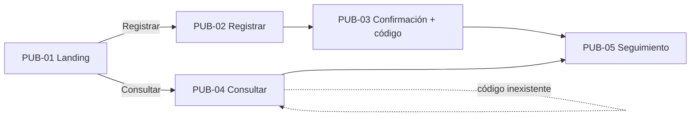
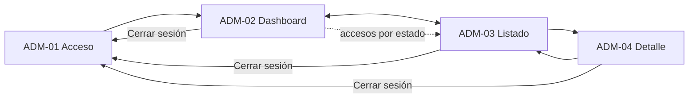

# FIXORA — Exploración UX/UI con Google Stitch

> Fase 02 · Diseño · Parte 1 (Exploración UX) · Estado: **COMPLETADA — pendiente de auditoría y commit**
>
> Fecha del documento: 2026-10-25.
>
> Este documento registra la exploración UX realizada y fija la **estructura UX y la navegación** aprobadas. **No es `DESIGN.md`**, no define el sistema visual y no es un Technical Design.
>
> **Jerarquía de autoridad:** `PRD.md` (fuente de verdad funcional) > este documento (estructura UX/navegación) > `STITCH-BRIEF.md` (insumo de la exploración) > capturas de Stitch (evidencia, no fuente de requisitos). Si algo de las capturas contradice al PRD o a este documento, prevalece el PRD y luego este documento.
>
> Los identificadores `SC-*`, `E*`, `SUP-*`, `VAL-*`, `RIE-*` y las referencias `§` son los del PRD. `DUX-*` son los de `STITCH-BRIEF.md` §14. Los identificadores de pantalla `PUB-*` y `ADM-*` son los de `STITCH-BRIEF.md` §3 (ver aclaración sobre los nombres de archivo de las evidencias en la sección 19).
>
> **Numeración:** lo que el plan maestro llama "Fase 3 — Exploración UX/UI con Google Stitch" corresponde, en la numeración documental del repositorio, a la carpeta `02-diseno/`. La "Fase 4 — Claude Design + sistema visual" también se archivará en `02-diseno/`.

---

## 1. Propósito

La Fase 3 tuvo como objetivo transformar el PRD aprobado en una dirección UX que sea:

- **comprensible** para un cliente sin conocimientos técnicos y para un administrador único;
- **navegable**, con flujos claros para registrar, consultar y administrar;
- **responsive**, utilizable en móvil y en escritorio (`SC-15`);
- **consistente con las reglas funcionales** aprobadas (estados, transiciones, público/interno, confirmaciones);

**antes** de definir el sistema visual definitivo y **antes** de implementar código.

Como herramienta de exploración UX/UI se utilizó **Google Stitch**. Stitch se empleó para generar y comparar propuestas de estructura, jerarquía y composición; no para decidir funcionalidad.

---

## 2. Fuente de verdad y restricciones

- `docs/01-producto/PRD.md` es la **fuente de verdad funcional**. Nada de este documento la modifica.
- `docs/02-diseno/STITCH-BRIEF.md` tradujo el PRD a un contexto de exploración UX: pantallas, flujos, estados, privacidad, qué es fijo, qué es libre y qué es `DECISIÓN UX PENDIENTE`.
- Stitch tuvo **libertad para explorar** layout, jerarquía, densidad, composición, navegación y microcopy provisional.
- Stitch **no tuvo autoridad para introducir funcionalidades nuevas**, cambiar estados, alterar transiciones ni mover información entre público e interno.

**Hallazgo central de la exploración.** En todas las direcciones, Stitch generó propuestas que **excedían el PRD** (módulos, datos, estados y mensajes que no están aprobados). Esas propuestas fueron **detectadas y descartadas**; la sección 8 las lista. Las capturas conservadas en `evidencias/` **todavía contienen restos de ese contenido** (sección 19.5): por eso son evidencia de composición y de patrones UX, no de contenido ni de comportamiento.

---

## 3. Metodología de exploración

1. **Preparación de `STITCH-BRIEF.md`**, derivado solo del PRD aprobado.
2. **Exploración divergente:** generar varias direcciones con intenciones distintas sobre las mismas pantallas.
3. **Dirección A — Clara.**
4. **Dirección B — Operativa.**
5. **Dirección C — Moderna y equilibrada.**
6. **Comparación** de las tres según criterios derivados del PRD (claridad del seguimiento, eficiencia administrativa, separación público/interno, responsive, representación de estados y confirmaciones), no según gusto estético.
7. **Construcción de una Dirección UX Consolidada** que combina patrones de las tres (sección 7).
8. **Corrección contra el PRD:** se revisó el contenido generado y se descartó lo que excedía el alcance (sección 8).
9. **Incorporación de pantallas faltantes** (confirmación de registro, seguimiento público en varios estados, etc.).
10. **Casos borde y estados UX** (sección 12).
11. **Variantes responsive móviles** (sección 14).
12. **Conexión de los flujos como prototipo** (sección 11).

**Criterio de selección.** Se evitó elegir una propuesta por sus colores o su estética: paleta, tipografía y sistema visual pertenecen a la siguiente fase. Las diferencias visuales entre direcciones (por ejemplo, el uso de tipografías serif en partes de B y C, o los tonos azules de cada una) **no se tomaron como decisiones**.

---

## 4. Dirección A — Clara

**Objetivo:** priorizar simplicidad, espacio en blanco, claridad y seguimiento.

**Fortalezas identificadas**

- Facilidad de lectura.
- Buena experiencia para un usuario no técnico.
- Acciones principales evidentes (registrar, consultar).
- Buena base para el área pública.

**Limitaciones detectadas**

- Menor densidad administrativa: el listado y el panel resultan más espaciados y muestran menos información por pantalla.
- Algunas propuestas de Stitch introdujeron contenido fuera del PRD (sección 8). Ese contenido **no se toma como requisito**.

**Evidencias (válidas):** `evidencias/stitch/exploracion/direccion-a/PUB-01.png` (landing), `PUB-02.png` (registro), `ADM-01.png` (dashboard), `ADM-02.png` (listado). **Evidencias no utilizables:** `PUB-03.png` y `ADM-03.png` están corruptas (ver 19.4). Dirección A, por tanto, no tiene evidencia del seguimiento público ni del detalle administrativo.

---

## 5. Dirección B — Operativa

**Objetivo:** explorar mayor eficiencia administrativa y aprovechamiento del espacio.

**Fortalezas**

- Densidad de información útil.
- Escaneo rápido.
- Mejores patrones operativos para Dashboard, Listado y Detalle (tabla densa, cabecera de acciones, bloques diferenciados).

**Limitaciones**

- Riesgo de saturación.
- Stitch tendió a introducir conceptos propios de un ERP o sistema de taller que **no pertenecen a FIXORA** (sección 8). Ejemplos visibles en las capturas, todos **descartados**: técnicos de guardia y asignación a técnico, mesas/estaciones de trabajo, inventario ("Repuestos y Stock"), facturación y caja, turnos, búsqueda por IMEI/serial, atajos de teclado y escaneo, capacidad de planta, garantías.

**Evidencias (válidas):** `evidencias/stitch/exploracion/direccion-b/PUB-01.png` (landing), `PUB-02.png` (dashboard administrativo), `02. Opcion B - Publico - Registrar Reparacion.png` (registro), `ADM-01.png` (listado), `ADM-02.png` (detalle administrativo), `ADM-03.png` (seguimiento público).

> Los nombres de archivo de Dirección B no corresponden a los identificadores del `STITCH-BRIEF.md`; el contenido real de cada archivo es el indicado arriba.

---

## 6. Dirección C — Moderna y equilibrada

**Objetivo:** equilibrio entre claridad, densidad, modernidad y responsive.

**Fortalezas**

- Composición contemporánea.
- Repair Journey visual claro (siete etapas en línea, con fecha y estado de cada una).
- Mejor equilibrio entre el área pública y la administrativa.
- Patrones **Card-Row** en listados y paneles.
- Buen potencial responsive.
- En el detalle administrativo, separación explícita entre un bloque **público** y un bloque **interno**.

**Limitaciones**

- También produjo elementos funcionales no autorizados que tuvieron que corregirse: documento de identidad (DNI), número de serie, mapa y dirección del local, garantía, facturación/boleta, "lead time", inventario, SMS y estados con nombres no aprobados (por ejemplo, "Reparado" o "Esperando repuesto" en el Journey del detalle).

**Evidencias (válidas):** `evidencias/stitch/exploracion/direccion-c/PUB-01.png` (landing), `PUB-02.png` (registro), `PUB-03.png` (seguimiento público), `ADM-01.png` (dashboard), `ADM-02.png` (listado), `ADM-03.png` (detalle administrativo con panel de confirmación E11).

---

## 7. Decisión de convergencia

**No se eligió A, B ni C de forma pura.** Se construyó la **Dirección UX Consolidada de FIXORA**, basada conceptualmente en:

**De A**
- claridad y simplicidad;
- acciones evidentes;
- espacio suficiente para usuarios no técnicos.

**De B**
- eficiencia administrativa;
- densidad útil;
- escaneo rápido.

**De C**
- jerarquía moderna;
- Repair Journey;
- Card-Rows;
- equilibrio de información;
- responsive;
- separación público/interno.

**Alcance de lo tomado.** Las propuestas visuales solo aportaron **patrones UX**. La lógica funcional fue **reconstruida y validada contra el PRD**, no copiada de ninguna propuesta. Lo que Stitch afirme sobre reglas de negocio no tiene valor normativo.

---

## 8. Elementos descartados durante la exploración

Los siguientes elementos aparecieron en las propuestas de Stitch y **NO forman parte de FIXORA V1**. Se documentan como **descartados**, no como funcionalidades ni como ideas pendientes. Todos están fuera del PRD (§4 No alcance, `PROJECT-BRIEF.md` §7) o no están aprobados en él.

| Categoría | Elementos descartados |
|---|---|
| Personal y operación del taller | técnicos y asignación de técnicos ("técnico de guardia", nombres de técnicos); turnos; mesas/estaciones de trabajo y bahías; "capacidad operativa" y ocupación; atajos de teclado y escaneo; operador/sede como dato de la orden |
| Inventario y repuestos | inventario, stock, "Repuestos y Stock" / "Inventario & Partes" como módulo; proveedores como módulo |
| Dinero | facturación, boletas, caja y liquidaciones; pagos; "facturación estimada" y métricas de ingresos; IGV; desglose de repuestos, mano de obra o conceptos del costo (el PRD aprueba un **costo único**) |
| Garantía y servicio posventa | garantías ("90 días", "6 meses"), "soporte post-entrega", "tarifario y servicios" |
| Priorización y plazos | prioridades, urgencias, SLA, "lead time", tiempos promedio de diagnóstico, estimaciones de entrega, "diagnóstico en banco < 24 h" |
| Identificación del equipo | IMEI, número de serie/S/N, DNI del cliente |
| Contenido adjunto | fotografías del equipo o del proceso ("historial fotográfico", fotos de inspección), documentos, firma digital |
| Comunicación | notificaciones automáticas (campana, "cliente notificado"), SMS, WhatsApp **como funcionalidad**, chat, "Llamar" como acción de la aplicación |
| Datos de contacto del taller | dirección, mapa, teléfono y horarios del local, "central telefónica", "múltiples sedes" / "sede principal" (el PRD no define datos de contacto del taller; ver `DUX-04`) |
| Cuentas y roles | datos de operador en el pie de la barra lateral, múltiples usuarios, roles |
| Acceso | recuperación automática del código de seguimiento, envío de códigos por correo o teléfono |
| Estados no aprobados | "Registrado", "Ingresado", "Reparado", "Esperando repuesto", "Recepción web", "Ingreso en mesa", "Evaluación técnica", "Intervención activa", "Control de calidad OK", "Histórico finalizado", "Cancelado / No reparable", "Cancelado / Sin reparación" y cualquier otra denominación distinta de los ocho estados del PRD |
| Auditoría | auditoría completa o trazabilidad de autor (el PRD no registra quién hizo cada cambio) |
| Motivos y reglas inventadas | motivo de cancelación como dato obligatorio o estructurado ("solicitud del cliente", "presupuesto rechazado"); plazos de recojo; checklists de recepción; "Términos del taller"; políticas del taller |
| Reclamos legales | cumplimiento de normativa de datos o cifrado "TLS 256-bit"/"hash criptográfico" como afirmaciones de producto |
| Arquitectura e infraestructura | "SYNC API", "base de datos reactiva", "Master DB", nodos/terminales, versiones del sistema, "bloqueo de concurrencia optimista" como texto de interfaz; cualquier decisión de arquitectura o infraestructura |
| Navegación ajena | barra de navegación inferior móvil con "Taller / Órdenes / Repuestos / Estado"; botón de imprimir |
| Modelo de datos | "ID Ref" o folios adicionales al código de seguimiento; formatos de código inventados ("FX-…", "FIX-XXXXX-PE"); límites de texto (300/500/1000 caracteres) como decisiones |

**Aclaraciones**

- Una **nota pública** en texto libre puede mencionar, por ejemplo, que "el repuesto fue solicitado al proveedor". Eso es solo el contenido de una nota que escribe el administrador; **no convierte** repuestos, proveedores ni inventario en módulos del producto.
- El **costo estimado** es un único importe en PEN (`S/`) con dos decimales y mayor que cero (PRD §4.5). Los importes `S/ 0.00` que aparecen en algunas capturas para órdenes canceladas **no son válidos** (ver 19.5).
- Los códigos de ejemplo (`EJ-0000`, `FX-…`) son ficticios; el formato real lo decide el Technical Design (`E16`).

---

## 9. Inventario final de pantallas

Nueve pantallas consolidadas. Los identificadores son los de `STITCH-BRIEF.md` §3.

### Área pública

**PUB-01 — Landing**
Presentar FIXORA y ofrecer acceso claro a **registrar reparación** y **consultar reparación**. Incluye el aviso de entorno demostrativo y un acceso discreto al área administrativa.

**PUB-02 — Registrar reparación**
Representa el formulario aprobado por el PRD (§4.1): datos de contacto del cliente (nombre y teléfono obligatorios, email opcional), tipo de equipo, marca, modelo opcional y descripción del problema; avisos de uso de datos personales y de no incluir contraseñas, PIN ni información sensible. Un equipo por solicitud.

**PUB-03 — Confirmación de registro**
- Confirmar el registro.
- Mostrar el código de seguimiento.
- Permitir copiarlo.
- Recordar que debe conservarse (`E2`: no hay recuperación de autoservicio).
- Dar acceso al seguimiento.

**PUB-04 — Consultar reparación**
- Ingresar el código.
- Consultar la orden.
- Manejar el código inexistente sin filtrar información (`E4`, `SC-13`).

**PUB-05 — Seguimiento público**
Mostrar **exclusivamente** la información pública permitida:
- código;
- equipo;
- descripción;
- estado;
- Repair Journey;
- timeline público con fechas;
- diagnóstico y costo **cuando sean públicos** (desde *Esperando aprobación*);
- notas públicas.

### Área administrativa

**ADM-01 — Acceso administrativo**
Proteger el acceso al área administrativa (`SC-12`). La UI de correo y contraseña es una **representación UX**; la implementación concreta de autenticación se decidirá posteriormente (`DUX-14`).

**ADM-02 — Dashboard**
Dashboard mínimo: conteos por estados aprobados, órdenes recientes y acceso al listado. **No** incluye analítica avanzada.

**ADM-03 — Listado de órdenes**
- Búsqueda por código o nombre (`E7`, `E15`).
- Filtro por estado.
- Orden predeterminado: más reciente primero (`E8`).
- Acceso al detalle.

**ADM-04 — Detalle administrativo**
- Información pública.
- Información interna.
- Datos del cliente.
- Datos del equipo.
- Diagnóstico.
- Costo.
- Notas públicas.
- Notas internas.
- Historial administrativo.
- Transiciones permitidas.

**Variantes y estados** (confirmaciones, errores, vacíos, orden cerrada) **no son pantallas adicionales**: son estados de estas nueve (sección 12).

---

## 10. Repair Journey aprobado

El flujo normal tiene exactamente **siete estados**:

1. Solicitud recibida
2. Equipo recibido
3. En diagnóstico
4. Esperando aprobación
5. En reparación
6. Listo para recojo
7. Entregado

**Cancelado** es un **estado terminal alternativo**, alcanzable únicamente desde:

- Solicitud recibida;
- Equipo recibido;
- En diagnóstico;
- Esperando aprobación.

**Representación:** visualmente, *Cancelado* **no** se muestra como una octava etapa posterior a *Entregado*. Se representa como una **salida alternativa** (bifurcación) del recorrido, que en una orden cancelada marca dónde se interrumpió el Journey.

La lógica de transiciones **no se modifica** respecto del PRD (§4.4): solo avance, sin saltos ni retrocesos; *Entregado* y *Cancelado* son finales; la transición a *Esperando aprobación* exige diagnóstico y costo registrados (`SC-07`); desde *En reparación* ya no se puede cancelar (`SC-05`).

---

## 11. Navegación aprobada

### Flujo público

```text
PUB-01 Landing
├─ Registrar
│  → PUB-02 Registrar reparación
│  → PUB-03 Confirmación de registro (código)
│  → PUB-05 Seguimiento público
│
└─ Consultar
   → PUB-04 Consultar reparación
   → PUB-05 Seguimiento público
```



### Flujo administrativo

```text
ADM-01 Acceso → ADM-02 Dashboard → ADM-03 Listado → ADM-04 Detalle
```



**Notas de navegación**

- Dashboard, Listado y Detalle forman parte de **una misma navegación administrativa**; el administrador se mueve entre ellos sin pasar por el acceso.
- **Cerrar sesión retorna al acceso administrativo (`ADM-01`).**
- Desde el área pública hay un acceso discreto al área administrativa (en las capturas consolidadas, "Acceso Taller" en la cabecera y "Acceso administrativo" en pie/móvil). Se registra como lo observado, **no como decisión cerrada de `DUX-01`**.
- Una sesión expirada devuelve al acceso (`E10`).

---

## 12. Casos borde y estados UX contemplados

Stitch exploró visualmente los siguientes estados o variantes. **No cada uno tiene una página independiente**: son variantes o superposiciones de las nueve pantallas. La relación con el PRD es la indicada; no se crean identificadores nuevos.

| Estado / variante | Pantalla | Referencia PRD |
|---|---|---|
| Formulario inválido (campos obligatorios, error por campo) | PUB-02 | `E3`, `SC-16` |
| Código inexistente | PUB-04 | `E4`, `SC-13` |
| Diagnóstico, costo o notas aún no disponibles (mensaje claro, sin secciones rotas) | PUB-05 | `E6`, `SC-08` |
| Orden cancelada | PUB-05 | `E5`, `SC-05` |
| Orden entregada (cerrada, solo lectura) | PUB-05 | `SC-09`, `E12` |
| Credenciales inválidas (mensaje genérico) | ADM-01 | `SC-12` |
| Listado sin resultados | ADM-03 | `E7` |
| Las cuatro confirmaciones de transición | ADM-04 | `E11` (sección 13) |
| Vista administrativa desactualizada (la acción se rechaza; actualizar) | ADM-04 | `E9` |
| Sesión expirada (acción no ejecutada; volver a autenticarse) | ADM-04 | `E10` |

**Cobertura real en las evidencias.** Las variantes están en `consolidado-desktop/` (ver 19.2). No existe una captura independiente de cada una de las cuatro confirmaciones de `E11` ni variantes móviles de los estados de error (ver 19.6).

---

## 13. Confirmaciones E11

PRD §7.3. Se requiere confirmación explícita antes de estas **cuatro** transiciones; las demás no piden confirmación.

| # | Transición | Qué advierte la confirmación (aprobado en el PRD) |
|---|---|---|
| 1 | *En diagnóstico* → *Esperando aprobación* | Permite revisar diagnóstico y costo estimado, que quedarán **congelados** y **disponibles para el cliente**. |
| 2 | *Esperando aprobación* → *En reparación* | Representa que el cliente aprobó **externamente**. Advierte que, desde ese momento, la reparación **ya no podrá cancelarse** en FIXORA V1. |
| 3 | Cualquier transición permitida → *Cancelado* | La orden quedará **cerrada**, sin reapertura; datos y notas pasan a **solo lectura**; cualquier explicación pública o interna que se quiera conservar debe registrarse **antes** de confirmar. El motivo sigue siendo opcional (`E14`). |
| 4 | *Listo para recojo* → *Entregado* | La orden quedará **cerrada** y no podrá modificarse en V1. |

**Forma visual:** el PRD delega la forma a Diseño (§7.3). En la exploración se vieron un **modal** (consolidado) y un **panel en línea** (Dirección C). La forma definitiva se resuelve en la Fase 4; aquí solo se fija que las cuatro existen y qué advierten.

---

## 14. Responsive

Se exploraron variantes de **escritorio** y de **móvil** (`consolidado-desktop/` y `consolidado-mobile/`).

**Principios aprobados**

- El **área pública** es **mobile-first**: es el contexto de uso más probable del cliente (`SUP-03`).
- La **administración** debe ser usable en **escritorio y en móvil** (`SC-15`).
- **Sin scroll horizontal de página** como requisito normal.
- Los **formularios** pasan a **una columna** cuando corresponde.
- Los **Card-Rows** se adaptan a **tarjetas o filas verticales**.
- El **detalle administrativo** pasa de **columnas a bloques verticales**.
- El **Repair Journey** puede adoptar una **representación móvil distinta** (por ejemplo, vertical), **manteniendo semántica y estados**.

**No se fijan breakpoints** en esta fase.

**Salvedad sobre la evidencia móvil:** las capturas móviles validan **patrones de composición** (una columna, tarjetas, Journey vertical). Su **contenido contiene varios restos fuera del PRD** (19.5) y no debe tomarse como referencia funcional.

---

## 15. Separación público/interno

Decisión UX importante: en el detalle administrativo (`ADM-04`) la información se distingue visualmente en dos grupos con etiquetas explícitas:

- **Público — Visible al cliente:** equipo, descripción, estado, Repair Journey, timeline, diagnóstico y costo (cuando corresponda) y notas públicas.
- **Interno — Solo taller:** datos de contacto del cliente (nombre, teléfono, email), notas internas e historial administrativo (incluido el historial de diagnóstico y costo).

Esto responde al diferenciador 4 del Brief, a `SC-11` (innegociable) y a la parte de `SC-15` que pide identificar información pública e interna. En la exploración, la Dirección C aportó la separación en dos bloques (público/interno); la consolidada la conservó.

**Advertencia:** esta separación **visual** **no sustituye** los controles de seguridad (servidor como fuente de verdad, filtrado de respuestas públicas, autorización) que deberán diseñarse e implementarse posteriormente y verificarse en el Security Pass (`SC-11`, `SC-12`, `SC-18`). Que algo se vea separado en la interfaz no lo hace seguro.

---

## 16. Privacidad UX

- **Aviso de entorno demostrativo**, breve y no intrusivo, visible en las pantallas públicas (PRD §4.10, `RIE-20`). En el área administrativa también se vio un aviso equivalente.
- **Advertencia en el formulario** de no introducir contraseñas, PIN, patrones de desbloqueo, credenciales ni datos sensibles.
- La **descripción del problema es visible** para cualquier persona que tenga el código; el formulario debe decirlo.
- Los **datos estructurados** (nombre, teléfono, email) **nunca aparecen** en la vista pública.
- Las **notas internas** tampoco.
- El formulario informa para qué se usan los datos de contacto (gestionar la reparación y permitir que el taller se comunique).

Esto es una decisión de **experiencia**, no un análisis legal. **`VAL-04` continúa pendiente** para el uso operativo real con datos personales reales; no bloquea el proyecto académico ni la demostración.

---

## 17. Decisiones abiertas para la Fase 4 (Claude Design + sistema visual)

Siguen **pendientes** y no se definen aquí:

- paleta definitiva;
- tipografía y escalas tipográficas;
- tokens;
- spacing;
- radius;
- shadows;
- iconografía definitiva;
- reglas de botones;
- inputs;
- cards;
- badges;
- modales;
- tablas / card-rows;
- Repair Journey como componente visual definitivo;
- estados visuales (vacío, carga, error, cerrado, deshabilitado);
- accesibilidad visual detallada (contraste, foco, objetivos táctiles, movimiento).

Los colores, tipografías e iconos de las capturas de Stitch son **provisionales** y no constituyen el sistema de diseño.

---

## 18. Decisiones abiertas para el Technical Design

Se reconocen como pendientes; **no se resuelven aquí**:

- formato técnico del código de seguimiento (`E16`);
- persistencia, base de datos y ORM;
- autenticación y sesiones (`DUX-14`);
- arquitectura;
- protección de la consulta pública frente a intentos masivos (`E4`);
- idempotencia del registro (`E1`);
- concurrencia (`E9`);
- despliegue técnico en Vercel.

---

## 19. Evidencias

Ruta base: `docs/02-diseno/evidencias/stitch/`. Se enumeran **solo archivos existentes**, revisados uno por uno.

### 19.1 Aclaración sobre los nombres de archivo

Los nombres `PUB-0N` / `ADM-0N` dentro de las carpetas **no siempre** coinciden con los identificadores de pantalla de la sección 9. En `consolidado-desktop/` el número es un índice de **variante** (hay 9 archivos `PUB-*` para 5 pantallas públicas). En `exploracion/` cada dirección usó su propia numeración. **Para identificar qué muestra un archivo, usa las tablas siguientes, no el nombre.**

### 19.2 Dirección consolidada — escritorio (`consolidado-desktop/`, 16 archivos)

| Archivo | Muestra | Pantalla | Estado / variante |
|---|---|---|---|
| `PUB-01.png` | Landing con registrar/consultar | PUB-01 | — |
| `PUB-02.png` | Formulario de registro | PUB-02 | vacío |
| `PUB-03.png` | Formulario con errores por campo | PUB-02 | inválido (`E3`, `SC-16`) |
| `PUB-04.png` | Confirmación y código | PUB-03 | `E2` |
| `PUB-05.png` | Consulta con "no encontramos una reparación" | PUB-04 | código inexistente (`E4`) |
| `PUB-06.png` | Seguimiento en *En diagnóstico* | PUB-05 | sin diagnóstico/costo/notas (`E6`) |
| `PUB-07.png` | Seguimiento en *Entregado* | PUB-05 | orden cerrada |
| `PUB-08.png` | Seguimiento en *Cancelado* | PUB-05 | `E5` |
| `PUB-09.png` | Seguimiento en *Esperando aprobación* | PUB-05 | diagnóstico y costo públicos |
| `ADM-01.png` | Acceso con error de credenciales | ADM-01 | credenciales inválidas |
| `ADM-02.png` | Dashboard | ADM-02 | — |
| `ADM-03.png` | Listado con búsqueda y filtros | ADM-03 | — |
| `ADM-04.png` | Listado sin resultados | ADM-03 | vacío (`E7`) |
| `ADM-05.png` | Detalle con bloques público/interno | ADM-04 | orden en *Esperando aprobación* |
| `ADM-06.png` | Avisos de orden cambiada y sesión expirada | ADM-04 | `E9`, `E10` |
| `ADM-07.png` | Confirmación de *En diagnóstico* → *Esperando aprobación* | ADM-04 | `E11` (#1; resume las otras tres) |

### 19.3 Dirección consolidada — móvil (`consolidado-mobile/`, 9 archivos)

| Archivo | Muestra | Pantalla |
|---|---|---|
| `PUB-01.png` | Landing | PUB-01 |
| `PUB-02.png` | Registro | PUB-02 |
| `PUB-03.png` | Confirmación y código | PUB-03 |
| `PUB-04.png` | Consulta | PUB-04 |
| `PUB-05.png` | Seguimiento (*Esperando aprobación*) | PUB-05 |
| `ADM-01.png` | Acceso | ADM-01 |
| `ADM-02.png` | Dashboard | ADM-02 |
| `ADM-03.png` | Listado | ADM-03 |
| `ADM-04.png` | Detalle | ADM-04 |

### 19.4 Exploración (`exploracion/`)

**Dirección A** (`direccion-a/`): `PUB-01.png` landing · `PUB-02.png` registro · `ADM-01.png` dashboard · `ADM-02.png` listado. `PUB-03.png` y `ADM-03.png` **no son imágenes válidas** (28 bytes, contienen el texto `<FIFE Image failed to fetch>`).

**Dirección B** (`direccion-b/`): `PUB-01.png` landing · `PUB-02.png` dashboard · `02. Opcion B - Publico - Registrar Reparacion.png` registro · `ADM-01.png` listado · `ADM-02.png` detalle administrativo · `ADM-03.png` seguimiento público.

**Dirección C** (`direccion-c/`): `PUB-01.png` landing · `PUB-02.png` registro · `PUB-03.png` seguimiento público · `ADM-01.png` dashboard · `ADM-02.png` listado · `ADM-03.png` detalle administrativo.

### 19.5 Restos fuera del PRD en las capturas (para que nadie los tome como requisito)

Revisando las capturas **consolidadas** se encontraron elementos que **no deben pasar a diseño ni a implementación**:

- **Escritorio.** `ADM-02` (dashboard): etiquetas de estado renombradas ("Recepción web", "Ingreso en mesa", "Control de calidad OK", "Histórico finalizado"), bloque "Políticas del Taller" (custodia, plazo de recojo, "renuncia voluntaria"), "Taller operativo · sede principal", "Gestionar contactos" y mención de WhatsApp. `ADM-05` (detalle): etiquetas abreviadas del Journey ("Registrado", "Ingresado", "Listo"), "Acción ejecutada por el Administrador único" en el historial (el PRD no registra autor). `PUB-08` (cancelado): "Costo final **S/ 0.00**" (contradice el costo único > 0 y que diagnóstico/costo no se publican si no se llegó a *Esperando aprobación*, `SC-08`/`E5`). `PUB-07`, `PUB-09`, `PUB-04`, `PUB-05`, `PUB-01`: menciones a garantía, "mesa de trabajo", "número de serie", fotografía de inspección, "sede asignada", "ID Ref", "códigos de prueba", "TLS 256-bit", "token activo", promesas de tiempo ("60 segundos"). `ADM-01` (acceso): textos de sistema ("CORE V4.2", "SYS_NODE", "HASH_AUTH") y tipografía serif inconsistente.
- **Móvil.** Barra inferior "Taller / Órdenes / Repuestos / Estado"; notificaciones por SMS; técnicos, mesas, turnos y "capacidad operativa"; garantía; número de serie; fotografías; botón "Llamar" e imprimir; "central telefónica" con horarios; autor en el historial; "Cancelado / No reparable"; casilla de accesorios; formato de código inventado. **El contenido móvil requiere depuración en la Fase 4**; solo es válido como evidencia de patrón responsive.
- **Exploración (A/B/C).** Contienen la mayor parte de los elementos de la sección 8 (inventario, caja, turnos, IMEI, DNI, mapa, garantía, técnicos…).

### 19.6 Evidencia faltante o no utilizable

1. **Dirección A:** dos archivos corruptos (`PUB-03.png`, `ADM-03.png`). No hay evidencia A de seguimiento público ni de detalle administrativo.
2. **Prototipo:** **no hay** exportación, enlace, grabación ni registro del proyecto de Stitch que respalde el paso 12 (flujos conectados como prototipo). Esa conexión queda documentada en la sección 11 pero **sin evidencia en el repositorio**.
3. **E11:** no hay captura individual de las confirmaciones 2, 3 y 4; la consolidada (`ADM-07.png`) muestra la #1 y resume las otras tres. Dirección C (`direccion-c/ADM-03.png`) muestra en línea la #2.
4. **Estados de error en móvil:** no hay variantes móviles de formulario inválido, código inexistente, orden cancelada o entregada, credenciales inválidas, listado vacío, `E9`, `E10` ni confirmaciones `E11`.
5. **Registro de la exploración:** no se conservan los *prompts* ni los identificadores del proyecto de Stitch. La metodología (sección 3) se documenta según el desarrollo de la fase, **no** a partir de un registro verificable.

---

## 20. Resultado de la Fase 3

La fase entrega:

- **briefing UX** (`STITCH-BRIEF.md`);
- **exploración A/B/C** (con la salvedad de la evidencia incompleta de A);
- **Dirección UX Consolidada**;
- **9 pantallas principales** (sección 9);
- **estados y casos borde** (sección 12);
- **variantes responsive** (sección 14);
- **flujos de navegación / prototipo** (sección 11);
- **evidencia visual** (sección 19), con sus limitaciones.

> **La Fase 3 define la estructura y la experiencia UX, pero NO el sistema visual definitivo.**

La siguiente fase es **Fase 4 — Claude Design + sistema visual**. Debe partir de `PRD.md` + `UX-EXPLORATION.md`, depurar el contenido no autorizado de las capturas y **no introducir silenciosamente** nuevas pantallas, flujos ni funcionalidades.

---

## Anexo — Estado de las decisiones UX pendientes del STITCH-BRIEF

Lo que la exploración mostró para cada `DUX`. **Son observaciones, no decisiones cerradas**; las confirma o ajusta la Fase 4 (o el Technical Design donde se indica).

| DUX | Tema | Observado en la consolidada |
|---|---|---|
| 01 | Acceso al login desde lo público | Enlace "Acceso Taller" en cabecera; acceso discreto en pie/móvil |
| 02 | Cerrar sesión | Presente en la navegación administrativa; retorna a `ADM-01` |
| 03 | Aviso de entorno demostrativo | Franja o aviso en las pantallas públicas y en el acceso y el área administrativa |
| 04 | Contactar al taller | Mensaje genérico sin datos de contacto (los datos de contacto inventados se descartaron) |
| 05 | Salida de PUB-03 | Acciones "Consultar estado" y "Volver al inicio" |
| 06 | Contenido de PUB-03 | Código, copiar, aviso de conservarlo y resumen del equipo (sin datos personales) |
| 07 | *Cancelado* en el Journey | Siete etapas + bloque de salida alternativa; orden cancelada marca la etapa interrumpida |
| 08 | Dashboard | Tarjetas por estado con acceso al listado filtrado, órdenes recientes y acceso al listado (con residuos a depurar, 19.5) |
| 09 | Listado | Card-Rows con código, fecha, cliente, equipo y estado; volumen: pendiente (`E8`) |
| 10 | Organización de ADM-04 | Journey, bloque público y bloque interno, historial administrativo |
| 11 | Presentación de transiciones | Acciones principales "Avanzar a …" y "Cancelar orden"; la explicación del requisito de `SC-07` queda para Fase 4 |
| 12 | Público vs interno | Etiquetas "Visible al cliente" / "Solo taller" |
| 13 | Carga y error genérico | No explorado |
| 14 | Campos del login | Correo y contraseña como representación; depende del Technical Design |
| 15 | "Código inexistente" | Mensaje en `PUB-04`, sobre el campo |
| 16 | Eliminar una nota | No explorado |
