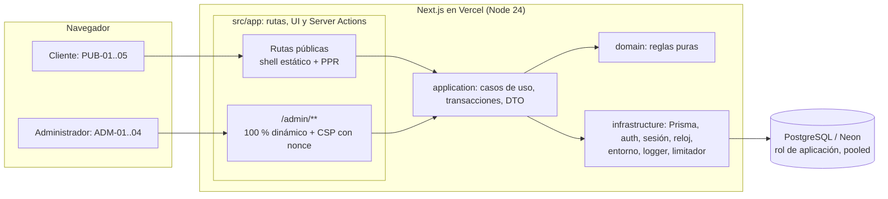
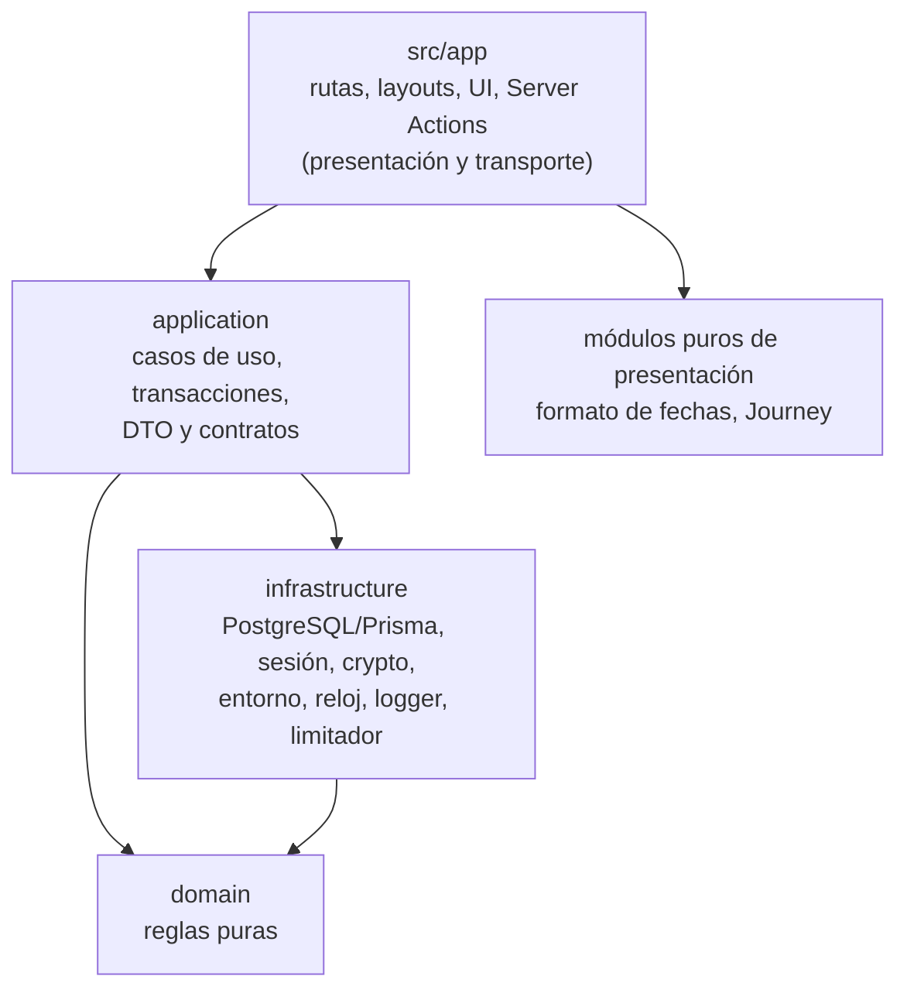
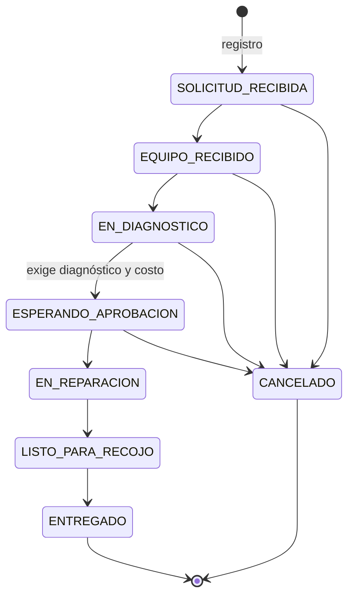
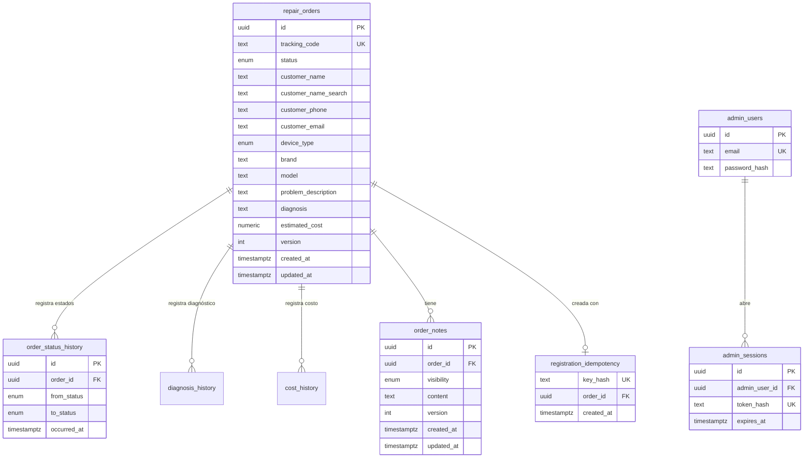
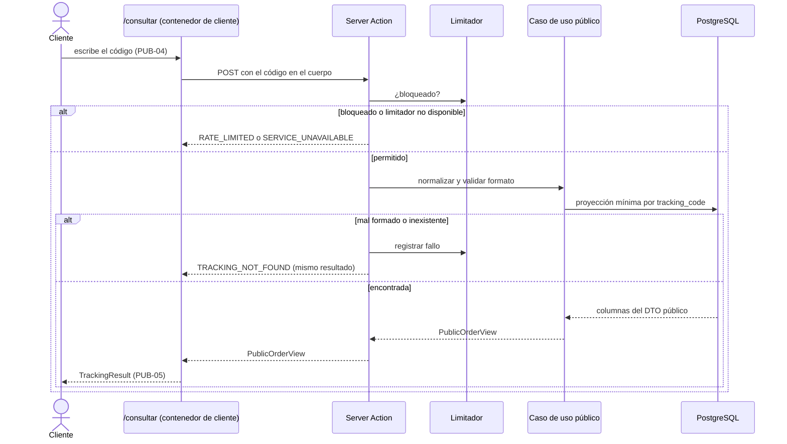
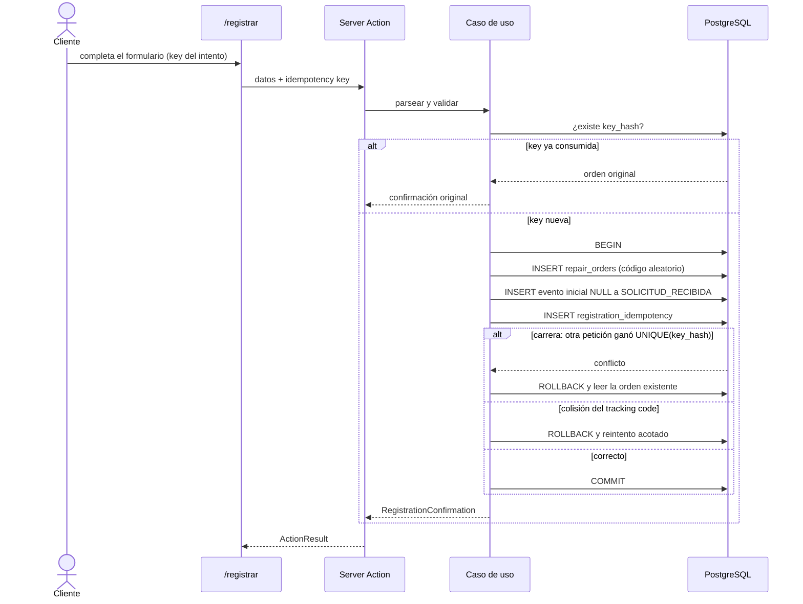
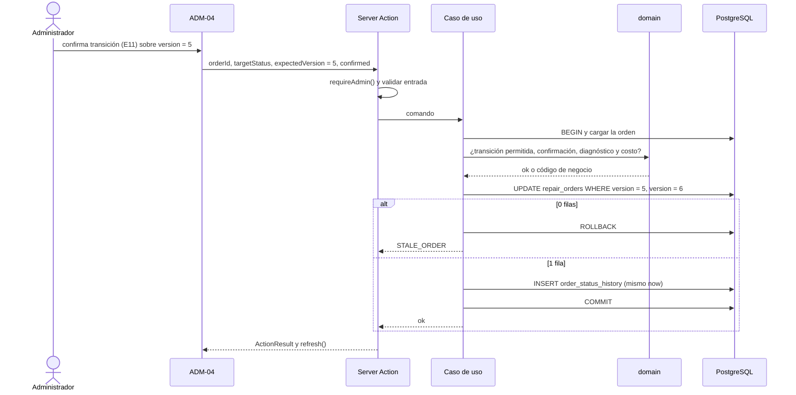
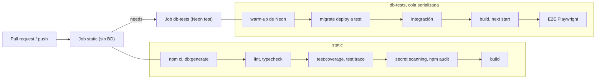

# FIXORA — Technical Design

> Fase 5 · Technical Design / Arquitectura · Área documental: `03-arquitectura` · Estado: **APROBADO — Fase 5 cerrada**.
>
> Nota: la Fase 5 se cerró el 2026-10-26. ADR-001 … ADR-010 están formalizados y aceptados (sección 33), la revisión adversarial y sus correcciones están completadas (0 Critical, 0 High) y A-5 está completado. El Architecture Validation Gate (sección 29) **está pendiente para la implementación** y no se ha ejecutado. Siguiente etapa: Specs/OpenSpec (aún no inicializado).
>
> Fecha: 2026-10-26.
>
> Consume: `docs/01-producto/PRD.md` (qué debe hacer el producto) y `docs/02-diseno/DESIGN.md` (experiencia e interfaz). Consumido por: los ADRs (`docs/03-arquitectura/adrs/`), el Backlog y las Specs.
>
> Los identificadores `SC-*`, `E*`, `SUP-*`, `VAL-*` y `RIE-*` son los del PRD; `PUB-*`/`ADM-*` son las pantallas aprobadas en `UX-EXPLORATION.md` y `DESIGN.md`. Las decisiones recogidas aquí se tomaron en la entrevista técnica de la Fase 5 (catorce secciones, aprobadas una a una); los ADRs (sección 33) las formalizan con sus alternativas.

---

## 1. Propósito y alcance

**Propósito.** Este documento es la fuente de verdad técnica de FIXORA V1: describe cómo se construye el sistema, por qué se eligió esa arquitectura, cómo se separan las responsabilidades, cómo viajan los datos, cómo se preservan las reglas de negocio y la privacidad, cómo se prueba y se despliega, qué riesgos residuales se aceptan y qué se delega a las Specs.

**Relación con otros documentos**

- El **PRD** manda en lo funcional. Si algo de este documento lo contradijera, prevalece el PRD y este documento se corrige de forma explícita.
- **DESIGN.md** define la experiencia, la interfaz y el sistema visual. Este documento no redefine pantallas, componentes ni microcopy; solo decide cómo se hacen cumplir técnicamente.
- Las **Specs** (fase posterior de Specs/OpenSpec) concretan cambios implementables **sin contradecir** las decisiones de este documento. Una Spec que necesite hacerlo debe detenerse y pedir revisión arquitectónica.

**Alcance V1.** El de `PRD.md`: landing, registro de solicitud, código de seguimiento, consulta pública, timeline, acceso administrativo, dashboard, listado y búsqueda, detalle, diagnóstico y costo, cambio controlado de estados, historial, notas públicas e internas, persistencia, pruebas E2E, Security Pass, CI/CD y despliegue público de demostración en Vercel.

**Qué no es este documento.** No es una Spec de implementación. Los detalles delegados a las Specs (longitudes máximas, expresiones regulares, parámetros de `scrypt`, valor de `bodySizeLimit`, schema Prisma definitivo, YAML de CI, mecanismo SQL concreto de los bloqueos, ciclo de vida de la idempotency key en el navegador, CSS final) se señalan como diferidos (sección 28).

**Estado de implementación.** Hoy solo existe el scaffold de Next.js. Nada de lo descrito como «aprobado» en este documento está implementado ni instalado, salvo lo indicado como presente en la sección 4.

> **Nota posterior (2026-10-30).** La frase anterior describe el estado **en el momento en que se redactó este diseño** (Fase 5) y se conserva como histórica. La arquitectura descrita **ya fue implementada**, verificada y desplegada (FIXORA V1 completa; ver `docs/README.md` y `docs/09-deploy/RELEASE-READINESS.md`). Este documento sigue siendo la fuente de verdad técnica y no se reescribe.

---

## 2. Resumen ejecutivo de arquitectura

FIXORA V1 es un **monolito modular Next.js** (App Router, Server Components por defecto) desplegado en Vercel, con **PostgreSQL en Neon** como única fuente de persistencia y **Prisma 7 (estable) con adaptador `pg`** como capa de acceso a datos. La interfaz se comunica con el servidor mediante **Server Actions**, que son adaptadores delgados de transporte; no existe una API REST/JSON de negocio. Las reglas de negocio viven en un núcleo de **dominio puro** (máquina de estados, capacidades, validadores, dinero, código de seguimiento), orquestado por **casos de uso** que construyen DTO de lista positiva. Hay un único administrador, con **autenticación propia** (contraseña con `scrypt`, sesiones opacas almacenadas en PostgreSQL). El cliente consulta su reparación **sin cuenta**, con un código de seguimiento de 12 caracteres que viaja siempre en el cuerpo de una petición, nunca en la URL. La integridad se garantiza con **defensa en profundidad**: dominio, concurrencia optimista (`version`), transacciones, restricciones de PostgreSQL y privilegios mínimos por rol.



Dos flujos principales:

- **Público:** registro (PUB-02 → PUB-03) y consulta (PUB-04 → PUB-05) sin sesión; solo se expone `PublicOrderView`/`RegistrationConfirmation`.
- **Administrativo:** toda lectura y escritura exige una sesión válida, se revalida en cada operación y se protege con una CSP estricta de nonce.

---

## 3. Principios arquitectónicos

1. **El servidor es la autoridad.** Reglas de negocio, autorización y separación público/interno se deciden y se verifican en servidor; el cliente solo solicita operaciones.
2. **La UI nunca es una barrera.** Las capacidades que se envían al cliente son indicaciones de representación; el servidor recalcula todo sobre la orden vigente cargada de PostgreSQL.
3. **Lista positiva para lo público.** Los datos públicos se construyen campo a campo desde una proyección mínima; nunca «cargar todo y excluir».
4. **Dominio independiente.** `domain/` no conoce Next.js, Prisma, Vercel, el reloj ni el entorno. `application/` no depende de tipos de Prisma.
5. **Infraestructura implementa lo técnico:** persistencia, criptografía, sesión, entorno, reloj, fuente aleatoria, logging y limitación.
6. **Sin reglas de negocio en React.** Los componentes representan; no deciden.
7. **Fallos esperados tipados, excepciones para lo inesperado.** Los resultados de negocio son valores con códigos estables; `INTERNAL_ERROR` queda reservado para fallos inesperados.
8. **Sin complejidad que V1 no necesita:** sin microservicios, sin API paralela, sin contenedor de inyección de dependencias ni arquitectura formal de puertos y adaptadores, sin triggers de negocio, sin `SERIALIZABLE`.
9. **Seguridad por capas.** Cada barrera asume que la anterior puede fallar.
10. **Cambios mínimos y justificables.** Ninguna dependencia, funcionalidad o decisión se añade sin aprobación explícita y trazabilidad.
11. **Datos ficticios en desarrollo, test, seed y presentaciones.** La demo pública no está autorizada para el tratamiento operativo de datos reales y muestra el aviso correspondiente, pero un tercero puede introducirlos accidentalmente; ese riesgo permanece cubierto por `RIE-20`, `VAL-04`, el procedimiento *break-glass* y el plan de retiro de la demo. No se afirma que todos los entornos contengan únicamente datos ficticios.
12. **Sin dependencias circulares entre capas** (sección 5).
13. **Validadores propios, puros y tipados; la validación del cliente nunca sustituye a la del servidor** (sección 18).

---

## 4. Stack técnico

### 4.1 Presente hoy en el repositorio (scaffold)

| Tecnología | Versión | Observación |
|---|---|---|
| Next.js | 16.4.3 | App Router, `src/app/`. Proyecto en JavaScript (`layout.js`, `page.js`, `jsconfig.json`) |
| React / React DOM | 19.3.0 | |
| Tailwind CSS | 4.3.3 (+ `@tailwindcss/turbopack`) | Cargado por reglas de Turbopack en `next.config.mjs` |
| ESLint | 9.x + `eslint-config-next` 16.4.3 | |
| Geist / Geist Mono | `next/font/google` en `layout.js` | `next/font` empaqueta las fuentes en el build; se sirven desde el propio despliegue |
| `cacheComponents` y `partialPrefetching` | Activados en `next.config.mjs` | Ver sección 6. `partialPrefetching` regula el prefetch del *shell* de cada ruta y depende de `cacheComponents`; no es una decisión arquitectónica independiente, pero su comportamiento de caché en cliente se valida en AV-1 (sección 29) |

Scripts existentes: `dev`, `build`, `start`, `lint`. No existen scripts de pruebas, `typecheck` ni de base de datos.

### 4.2 Aprobado arquitectónicamente, aún no instalado ni configurado

| Tecnología | Objetivo |
|---|---|
| TypeScript con `strict` | Migración del scaffold; `typecheck` como puerta de CI |
| Node.js | **24.x** (`engines`, `.nvmrc`, Vercel y GitHub Actions). El Node local actual (26.x) debe alinearse antes de implementar |
| PostgreSQL en Neon | Vía Vercel Marketplace; ramas `development`, `test`, `main` |
| Prisma ORM | **7.x estable**; nunca RC. A fecha de este diseño (26/10/2026), Prisma ORM 8 continúa en RC; FIXORA V1 fija Prisma ORM 7.x estable y migrar a otro major requiere nueva decisión/ADR. Versión exacta verificada al instalar. Requisitos de preparación en la sección 11 |
| `@prisma/adapter-pg` y `pg` | Adaptador PostgreSQL estable compatible |
| Vitest y `@vitest/coverage-v8` | Pruebas unitarias e integración (entorno Node) |
| Playwright (`@playwright/test`) | E2E y smoke |
| `server-only` | Solo si la versión de Next realmente exige instalar el paquete |
| GitHub Actions | CI/CD; no existe ningún workflow todavía |
| OpenSpec | Proceso de Specs, a partir del cierre de la Fase 5 (sección 31); no es dependencia de runtime |

### 4.3 Restricción de entrega fija

El despliegue público de demostración **en Vercel** (PRD §4.11). Este documento decide cómo, no si.

### 4.4 Reglas sobre dependencias

La instalación es una puerta explícita: la primera tarea que instale dependencias verifica la versión estable vigente, excluye RC y prereleases, presenta la lista exacta y solo instala las categorías aprobadas arriba. Cualquier otra dependencia requiere aprobación previa. Los scripts operativos en TypeScript (`admin:provision`, `seed:demo`) intentarán primero la ejecución nativa de Node 24; un ejecutor adicional (`tsx`) solo se propondría si es necesario y con aprobación.

---

## 5. Organización lógica y dependencias



| Capa | Responsabilidad | No debe |
|---|---|---|
| `src/app/` | Rutas, layouts, composición de UI, Server Components, Client Components, Server Actions como adaptadores de transporte | Contener reglas de negocio ni acceder a Prisma |
| `application/` | Casos de uso, orquestación de transacciones, carga de estado vigente, construcción de DTO públicos y administrativos | Depender de tipos de Prisma o de APIs de Next |
| `domain/` | Máquina de estados, capacidades, validadores isomórficos, dinero, código de seguimiento (alfabeto, longitud, normalización, validación), normalización de nombres para búsqueda | Depender de Next.js, Prisma, Vercel, entorno o reloj |
| `infrastructure/` | Acceso a PostgreSQL (repositorios que traducen entre modelos Prisma y tipos de dominio), sesión y autenticación, `scrypt`, fuente aleatoria criptográfica, reloj, único acceso a variables de entorno, logger, limitador | Contener reglas de negocio |
| Módulos puros de presentación | Formateo de fechas (`America/Lima`), construcción del Journey a partir de estado y timeline, formateo de dinero | Depender del dominio de forma inversa ni de infraestructura |

**Dirección de dependencias (sin ciclos):** `src/app → application`; `application → domain`; `application → infrastructure`; `infrastructure → domain`. Los módulos de infraestructura pueden usar tipos de dominio cuando necesiten mapear persistencia ↔ dominio. **`infrastructure` no importa implementación de `application`**, y `domain` no depende de `application`, `infrastructure`, Next.js, Prisma ni Vercel. La frase «`infrastructure` implementa las necesidades técnicas de `application`» (reloj, aleatoriedad, repositorios, sesión) es solo una explicación conceptual de responsabilidades, no una importación inversa. **No se permiten dependencias circulares entre capas.** No se introduce arquitectura formal de puertos y adaptadores ni un contenedor de inyección de dependencias; la estructura física exacta de contratos y *helpers* se difiere a la Spec de fundamentos.

**Reglas transversales**

- Los módulos con acceso a base de datos, configuración y secretos, autenticación y sesiones, repositorios, limitador, provisioning y utilidades criptográficas son `server-only` (error de build si un Client Component los importa).
- El único acceso normal a `process.env` es un módulo de configuración de `infrastructure/`.
- Los validadores de `domain/` son puros e isomórficos: se ejecutan en cliente (retroalimentación) y en servidor (autoridad).
- El detalle de la estructura física de archivos se fija en la Spec de fundamentos; aquí solo se fijan límites y dirección de dependencias.

---

## 6. Renderizado y límites Server/Client

**Server Components por defecto.** Client Components solo donde hay interacción real: selector de tipo de equipo, copiar código, diálogos de confirmación, formularios con estado, *chips* de filtro, menú móvil, contenedores de consulta y registro.

**Cache Components.** `cacheComponents` permanece habilitado globalmente.

- Las rutas públicas se benefician del *shell* estático y PPR; sus partes dinámicas se aíslan detrás de `Suspense`.
- **Los datos de órdenes —públicos y administrativos— y los conteos del Dashboard no se cachean con `use cache`**: deben obtenerse frescos (`SC-04`). `use cache` se reserva para contenido realmente estático.
- **`/admin/**` es deliberadamente 100 % dinámico** (con `connection()` o el mecanismo vigente equivalente; no basta con leer cookies dentro de `Suspense`). La razón es que la CSP estricta con nonce exige renderizado dinámico y es incompatible con el *shell* estático de PPR. Es una excepción consciente de rendimiento limitada al área administrativa.
- El runtime es Node.js.
- **Estado preservado de navegación (React Activity).** Con `cacheComponents`, Next.js puede conservar el estado y el DOM de rutas ocultas al navegar en el cliente. **Por lo tanto no se puede depender de «navegar fuera → el componente se desmonta → el estado sensible desaparece».** `/registrar` y `/consultar` **no deben conservar de forma reutilizable** el código de seguimiento, `RegistrationConfirmation`, `PublicOrderView` ni el resultado de una consulta después de abandonar el flujo sensible; la implementación debe ser **consciente de Activity** (*Activity-aware*: limpiar o reiniciar ese estado al ocultarse la ruta, no solo al desmontarse). La Spec decide el mecanismo exacto compatible con la versión instalada de Next. Esa información no se guarda tampoco en URL, cookie, `sessionStorage` ni almacenamiento persistente, y una recarga completa vuelve al estado inicial. Se prueba con E2E (sección 24) y se valida en AV-1 (sección 29).

| Pantalla | Ruta | Renderizado |
|---|---|---|
| PUB-01 | `/` | *Shell* estático |
| PUB-02 → PUB-03 → PUB-05 | `/registrar` | *Shell* estático + contenedor de cliente (estados del flujo) |
| PUB-04 → PUB-05 | `/consultar` | *Shell* estático + contenedor de cliente |
| ADM-01 | `/admin/acceso` | Dinámico |
| ADM-02 | `/admin` | Dinámico |
| ADM-03 | `/admin/ordenes` | Dinámico (acepta solo el filtro de estado como parámetro) |
| ADM-04 | `/admin/ordenes/[id]` | Dinámico (`id` = UUID interno de la orden, nunca el código) |

**Transporte.**

- **Server Actions** para mutaciones públicas y administrativas, login y logout, la consulta pública por código (el código debe ir en el cuerpo) y las lecturas interactivas administrativas cuyos criterios no se colocan en la URL (búsqueda y paginación asociada).
- **No hay API REST/JSON de negocio.** Los Route Handlers solo podrán aparecer por una necesidad técnica u operativa futura y demostrada, no como una segunda API paralela.
- **V1 requiere JavaScript** para la experiencia completa. Esto no autoriza mover reglas de negocio o seguridad al cliente.

**Las Server Actions no son una frontera de seguridad por sí mismas.** Son endpoints POST invocables directamente, no solo desde la UI. Por eso cada acción valida todas sus entradas, reautentica si es administrativa y no confía en la UI, en los identificadores de acción ni en la cola secuencial del cliente. La concurrencia y la idempotencia no dependen de la secuenciación del framework, sino de `version`, restricciones, transacciones e idempotency keys.

**Reglas de las acciones.** Flujo único: Server Action → autenticación/autorización cuando corresponda → parseo y validación → caso de uso → dominio → repositorios. Una acción nunca accede a Prisma directamente ni contiene reglas.

---

## 7. Modelo de dominio

### 7.1 RepairOrder (conceptual)

Una orden representa **un único equipo** y nace siempre en `SOLICITUD_RECIBIDA` por el flujo público (el administrador no crea órdenes).

| Grupo | Campos conceptuales |
|---|---|
| Identidad | `id` (UUID interno), `trackingCode` (inmutable, separado del `id`) |
| Cliente (snapshot por orden) | `customerName`, `customerPhone`, `customerEmail?` |
| Equipo | `deviceType` (`CELULAR`, `TABLET`, `LAPTOP`, `PC`, `CONSOLA`, `OTRO`), `brand`, `model?`, `problemDescription` |
| Reparación | `status`, `diagnosis?`, `estimatedCost?` (decimal canónico) |
| Control | `version`, `createdAt`, `updatedAt` |

No existe entidad `Customer`: FIXORA V1 trata los datos del cliente como un *snapshot* de cada orden, sin cuentas, perfil compartido, CRM, deduplicación ni relación entre solicitudes. Dos órdenes de la misma persona son independientes.

### 7.2 Estados y máquina de estados

Ocho estados: `SOLICITUD_RECIBIDA`, `EQUIPO_RECIBIDO`, `EN_DIAGNOSTICO`, `ESPERANDO_APROBACION`, `EN_REPARACION`, `LISTO_PARA_RECOJO`, `ENTREGADO`, `CANCELADO`. La interfaz muestra los nombres exactos del PRD mediante un único mapa de etiquetas en `domain/`.



- **Diez transiciones de negocio** más el evento inicial `NULL → SOLICITUD_RECIBIDA`. Sin saltos, retrocesos ni reapertura.
- Se implementa como **una única tabla declarativa tipada** más funciones puras en `domain/`. No se usa el patrón State, XState ni librerías de máquina de estados.
- Las 54 combinaciones restantes de los 8×8 pares se rechazan en dominio y, como pares individuales, también en el `CHECK` de PostgreSQL; la paridad de los pares permitidos se verifica con una prueba exhaustiva (alcance y límites en la sección 11).
- **La aprobación del cliente ocurre fuera de FIXORA** (teléfono, WhatsApp o en persona). La confirmación `E11` de `ESPERANDO_APROBACION → EN_REPARACION` significa que el administrador declara que esa aprobación ya ocurrió externamente. FIXORA V1 no almacena canal, firma, documento, evidencia, fecha estructurada de aprobación ni usuario que aprobó; por eso no existe una entidad o tabla de aprobación y no se añaden campos al modelo. El momento de la decisión queda trazado indirectamente por el cambio de estado.

### 7.3 Capacidades (funciones puras)

El dominio expone funciones equivalentes a `allowedTransitions`, `canEditBasicData`, `canEditDiagnosisAndCost`, `canManageNotes`, `isTerminal`, `requiresConfirmation` e `isDiagnosisAndCostPublic`. Resumen del PRD §4.8:

| Estado | Datos básicos | Diagnóstico y costo | Notas | Transiciones |
|---|:-:|:-:|:-:|---|
| `SOLICITUD_RECIBIDA` | sí | sí | sí | `EQUIPO_RECIBIDO`, `CANCELADO` |
| `EQUIPO_RECIBIDO` | sí | sí | sí | `EN_DIAGNOSTICO`, `CANCELADO` |
| `EN_DIAGNOSTICO` | sí | sí | sí | `ESPERANDO_APROBACION` (exige diagnóstico y costo), `CANCELADO` |
| `ESPERANDO_APROBACION` | sí | no (congelados) | sí | `EN_REPARACION`, `CANCELADO` |
| `EN_REPARACION` | sí | no | sí | `LISTO_PARA_RECOJO` |
| `LISTO_PARA_RECOJO` | sí | no | sí | `ENTREGADO` |
| `ENTREGADO` | no | no | no | ninguna |
| `CANCELADO` | no | no | no | ninguna |

**Confirmaciones `E11`.** `requiresConfirmation(from, to)` es la **única** función que decide, y la usan tanto el diálogo de la UI como el servidor. Las cuatro: `EN_DIAGNOSTICO → ESPERANDO_APROBACION`, `ESPERANDO_APROBACION → EN_REPARACION`, cualquier transición permitida → `CANCELADO` y `LISTO_PARA_RECOJO → ENTREGADO`. El comando de transición del servidor debe llevar una confirmación explícita para ellas; si falta, devuelve `CONFIRMATION_REQUIRED` y no cambia nada. Es una garantía de integridad del flujo de aplicación, **no una prueba criptográfica** de que alguien leyó el diálogo y no sustituye al diálogo.

**La UI nunca es la autoridad.** Nunca se acepta del cliente un booleano como `canEdit`, `canCancel` o `canTransition`. El servidor recalcula la capacidad con `domain/` sobre la orden vigente.

---

## 8. Reglas de diagnóstico, costo y publicación

- **Diagnóstico** y **costo estimado** son editables solo mientras la orden esté en `SOLICITUD_RECIBIDA`, `EQUIPO_RECIBIDO` o `EN_DIAGNOSTICO`. Pueden crearse, modificarse y **limpiarse a `NULL`** en esos estados.
- Tras `trim`, un diagnóstico vacío equivale a ausente (`NULL`).
- **No-op simétrico para diagnóstico y costo:** si el diagnóstico normalizado o el costo canónico resultante es exactamente igual al valor vigente, no se ejecuta un `UPDATE` efectivo, no se incrementa `repair_orders.version` y no se genera historial.
- **Requeridos** para `EN_DIAGNOSTICO → ESPERANDO_APROBACION` (`SC-07`): deben existir ambos; si falta alguno, `DIAGNOSIS_AND_COST_REQUIRED`.
- **Congelamiento y publicación.** Al entrar en `ESPERANDO_APROBACION`, ambos quedan congelados y pasan a ser visibles para el cliente. No existe ningún campo «publicado» ni booleano equivalente; la visibilidad se **deriva del flujo de estados**:

| Estado de la orden | ¿Visible para el cliente? |
|---|---|
| `SOLICITUD_RECIBIDA`, `EQUIPO_RECIBIDO`, `EN_DIAGNOSTICO` | No |
| `ESPERANDO_APROBACION`, `EN_REPARACION`, `LISTO_PARA_RECOJO`, `ENTREGADO` | Sí |
| `CANCELADO` | Solo si alguna vez alcanzó `ESPERANDO_APROBACION` |

- Para `CANCELADO` la regla se expresa como: **existe una fila en `order_status_history` de esa orden con `to_status = ESPERANDO_APROBACION`**. Si la orden se canceló antes, nunca se publican (`SC-08`, `E5`). Esta regla alimenta `isDiagnosisAndCostPublic`.
- **La autorización de esos valores se aplica en la propia proyección de persistencia, no después.** La lectura pública **no carga en memoria de la aplicación `diagnosis` ni `estimated_cost` mientras no sean públicos**: no basta con `SELECT diagnosis → mapper → null`. Preferencia conceptual: una sola consulta o proyección condicionada que devuelva los valores solo en estados públicos, en `CANCELADO` solo si `EXISTS` un evento hacia `ESPERANDO_APROBACION` y `NULL` en cualquier otro caso. El SQL exacto y si se expresa con Prisma o con SQL parametrizado compatible lo decide la Spec de persistencia. Pruebas de integración obligatorias: (1) antes de la aprobación, con diagnóstico y costo ya escritos, el repositorio público no devuelve sus valores; (2) `CANCELADO` antes de `ESPERANDO_APROBACION` no los devuelve; (3) `CANCELADO` después de `ESPERANDO_APROBACION` sí; (4) un estado posterior normal sí.
- En el DTO público, diagnóstico y costo viajan agrupados en `repairDetails`, que es `null` salvo que la regla lo autorice; **nunca se envían los valores junto con un indicador de visibilidad**.
- **Dinero.** En el dominio, el costo es una **cadena decimal canónica con exactamente dos decimales** (`"50.00"`, `"1250.50"`). Para comparar o validar se convierte directamente a `BigInt` de céntimos (`"180.00" → 18000n`); **nunca a `number` de JavaScript** ni coma flotante.
  - Reglas: mayor que cero, como máximo dos decimales de entrada, sin tope de negocio, PEN implícito. Más de dos decimales se **rechaza** (sin redondeo silencioso).
  - Persistencia: PostgreSQL `NUMERIC` sin precisión artificial, con restricciones de valor > 0 y como máximo dos decimales. El repositorio convierte de forma exacta entre dominio, Prisma `Decimal` y `NUMERIC`, sin pasar por `number`. No se almacena moneda.
  - Presentación: `S/ ` + valor con dos decimales, sin separador de miles y sin `Intl.NumberFormat`.
- El mapeo de `NUMERIC` sin precisión en Prisma se valida en el Architecture Validation Gate (sección 29).

---

## 9. Notas

- Dos visibilidades: **`PUBLIC`** (visible para el cliente) e **`INTERNAL`** (solo taller). La `visibility` es **inmutable** tras crear la nota; para corregirla se elimina (si `E12` lo permite) y se crea otra. No existe `changeNoteVisibility`.
- Mientras la orden no sea terminal, el administrador puede agregar, editar y eliminar ambas. En `ENTREGADO` y `CANCELADO` son solo lectura. Escribir una nota nunca es requisito de una transición.
- Tras `trim`, una nota vacía es inválida y nunca se almacena. La eliminación es **física** (sin papelera, *undo* ni historial); no hay historial de notas ni marca de «editada».
- Orden de presentación: de la más reciente a la más antigua dentro de su bloque (por `created_at`). Eliminar no abre un diálogo `E11` adicional; la UI da feedback posterior.
- **Concurrencia entre notas.** `order_notes.version` (entero, inicial 1) es un control técnico, no un historial. Editar y eliminar llevan `noteId` y `expectedNoteVersion`; si la nota existe con otra versión: `STALE_NOTE`; si ya no existe: `NOTE_NOT_FOUND`.
- **Concurrencia nota contra cierre.** Invariante: ninguna nota se crea, edita o elimina cuando la orden es terminal. Cada operación de nota, dentro de su transacción, bloquea la fila de `repair_orders` (SQL parametrizado controlado en `infrastructure/`, p. ej. `SELECT … FOR UPDATE`), verifica que no sea terminal, opera sobre la nota y confirma. Una transición a `ENTREGADO` o `CANCELADO` toca esa misma fila, por lo que ambas operaciones se serializan: nota primero → luego puede cerrar; cierre primero → la nota devuelve `ORDER_CLOSED`. No se modifica `updated_at` solo para adquirir el bloqueo.
- **Separación en la consulta pública.** La lectura pública consulta explícitamente `visibility = PUBLIC`, con una proyección de campos en lista positiva; nunca trae todas las notas para filtrarlas después. Una prueba de integración demuestra esta separación.

---

## 10. Persistencia y modelo de datos

PostgreSQL en Neon es la única fuente de persistencia. Las tablas se describen conceptualmente; **el schema Prisma y el SQL definitivos son material de la Spec de persistencia**.



| Tabla | Propósito | Notas clave |
|---|---|---|
| `repair_orders` | La orden: datos declarados, estado actual, diagnóstico y costo vigentes | UUID interno; `tracking_code` `UNIQUE` e inmutable, separado del `id`; `version`; `customer_name_search` derivada (sección 19). Todas las relaciones usan el UUID, nunca el código |
| `order_status_history` | Cada cambio de estado con su instante | **Única tabla de historial consumible por la consulta pública.** Sin autor, motivo ni comentario. Sin texto libre ni datos personales |
| `diagnosis_history` | Primer registro y modificaciones del diagnóstico (valor anterior y nuevo, ambos admiten `NULL`) | Solo administrativa. Contiene texto libre |
| `cost_history` | Primer registro y modificaciones del costo (anterior y nuevo, ambos admiten `NULL`) | Solo administrativa. Sin texto libre |
| `order_notes` | Notas públicas e internas | Una tabla con `visibility`; `version` propia |
| `registration_idempotency` | Una fila por orden creada | `key_hash` (SHA-256 de la key) `UNIQUE`; `order_id` `UNIQUE`; vive tanto como la orden |
| `admin_users` | El único administrador | Singleton garantizado por BD (mecanismo concreto en la Spec); correo normalizado |
| `admin_sessions` | Sesiones opacas | `token_hash` `UNIQUE`; `expires_at` y `last_seen_at`; sin IP ni user-agent |
| Tablas del limitador | Contadores y bloqueos por clave de cliente y superficie | **Separadas por completo** de las tablas de negocio; modelo exacto en la Spec |

**Convenciones.** Tablas y columnas en inglés y `snake_case`; valores de enum técnicos ASCII en español alineados con el PRD (`SOLICITUD_RECIBIDA`, `CELULAR`, …); `timestamptz(3)` para timestamps (el mapeo por defecto de Prisma puede ser `timestamp(3)` sin zona, por lo que se declara explícitamente); `ON DELETE RESTRICT` entre la orden y sus dependientes (las órdenes no se eliminan desde la aplicación); eliminación física solo de notas.

**Historiales tipados.** Son tres tablas (estados, diagnóstico, costo), no una tabla polimórfica: tipos fuertes por evento, restricciones más claras y separación física del historial público de estados respecto del administrativo. El historial administrativo se compone en `application/` ordenando los tres flujos por `occurred_at` (con un desempate determinista definido en la Spec). No hay autor, notas ni correcciones de datos básicos en el historial.

**Qué no se almacena:** IMEI, número de serie, contraseña o PIN del equipo, accesorios, fotografías, datos de facturación, técnico, sucursal, prioridad o plazos, moneda, motivo estructurado de cancelación, registro de la aprobación del cliente, autor de cambios, historial de notas o de correcciones, ni auditoría de accesos.

**Privacidad en el modelo.** Los datos personales estructurados (`customer_name`, `customer_phone`, `customer_email`) viven exclusivamente en `repair_orders`. Todo **texto libre** (`problem_description`, `diagnosis`, `diagnosis_history`, notas públicas e internas) se trata como potencialmente capaz de contener información personal o sensible accidental; esto no cambia qué es público. `order_status_history` y `cost_history` no contienen texto libre ni datos personales estructurados. Los datos de desarrollo, pruebas y seed son ficticios; no se afirma que todos los entornos lo sean, porque la demo pública puede recibir datos reales (`RIE-20`).

---

## 11. Integridad de la base de datos y migraciones

**Segunda barrera parcial.** La fuente principal de las reglas es `domain/`. PostgreSQL actúa como segunda barrera **solo para las invariantes que pueden expresarse de forma declarativa** (claves, unicidad, restricciones de fila, privilegios) y evita ciertos estados imposibles si hay un error de implementación; no sustituye a la máquina de estados del dominio. **No se usan triggers para reglas de negocio.**

| Mecanismo | Propósito |
|---|---|
| Claves foráneas (`RESTRICT`) | Integridad referencial; las órdenes no se eliminan desde la aplicación |
| `UNIQUE(tracking_code)` | Unicidad del código (`E17`) |
| `UNIQUE(order_id, to_status)` en `order_status_history` | Una orden nunca entra dos veces en el mismo estado (solo avance) |
| `CHECK` de transiciones en `order_status_history` | **Cada fila individual** representa el evento inicial permitido (`NULL → SOLICITUD_RECIBIDA`) o uno de los 10 pares `(from_status, to_status)` permitidos |
| `CHECK` de costo | `estimated_cost` nulo o > 0, con como máximo dos decimales |
| `CHECK` de `SC-07` | Si `status IN (ESPERANDO_APROBACION, EN_REPARACION, LISTO_PARA_RECOJO, ENTREGADO)` entonces `diagnosis IS NOT NULL AND estimated_cost IS NOT NULL`. **`CANCELADO` queda fuera de este `CHECK`**: una orden puede cancelarse antes o después de `ESPERANDO_APROBACION`, y una restricción de fila no puede consultar el historial para distinguirlo sin recurrir a triggers o lógica entre tablas, que se rechazan |
| `CHECK(version >= 1)` | En órdenes y notas |
| Singleton de `admin_users` | Impide más de un administrador |
| `UNIQUE(key_hash)` y `UNIQUE(order_id)` en `registration_idempotency` | Idempotencia del registro |
| Enums de estado, tipo de equipo y visibilidad | Dominios cerrados |

**Qué garantiza y qué no garantiza el `CHECK` de transiciones.** Garantiza que cada fila de `order_status_history` es el evento inicial permitido o uno de los 10 pares permitidos. **Por sí solo no puede garantizar:** que `from_status` coincida con el último estado histórico real, que las filas estén encadenadas correctamente, que `repair_orders.status` corresponda al último evento ni que una actualización directa de `repair_orders.status` no haya saltado estados. Esas invariantes completas se preservan mediante el repositorio y el caso de uso controlados, el dominio, la transacción atómica, la concurrencia optimista y las pruebas de integración. La prueba exhaustiva de los 64 pares estado→estado (los 10 permitidos son aceptados; los otros 54, rechazados; el evento inicial se prueba aparte) demuestra la **paridad de los pares permitidos** entre dominio y BD, no una prueba matemática de toda la secuencia histórica.

Las reglas de edición y congelamiento **no** se imponen con triggers: las garantizan el dominio, la actualización condicional por versión y las pruebas. Para `CANCELADO`, el dominio preserva el congelamiento si ya se había alcanzado `ESPERANDO_APROBACION`, y `order_status_history` determina si `repairDetails` puede publicarse.

**Roles de PostgreSQL (mínimo privilegio).**

| Rol | Uso | Permisos (dirección) |
|---|---|---|
| **Migrator/owner** | DDL, migraciones, `GRANT`, operaciones administrativas, script de provisioning y rotación del administrador, tareas *break-glass* | Propietario. **No existe en el runtime desplegado** |
| **Application runtime** | La aplicación en ejecución | Sin DDL. `repair_orders`: SELECT, INSERT, UPDATE (no DELETE). Historiales y `registration_idempotency`: SELECT, INSERT (no UPDATE/DELETE). `order_notes`: SELECT, INSERT, UPDATE, DELETE. `admin_users`: solo SELECT. `admin_sessions` y limitador: lo estrictamente necesario |

Para el rol runtime de la aplicación, los historiales son *append-only* por privilegios de PostgreSQL (sin triggers): puede leer e insertar, pero no actualizar ni eliminar. El propietario/migrador y los procedimientos *break-glass* siguen siendo deliberadamente privilegiados, de modo que la garantía es **frente al runtime normal**, no una inmutabilidad absoluta de la base de datos. Esto protege frente a operaciones destructivas desde la aplicación, pero **no sustituye a `SC-11`**: la separación público/administrativa depende de casos de uso, proyecciones y DTO. Los `GRANT` exactos se validan al generar las migraciones. La Spec de persistencia (y AV-2) evalúa además `GRANT UPDATE` por columnas para el rol runtime sobre `repair_orders`, excluyendo al menos `id`, `tracking_code` y `created_at`, si Prisma 7 y PostgreSQL lo permiten limpiamente; no es todavía un requisito irreversible. `tracking_code` sigue siendo inmutable por dominio y no existe caso de uso para editarlo.

**Conexiones.** `DATABASE_URL` = rol de aplicación, conexión *pooled* de Neon, con el adaptador `pg` y transacciones PostgreSQL reales (no se adopta un driver HTTP que las impida o complique). `DIRECT_URL` = rol migrador, conexión directa, solo para migraciones y operación. TLS obligatorio. Tamaño de *pool* y *timeouts* se ajustan en implementación.

**Prisma 7: requisitos de preparación** (se validan con la versión estable instalada, en el Architecture Validation Gate; esta sección no modifica el repositorio):

- **ESM.** Prisma ORM 7 requiere un proyecto ESM. Antes de implementar Prisma se debe verificar y aplicar la configuración compatible (conceptualmente `"type": "module"` en `package.json`).
- **Runtime frente a CLI.** *Runtime:* `DATABASE_URL` → rol de aplicación → conexión *pooled* → `@prisma/adapter-pg`. *Prisma CLI y migraciones:* `DIRECT_URL` → rol migrador → conexión directa → `prisma.config.ts`. No se usa el antiguo `directUrl` del schema como si Prisma 7 funcionara igual que los majors anteriores; la configuración exacta se valida con Prisma 7 instalado.
- **Carga de variables del CLI.** La Spec decide cómo `prisma.config.ts` obtiene las variables locales, prefiriendo una solución compatible con Node 24 sin añadir una dependencia cuando sea razonable. Si se requiriera `dotenv`, entra por la puerta normal de aprobación de dependencias; no se instala en silencio.
- **Shadow database.** `prisma migrate dev` en development exige cerrar una estrategia segura de *shadow database*; la Spec de persistencia define `shadowDatabaseUrl` o el mecanismo equivalente vigente de Prisma 7/Neon. **No se usan `main` ni `test` como *shadow database* destructiva.**

**Migraciones.**

- Migraciones **SQL versionadas**, parte del repositorio, con el SQL generado revisado; pueden contener SQL manual (`CHECK`, `GRANT`, índices funcionales, extensiones) cuando Prisma no pueda expresarlo.
- **Forward-only.** No se edita una migración ya aplicada en un entorno compartido; los cambios posteriores se hacen con una migración nueva.
- **Expand / contract.** Toda migración de producción debe ser compatible con la aplicación actualmente desplegada: primero cambios aditivos; después se despliega el código que los usa; los cambios destructivos (eliminar, renombrar, endurecer constraints incompatibles) van en una migración posterior. Cada PR con migraciones declara su compatibilidad hacia atrás.
- **Nunca** `db push` en producción ni migraciones automáticas durante `next build`, `next start`, el arranque de Functions o Preview.
- Una base vacía debe poder llegar al esquema actual aplicando únicamente las migraciones versionadas; CI lo verifica.
- Procedimiento y workflow de producción: sección 25.

---

## 12. Código de seguimiento y consulta pública

**Formato.**

- **12 caracteres**, sin prefijo, guiones, espacios ni otros separadores.
- Alfabeto de 23 símbolos: `23456789BDFGHJKMNPRSTWX` (sin vocales, sin `0 O 1 I L Q Y`). Aproximadamente **54 bits** de entropía.
- Se almacena **canónicamente en mayúsculas**. No hay formatos alternativos ni prefijos en V1.

**Generación.** CSPRNG de `node:crypto` con selección uniforme de símbolos; sin `Math.random`, contadores, marcas de tiempo ni datos derivados de la orden o del cliente. `domain/` define alfabeto, longitud, normalización y validación; `infrastructure/` aporta la fuente aleatoria criptográficamente segura (sustituible en pruebas). La unicidad la garantiza `UNIQUE(tracking_code)`; ante colisión se genera otro código y se reintenta un número pequeño y acotado de veces, y si se agotan, la operación falla de forma segura. Una colisión nunca se resuelve modificando una orden existente.

**Inmutable.** Nunca se regenera, reemplaza ni edita, y no es clave primaria. No hay recuperación pública: si el cliente lo pierde, contacta al taller (`E2`).

**Normalización (`E15`).** Exactamente: (1) eliminar solo el espacio en blanco exterior, (2) convertir letras ASCII `a–z` a `A–Z`, (3) validar longitud y alfabeto, (4) comparar exactamente con la forma canónica almacenada. No se eliminan ni insertan guiones, no se corrigen caracteres (`O↔0`, `I/L↔1`), no se completan códigos, no se aceptan caracteres Unicode parecidos ni transliteraciones. La misma regla se aplica en la consulta pública y en la búsqueda administrativa. Un código mal formado y uno bien formado pero inexistente producen el mismo resultado visible (`TRACKING_NOT_FOUND`).

**Tratamiento como secreto bearer de lectura.** Quien posee el código puede consultar la información pública de la orden. Por eso:

- **El código nunca va en la URL** (ni ruta ni query): viaja en el cuerpo de una Server Action.
- No se registra en logs, analytics, telemetría ni nombres de eventos; no se guarda en cookies ni `sessionStorage`; la respuesta de una consulta no se cachea públicamente.
- No hay listados, autocompletado ni «olvidé mi código».
- **El código por sí solo no elimina `RIE-01`**: el riesgo queda mitigado por el conjunto de controles (entropía, aleatoriedad criptográfica, respuesta uniforme, limitación de intentos, ausencia de enumeración, código fuera de logs y URL) y se revisa de nuevo en el Security Pass.

**PUB-05 es efímero por diseño.**



- La acción devuelve `PublicOrderView` y un Client Component (`TrackingResult`) lo representa **sin cambiar de URL**. `TrackingResult` solo recibe `PublicOrderView`, no consulta Prisma y no contiene reglas de visibilidad.
- Un **reload completo** de `/consultar` no repite la consulta ni reenvía el POST, no conserva el código y vuelve a PUB-04. «Consultar otro código» reinicia el estado. El cliente conserva su código, como exige `E2`.
- Desde PUB-03, «Consultar estado» usa internamente el código de la confirmación para abrir PUB-05 sin pedir que se vuelva a escribir; el flujo `/registrar` (PUB-02 → PUB-03 → PUB-05) es un contenedor con estados, y un reload vuelve al registro inicial **sin reejecutar nunca la creación**.
- Prohibido: cookie temporal de vista, cookie persistente con el código, token secundario, `sessionStorage` con el código, código en ruta o query.
- El comportamiento del botón «atrás» se detalla en la Spec sin persistir el código ni crear una URL con él.

---

## 13. Registro e idempotencia (`E1`)

**Problema.** Un reenvío accidental del formulario público (doble clic, reintento de red, recarga, retorno accidental) no debe generar dos órdenes; dos solicitudes deliberadas del mismo cliente son órdenes independientes, y FIXORA **no detecta duplicados comparando nombre, teléfono, equipo ni descripción**.

**Mecanismo.**

- Una **idempotency key aleatoria por intento de registro** (`crypto.randomUUID()` u otra de alta entropía), generada en el cliente. El invariante: la misma intención de registro conserva la misma key durante reenvíos accidentales y reintentos; una solicitud deliberadamente nueva recibe una key nueva.
- **Nunca debe venir embebida en el HTML estático** compartido por Cache Components: el *shell* de PUB-02 es estático y una key incrustada sería la misma para todos los visitantes.
- En el servidor se persiste únicamente `SHA-256(key)` en `registration_idempotency` (`key_hash UNIQUE`, `order_id UNIQUE`, FK `RESTRICT`, `created_at`). La key original viaja con la petición y no se escribe en logs, tablas, analytics ni telemetría. Aquí SHA-256 se aplica a un token aleatorio de alta entropía, no a una contraseña.
- La fila **vive tanto como la orden**; `E1` no define ventana temporal y no hay limpieza.
- **Replay:** si llega una key ya consumida, no se crea otra orden, no se modifica la existente, no se compara contenido y se devuelve la confirmación de la orden original, ignorando el contenido nuevo si difiere.
- **Validación fallida:** no crea orden ni fila de idempotencia; la misma key se reutiliza al corregir. Solo se consume cuando el registro se completa.



- **Atomicidad:** orden, evento inicial e idempotencia se crean en **una sola transacción**. Ante dos solicitudes concurrentes con la misma key, una gana el `UNIQUE(key_hash)`; la otra no crea una segunda orden, consulta el registro existente y devuelve la misma confirmación **sin exponer una excepción interna**.
- Lo único reintentado automáticamente es la colisión del tracking code (acotada). Ante cualquier otro error transitorio no se reintenta en silencio; el usuario puede reintentar con seguridad porque la key lo hace idempotente.
- **Diferido a la Spec:** el ciclo de vida exacto de la key en el navegador (conservarla ante recarga y retorno accidental, y renovarla ante un registro nuevo iniciado por navegación explícita), sin convertirla en identidad permanente del cliente.
- Esto es independiente de `E13`: el registro no tiene limitación anti-spam (sección 22).

---

## 14. Concurrencia y atomicidad

### 14.1 `repair_orders.version`
- Entero `NOT NULL`, inicial `1`, `CHECK(version >= 1)`; lo modifica únicamente la capa de persistencia.
- Se incrementa **exactamente una vez por cambio efectivo** de la fila de la orden: transición de estado, diagnóstico, costo o datos básicos. No se incrementa por un no-op, por leer ni por operaciones exclusivas de notas.
- Toda modificación usa una actualización condicional equivalente a `WHERE id = ? AND version = expectedVersion` y `version = version + 1`. Si no modifica ninguna fila: **`STALE_ORDER`**, sin fusión ni reintento automático.
- La versión aparece solo en DTO/contratos administrativos, nunca en el público, no es editable por el usuario y es el testigo de la instantánea que ADM-04 estaba mostrando.

### 14.2 Comandos
Todo comando administrativo que modifique la fila de la orden incluye `expectedVersion`. Los de transición incluyen explícitamente `targetStatus` (nunca «avanzar al siguiente»), `expectedVersion` y `confirmed` cuando `E11` corresponda. El servidor valida sesión y entrada, carga el estado vigente, evalúa el dominio y ejecuta la actualización condicional; nunca asume «la última versión».

### 14.3 `E11` ligada a la versión revisada
Las cuatro confirmaciones usan la `expectedVersion` de la orden que el administrador revisó. En particular, `EN_DIAGNOSTICO → ESPERANDO_APROBACION` no puede congelar un diagnóstico o costo distinto del mostrado al abrir el diálogo: si la versión cambió, `STALE_ORDER`, sin transición. Es deliberadamente conservador: un cambio de datos básicos en otra pestaña también invalida una confirmación en curso (`RIE-06` justifica esta cautela).

### 14.4 Transacciones
- Aislamiento base **`READ COMMITTED`**; no se usa `SERIALIZABLE` en V1.
- Cada operación de negocio es **una transacción atómica**: transición = actualización condicional + `order_status_history`; diagnóstico = actualización condicional + `diagnosis_history`; costo = actualización condicional + `cost_history`; registro = orden + evento inicial + idempotencia. Cualquier fallo revierte todo.
- **Una transacción por sí sola no sustituye a la concurrencia optimista.** Bajo `READ COMMITTED`, dos transacciones pueden leer la misma versión y escribir en secuencia; la cláusula `WHERE version = expectedVersion` es lo que detecta el desfase entre lo que el administrador vio y lo que existe, tanto entre pestañas como entre acciones repetidas.



### 14.5 Acciones administrativas repetidas
No hay claves de idempotencia para comandos administrativos. Primera barrera de UX: el botón queda deshabilitado mientras la acción está pendiente. Segunda barrera: la versión (dos transiciones con `expectedVersion = 5`: la primera hace `5 → 6`, la segunda recibe `STALE_ORDER`). `E9` pide rechazar la acción que ya no es válida, y una transición `X → X` lo es por la matriz.

### 14.6 Sesión durante la transacción (`E10`)
La sesión debe ser válida cuando la operación se **autoriza**: `requireAdmin()` se ejecuta inmediatamente antes de iniciar la mutación. Una transacción ya autorizada puede terminar aunque el instante de expiración se cruce durante esos milisegundos; la expiración, el logout o la rotación afectan a las solicitudes posteriores.

### 14.7 Errores transitorios
No se reintentan en silencio las mutaciones de negocio ante timeout, desconexión o resultado ambiguo: se responde con un error genérico y el usuario puede reintentar. En acciones administrativas, la siguiente lectura y `expectedVersion` determinan el estado vigente.

---

## 15. Autenticación y sesiones

**Enfoque.** Autenticación propia mínima, por el alcance reducido de V1: un único administrador, correo y contraseña, sin registro, múltiples usuarios, roles, OAuth, recuperación dentro del producto ni cuentas de cliente. **No es permiso para implementar criptografía propia**: se usan exclusivamente primitivas estándar y mantenidas de Node.js, y autenticación y sesiones llevan pruebas específicas y son prioridad del Security Pass. No se usa Auth.js, Better Auth, Clerk, Auth0 ni ningún otro framework o proveedor.

**Administrador (`admin_users`).** Tabla con `id`, `email`, `password_hash`, `created_at`, `updated_at`. El correo se normaliza (`trim` + minúsculas) antes de buscar y de almacenar. Una restricción de la BD impide más de un administrador. El correo es solo un identificador: V1 no envía, verifica ni recupera por correo.

**Contraseña.** Entre 15 y 128 caracteres; se permiten espacios y Unicode; sin reglas artificiales de composición ni cambios periódicos; **no se aplica `trim` ni ninguna transformación** a la contraseña. Se rota a solicitud del operador o ante sospecha de compromiso. La Spec no puede reducir estos mínimos.

**Hash.** `scrypt` de `node:crypto`, con sal criptográficamente aleatoria y única por hash, parámetros de coste y un **formato versionado y autodescriptivo** que permita cambiar algoritmo o parámetros; comparación de tiempo constante. No se usa SHA-256 simple, cifrado reversible, bcrypt ni una implementación propia del algoritmo, ni el Argon2 de incorporación reciente en Node. Los parámetros exactos (`N`, `r`, `p`, memoria) se basan en al menos un perfil vigente de OWASP, se miden en el runtime objetivo y se fijan en la Spec antes de implementar, equilibrando resistencia y riesgo de DoS.

**Flujo de login.** Comprobación del limitador **antes** de calcular `scrypt` → búsqueda del administrador → verificación (para un correo inexistente se verifica igualmente contra un hash ficticio de parámetros equivalentes, para reducir —sin afirmar eliminar— las diferencias de tiempo observables) → **tanto un correo inexistente como una contraseña incorrecta para un correo existente devuelven el mismo `INVALID_CREDENTIALS` y exactamente el mismo mensaje visible**: nunca se expone si el correo existe, cuál de las dos comprobaciones falló ni información técnica, y el camino del correo inexistente realiza igualmente la verificación `scrypt` contra el hash ficticio equivalente → si es válido, token nuevo y sesión nueva (cada login genera un token distinto; no hay fijación de sesión). Un tope pequeño de verificaciones `scrypt` simultáneas por instancia protege recursos locales; no es un control distribuido de seguridad (el control principal es el limitador persistente). Esa protección local es **acotada**: sin cola ilimitada y sin consumo indefinido de memoria; cuando no pueda admitirse una nueva verificación dentro del límite o la espera acotada que fije la Spec, el resultado es `SERVICE_UNAVAILABLE`, **nunca `INVALID_CREDENTIALS`** (la saturación local no puede presentarse como credenciales incorrectas). El tamaño del tope y el tiempo de espera quedan para *benchmark* y Spec. No hay bloqueo permanente de la cuenta única.

**Sesiones opacas (`admin_sessions`).**

| Aspecto | Decisión |
|---|---|
| Token | Aleatorio de 256 bits (CSPRNG). La cookie no contiene datos de usuario, solo el token |
| Persistencia | Solo `SHA-256(token)` en `token_hash` (`UNIQUE`); nunca el token en claro |
| Campos | `id`, `admin_user_id` (FK `ON DELETE CASCADE`), `token_hash`, `created_at`, `last_seen_at`, `expires_at`. Índices por `admin_user_id` y `expires_at` |
| No se almacena | IP, user-agent, historial de login ni auditoría de accesos |
| Inactividad | **60 minutos** |
| Duración absoluta | **12 horas** desde el login |
| Validez | Inválida si no existe, superó el máximo absoluto o 60 min de inactividad |
| `last_seen_at` | Actualizado con *throttling* (frecuencia concreta en implementación) |
| Limpieza | Oportunista (login o validación); sin cron |

**Autoridad de la sesión.** **La fila de `admin_sessions` en PostgreSQL es la autoridad sobre la validez de la sesión.** La cookie contiene únicamente el *bearer token*, y **su presencia no demuestra por sí sola que la sesión sea válida.** La Spec puede decidir la expiración o `Max-Age` de la cookie del navegador, pero **la expiración del navegador nunca sustituye la autoridad del servidor**; los plazos autoritativos son 60 minutos de inactividad y 12 horas absolutas desde el login.

**Cookie de producción.** Nombre `__Host-fixora_session`; `HttpOnly`; `Secure`; `SameSite=Strict`; `Path=/`; sin atributo `Domain`. En `localhost` se admite un nombre o configuración compatible si las restricciones de `__Host-`/`Secure` lo exigen (Spec de autenticación). La política CSRF completa está en la sección 21.

**Logout.** Elimina la fila de sesión de PostgreSQL, borra la cookie y redirige a ADM-01. Invariante: tras cerrar sesión, ni Back/Forward ni el estado preservado de navegación de Next/React deben volver a mostrar información administrativa; la técnica exacta se fija en la Spec y se prueba con E2E.

**Provisioning y rotación.** Un **script operativo externo** (no endpoint ni pantalla) crea o actualiza al único administrador: pide la contraseña de forma interactiva, nunca por argumento de línea de comandos, nunca imprime la contraseña ni el hash, no guarda credenciales en el repositorio y, al rotar, **invalida todas las sesiones**. Antes de operar muestra el host y la base de destino sin exponer secretos, indica claramente el entorno (`PRODUCTION`, si aplica) y exige confirmación explícita. Es además el mecanismo de **recuperación** (`RIE-10`); perder también el acceso administrativo a Neon y Vercel queda fuera del producto. Development y test usan credenciales ficticias; las de la demo las guarda el administrador real fuera del repositorio.

---

## 16. Autorización

- Un único rol: «autorizado» equivale a «sesión de administrador válida».
- **`requireAdmin()` revalida la sesión en cada operación contra PostgreSQL:** (1) obtiene el token de la cookie; (2) calcula su `SHA-256` y busca esa fila en `admin_sessions`; (3) comprueba que existe; (4) comprueba la expiración absoluta (12 h desde el login); (5) comprueba la inactividad (60 min); (6) aplica la actualización con *throttling* de `last_seen_at` cuando corresponde. La presencia de la cookie nunca basta, y una cookie con expiración de navegador vigente no sustituye ninguna de estas comprobaciones.
- **`requireAdmin()`** (`server-only`) se usa al menos en páginas administrativas, lecturas administrativas, Server Actions administrativas, Route Handlers administrativos (si llegaran a existir) y cualquier caso de uso que exponga datos exclusivamente administrativos. Una mutación sigue conceptualmente: `requireAdmin → validar entrada → caso de uso → transacción`.
- **Proteger un layout o una página no basta:** una Server Action definida en una página puede invocarse directamente, así que cada acción administrativa vuelve a ejecutar `requireAdmin()`.
- Con sesión inválida: no se inicia la mutación, no queda estado parcial y se devuelve `SESSION_EXPIRED` (`E10`).
- La comprobación de sesión **nunca se cachea con `use cache`**; puede deduplicarse dentro de una misma petición cuando el framework lo permita de forma segura.
- **Conocer el UUID de una orden no otorga acceso** a ADM-04. Las capacidades enviadas a la UI son indicaciones de representación y nunca se aceptan de vuelta como autorización.
- `proxy.ts` **no es fuente de autorización** y `SC-12` no depende de él; puede usarse únicamente como infraestructura de cabeceras (CSP de `/admin/**`) o, eventualmente, para una redirección superficial que nunca sustituye a `requireAdmin()`.
- **Defensa en profundidad estructural: `AdminContext`.** Los casos de uso exclusivamente administrativos reciben en su firma un `AdminContext` (conceptualmente `AuthenticatedAdminContext`): un tipo opaco (*branded*) que solo se obtiene normalmente del módulo `server-only` que ejecuta `requireAdmin()` y que se pasa a esos casos de uso. Así, olvidar la autenticación al añadir una acción o una página es más difícil durante el desarrollo y la revisión. **Es una barrera estructural/estática de defensa en profundidad y no sustituye la comprobación runtime de la sesión**: la autoridad sigue siendo `requireAdmin()` contra la fila de sesión en PostgreSQL, y TypeScript por sí solo no impide un *bypass* deliberado. La Spec define la mecánica exacta (forma del tipo, módulo que lo emite).
- Esto es lo que respalda `SC-12`: las capacidades administrativas no son accesibles sin una sesión válida.

---

## 17. DTO y frontera pública/administrativa

**Reglas de construcción (aplican a todos los DTO).**

1. **Lista positiva (allowlist):** cada DTO se construye propiedad por propiedad. Nunca `{ ...filaDeBD }` ni «cargar todo y excluir lo privado».
2. **Proyección en el repositorio:** la lectura pública selecciona desde PostgreSQL **únicamente** lo necesario para el DTO público. **El caso de uso público no carga `customer_*`, notas internas, historial administrativo ni `version`**; no lee una `RepairOrder` administrativa completa para recortarla después. Las notas públicas se consultan explícitamente con `visibility = PUBLIC`.
3. **Tipos y módulos separados:** `PublicOrderView` y `AdminOrderDetail` son tipos distintos en módulos distintos; con TypeScript `strict`, uno no es asignable al otro. Un caso de uso público no importa mapeadores administrativos (se refuerza con una regla de importaciones restringidas de ESLint).
4. **Prueba negativa de `SC-11`:** con una orden completamente poblada (nombre, teléfono, correo, notas internas, diagnóstico, costo, ambos historiales, `version`, ids), se serializa `PublicOrderView` y se verifica que solo aparecen las claves permitidas; debe fallar si se añade un campo administrativo, un id interno, una nota interna o historial administrativo.
5. Fechas como ISO 8601 UTC (`…Z`), dinero como cadena canónica, estados como enum técnico (las etiquetas en español las pone la UI).
6. Lo que una acción devuelve se forma con lo que la UI necesita; nunca filas de BD.

**`PublicOrderView`** (consulta pública, PUB-05)

```text
PublicOrderView {
  trackingCode
  status
  device { type, brand, model | null }
  problemDescription
  statusTimeline [ { status, occurredAt } ]
  repairDetails: null | { diagnosis, estimatedCost }
  publicNotes [ { content, createdAt } ]
}
```

`repairDetails` es `null` salvo que `isDiagnosisAndCostPublic` lo autorice (sección 8). Para `CANCELADO`, solo existe si la orden alcanzó antes `ESPERANDO_APROBACION`. **Nunca contiene:** UUID interno, `version`, nombre, teléfono, correo, ids ni versiones de nota, notas internas, historial de diagnóstico o de costo, datos del administrador, idempotency key o su hash, datos del limitador, `updatedAt` ni capacidades administrativas. El código sí aparece: es información pública autorizada y ya conocida por quien consulta. El Journey se deriva con una función pura de presentación a partir de `status` y `statusTimeline`; el DTO no transporta estructuras visuales. **`statusTimeline` se entrega y presenta del evento más reciente al más antiguo**, según la decisión de producto; el Journey puede reordenar la información internamente para construir su secuencia visual lineal, y eso no modifica el contrato del timeline.

**`RegistrationConfirmation`** (PUB-03): `{ trackingCode, device { type, brand, model | null } }`. Sin nombre, teléfono, correo, UUID, `version` ni idempotency key o hash.

**DTO administrativos**

| DTO | Contenido |
|---|---|
| `AdminOrderDetail` (ADM-04) | `id`, `version`, `trackingCode`, `status`, `customer { name, phone, email \| null }`, `device`, `problemDescription`, `diagnosis`, `estimatedCost`, `createdAt`, `publicNotes[]` y `internalNotes[]` (cada nota con `id`, `version`, `content`, `createdAt`), historial administrativo y `capabilities` (`canEditBasicData`, `canEditDiagnosisAndCost`, `canManageNotes`, `allowedTransitions`; **solo indicaciones de UI**) |
| `AdminHistoryEvent` | Unión discriminada `StatusChangedEvent \| DiagnosisChangedEvent \| CostChangedEvent`, cada variante con solo sus campos y todas con `type` y `occurredAt`. Sin autor. El historial compuesto se ordena por `occurredAt DESC` con un desempate determinista cuando dos eventos comparten timestamp; el desempate exacto se fija en la Spec y no debe presentarse como una cronología de auditoría entre eventos producidos con el mismo `now` |
| `AdminOrderListItem` (ADM-03) | `id`, `trackingCode`, `customerName`, `device { type, brand, model \| null }`, `status`, `createdAt` |
| `AdminOrderPage` | `{ items: AdminOrderListItem[], page, pageSize: 20, totalItems, totalPages }` |
| `AdminDashboard` (ADM-02) | Conteos de los ocho estados y cinco `AdminOrderListItem` recientes; sin métricas, tendencias, gráficos, prioridades ni SLA |

La separación visual de DESIGN.md no sustituye estos controles: la separación real depende de casos de uso, proyecciones y DTO.

---

## 18. Contratos de acciones y manejo de errores

```text
ActionResult<T> =
  | { ok: true,  data: T }
  | { ok: false, code: StableErrorCode, fieldErrors?, retryAfterSeconds?, reference? }
```

**Dos categorías, nunca mezcladas.**

- **Resultados de negocio esperados:** valores con código estable; no son excepciones, no llevan stack, SQL, errores de Prisma, rutas internas, secretos ni mensajes técnicos, no generan logs de nivel `error` y la UI los traduce a su patrón específico de `DESIGN.md`.
- **Fallos inesperados** de aplicación o infraestructura: `INTERNAL_ERROR` con una referencia opaca. Es el único caso del patrón genérico «Ocurrió un problema inesperado».

| Código (conceptual) | Significado | Presentación (DESIGN.md) |
|---|---|---|
| `VALIDATION_FAILED` (+ códigos por campo: `REQUIRED`, `INVALID_FORMAT`, `TOO_LONG`, …) | Entrada inválida | Errores por campo (13.1) |
| `TRACKING_NOT_FOUND` | Código mal formado o inexistente (mismo resultado externo) | 13.2 |
| `INVALID_CREDENTIALS` | Login fallido. **Un único código y un único mensaje visible para correo inexistente y para contraseña incorrecta**; no revela la existencia del correo ni se convierte en un mensaje técnico | 13.3 |
| `SESSION_EXPIRED` | Sesión inválida al autorizar | 13.4 |
| `STALE_ORDER` | `expectedVersion` desfasada | 13.5 |
| `STALE_NOTE`, `NOTE_NOT_FOUND` | Nota desactualizada o inexistente | Apéndice A.5 |
| `ORDER_CLOSED` | La orden pasó a estado terminal | Apéndice A.5 |
| `TRANSITION_NOT_ALLOWED` | Transición que ya no es válida | Apéndice A.5 |
| `CONFIRMATION_REQUIRED` | Falta confirmación `E11` | Apéndice A.5 |
| `DIAGNOSIS_AND_COST_REQUIRED` | Falta diagnóstico o costo (`SC-07`) | Apéndice A.5 |
| `RATE_LIMITED` | Se superó un límite de intentos | Apéndice A.5 |
| `SERVICE_UNAVAILABLE` | Resultado operativo esperado **solo** donde una dependencia defensiva tratada como requisito previo —el limitador y su almacenamiento— no puede evaluarse de forma fiable (login y consulta pública); no implica que el usuario excediera ningún límite | Apéndice A.5 |
| `INTERNAL_ERROR` | Fallo inesperado | Apéndice A.3 |

**Alcance de `SERVICE_UNAVAILABLE`.** No es el destino automático de cualquier fallo de PostgreSQL. Un fallo inesperado de infraestructura durante una operación normal de negocio **no** se convierte en `SERVICE_UNAVAILABLE`: salvo clasificación explícita de una Spec, `fallo inesperado de infraestructura → INTERNAL_ERROR`. Así no se esconden *bugs* internos como indisponibilidad esperada (coherente con la sección 23).

Los nombres finales pueden consolidarse en la Spec, pero deben ser estables. Una acción fallida por **versión antigua de la aplicación** tras un despliegue no es un código de negocio: la UI la presenta con el mensaje de «la aplicación se ha actualizado» (Apéndice A.5), sin exponer mensajes internos de Next.

**Entradas.** Toda Server Action trata sus argumentos y `FormData` como no confiables: parsea explícitamente solo los campos esperados, ignora los desconocidos (nunca los copia con *spread*) y revalida los tipos técnicos (UUID, enums, enteros, `expectedVersion`, `expectedNoteVersion`, `targetStatus`, `confirmed`).

**Validación y normalización de entrada.**

- **Validadores propios, puros y tipados.** V1 no introduce Zod ni otra librería de esquemas. Los mismos validadores puros se reutilizan en el cliente (retroalimentación) y en el servidor (autoridad); **la validación del cliente nunca sustituye la del servidor**, que siempre vuelve a validar. Devuelven códigos estructurados por campo (`REQUIRED`, `INVALID_FORMAT`, `TOO_LONG`, …), no textos de interfaz; la UI los traduce.
- **`trim` en los campos de negocio:** nombre, teléfono, correo del cliente, marca, modelo, descripción del problema, diagnóstico y notas.
- **Excepciones:** no se aplica `trim` ni transformación alguna a la contraseña, los tokens de sesión, las idempotency keys ni otros secretos. El tracking code usa exclusivamente su normalización específica (sección 12): whitespace exterior y ASCII minúscula → mayúscula, nada más.
- **`U+0000`:** se rechaza en campos textuales como error de validación (nunca se convierte, elimina ni deja llegar a la base de datos).
- Las longitudes y formatos específicos (expresiones regulares incluidas) no se fijan aquí: continúan en la Spec.

**Frontera común de errores inesperados.** Una envoltura común convierte fallos inesperados en `INTERNAL_ERROR` con `reference`, sin texto técnico, y conserva lo que el usuario había escrito. **No es un `catch` indiscriminado:** Next usa excepciones internas como control de flujo para `redirect()` y `notFound()`, que no deben tragarse; la envoltura mantiene `redirect()` fuera del bloque que captura, los casos de uso devuelven resultados tipados siempre que sea posible, y no se depende de APIs `unstable_*`.

**Actualización de la vista.** `refresh()` no se llama tras toda acción exitosa: se usa en mutaciones administrativas que permanecen en la misma ruta (diagnóstico, costo, datos, notas, transiciones) para recibir versión y datos vigentes; **no** tras el registro público ni la consulta pública (necesitan mostrar el DTO devuelto en estado local). Login y logout pueden usar redirección. Cada Spec concreta la estrategia por acción.

---

## 19. Listado, búsqueda y paginación

- **Paginación offset/limit con total**, `pageSize = 20` fijo en el servidor (el cliente no lo controla ni hay selector), `page` desde 1; cualquier cambio de búsqueda o filtro vuelve a la página 1.
- **Orden estable** `created_at DESC, id DESC` (`id` solo desempata). Sin ordenamiento configurable por columnas ni scroll infinito.
- **Fuera de rango:** con resultados, `totalPages = ceil(totalItems / 20)` y una página mayor se sirve como la última válida; sin resultados: `items = []`, `page = 1`, `totalItems = 0`, `totalPages = 0` y la UI muestra el estado vacío; el paginador se oculta si `totalPages <= 1`. Valores no enteros, cero, negativos o NaN se normalizan o rechazan al parsear y nunca llegan al repositorio.
- Se acepta que una orden nueva pueda desplazar filas entre páginas; las mutaciones siguen protegidas por `expectedVersion`. Sin cursor, snapshot ni `SERIALIZABLE`.
- **Un solo caso de uso** sirve la carga inicial (Server Component) y la lectura interactiva (Server Action), con `AdminOrderPage`.
- **Búsqueda: un único campo «código o nombre».** `trim`; si el texto normalizado cumple exactamente el formato del código de seguimiento (sección 12) → búsqueda **exacta** por `tracking_code`; si no cumple y no está vacío → búsqueda **parcial por nombre**; vacío → sin criterio textual. El filtro por estado se combina siempre con `AND`. Sin otros filtros. Un texto que no cumple el formato exacto se interpreta como nombre y, en teoría, podría coincidir con un cliente; es aceptable en la búsqueda administrativa protegida. No hay búsqueda difusa, por prefijo ni «contains» sobre el código.
- **Nombre:** columna derivada `customer_name_search` en `repair_orders`, calculada por **una única función pura compartida por escritura y búsqueda**: `trim`, descomposición Unicode, minúsculas, eliminación de marcas diacríticas, colapso de espacios interiores y `ñ → n` (`Muñoz → munoz`). No altera `customer_name` ni forma parte de ningún DTO público; se trata como el mismo dato personal y se actualiza siempre en la misma transacción en que cambia el nombre. Coincidencia parcial = **subcadena** sobre esa columna (`moreno` encuentra `Wilder Moreno Zavaleta`); sin tokenización, orden libre, fuzzy ni ranking. Sin `unaccent` ni `pg_trgm` en V1.
- **Comodines:** `%`, `_` y `\` introducidos por el usuario son texto literal; la capa de persistencia usa un escape o consulta que lo garantice, sin dejarlo implícito al ORM, con una prueba de integración específica.
- **Transporte:** en la URL solo el filtro de estado (p. ej. `/admin/ordenes?estado=EN_DIAGNOSTICO`, para el enlace del Dashboard). El código buscado, el nombre, el texto de búsqueda y la página asociada **no** van en la URL; viajan por Server Action, que vuelve a ejecutar `requireAdmin()`. Los cuerpos de estas acciones no se registran.
- **Índices iniciales:** `UNIQUE(tracking_code)`; `(created_at DESC, id DESC)`; `(status, created_at DESC, id DESC)`; `(order_id, occurred_at DESC)` en cada historial; `(order_id, visibility, created_at DESC)` en `order_notes`. Sin índices especulativos.
- **Dashboard:** conteos de los **ocho estados** (la consulta agrupada devuelve solo los existentes y `application/` completa con `0`) y las **5** órdenes recientes (`created_at DESC, id DESC`, es decir, las registradas más recientemente; no «actualizadas»). Sin otras métricas. Dashboard, conteos y listado no usan `use cache`.
- Al volver desde ADM-04, el listado puede reaparecer con estado preservado por la navegación de Next; no se depende de ello y la Spec define que vuelva a consultar al reaparecer.

---

## 20. Fechas y zona horaria

- **Almacenamiento:** `timestamptz(3)` para timestamps de negocio y técnicos (se declara explícitamente el tipo nativo de Prisma equivalente a `@db.Timestamptz(3)`; la sintaxis se valida contra la versión estable instalada en el Architecture Validation Gate, que aún no se ha ejecutado).
- Todos los timestamps son **instantes absolutos**; en los DTO viajan como ISO 8601 UTC con sufijo `Z`. La capa de datos no entrega fechas formateadas como texto local.
- **Un único `now` por operación de negocio**, de una fuente de infraestructura inyectada al caso de uso, reutilizado en todas las filas de esa operación (por ejemplo `repair_orders.updated_at` y `diagnosis_history.occurred_at`). No se depende de que varias llamadas independientes a `now()` coincidan.
- **El servidor es la única autoridad del tiempo.** El navegador nunca define `createdAt`, `updatedAt`, `occurredAt`, fechas de notas ni timestamps de transiciones; los de sesiones y limitador siguen la misma regla.
- **Presentación:** siempre en `America/Lima`, 24 horas, `DD/MM/YYYY HH:mm`; nunca la zona del dispositivo ni un desfase fijo `-05:00`. Se implementa con `Intl.DateTimeFormat` (`timeZone: "America/Lima"`, `hourCycle: "h23"` o un equivalente a verificar al implementar) componiendo el texto con `formatToParts()` y no con el texto completo de una configuración regional. Se prueba con instantes que crucen medianoche UTC, cambio de día en Perú y fin/inicio de mes y año.
- **El formateador no está en `domain/`:** vive en un módulo compartido de presentación; el dominio trabaja con instantes, no con textos localizados.
- Dinero: `S/ ` + cadena canónica, sin `Intl.NumberFormat`.

---

## 21. Seguridad

### 21.1 Amenazas principales (resumen)

| Activo | Amenaza | Control principal |
|---|---|---|
| Datos personales y notas internas | Fuga a la vista pública | Lista positiva, proyección en BD, tipos separados, prueba de claves (`SC-11`) |
| Acceso administrativo | Fuerza bruta, robo de sesión, acción sin sesión | `scrypt`, limitador, cookie `__Host-`, `requireAdmin()` en cada operación (`SC-12`) |
| Código de seguimiento | Adivinarlo o enumerarlo | 54 bits, respuesta uniforme, limitador, fuera de URL y logs |
| Sesión del administrador | XSS almacenado vía texto escrito por un cliente anónimo | Escape de React, sin HTML crudo, CSP estricta en `/admin/**`, cookie `HttpOnly` y `SameSite=Strict` |
| Integridad | Cambios fuera de reglas, carreras | Dominio, `version`, transacciones, `CHECK`, privilegios mínimos |
| Disponibilidad | Agotamiento de CPU, memoria o BD | Limitadores, tope de `scrypt`, tamaños acotados |

Fuera de superficie por diseño: carga de archivos, envío de correos, exportaciones, peticiones salientes a URLs elegidas por el usuario y redirecciones con destino controlado por el usuario.

### 21.2 XSS y entrada
Todo texto de usuario se renderiza como texto. Prohibidos `dangerouslySetInnerHTML`, `eval` y `new Function`; sin Markdown, HTML permitido ni auto-enlazado de URLs; los saltos de línea se resuelven con CSS; `redirect`/`href`/`src` nunca se construyen directamente con texto del usuario; títulos y metadatos administrativos no incluyen datos personales. Se hace cumplir con ESLint. Se rechaza `U+0000` en textos como error de validación. La validación del servidor es siempre autoritativa.

### 21.3 CSP

- **Rutas públicas:** Cache Components/PPR con una CSP **estática base sin nonce**. Puede usar `unsafe-inline` para scripts y estilos únicamente cuando el *shell* estático de Next lo requiera técnicamente, y mantiene `default-src 'self'`, sin orígenes de terceros, `object-src 'none'`, `base-uri 'none'`, `form-action 'self'` y `frame-ancestors 'none'`.
- **`/admin/**`:** árbol completamente dinámico y CSP estricta con nonce por petición, generada por `proxy.ts` solo como infraestructura de cabeceras: `default-src 'self'`; `script-src 'self' 'nonce-…' 'strict-dynamic'`; `style-src 'self' 'nonce-…'` (o la variante mínima que Next necesite y pase la prueba de integración); `img-src 'self'` más `data:`/`blob:` solo si se necesitan; `font-src 'self'`; `connect-src 'self'`; `object-src 'none'`; `base-uri 'none'`; `form-action 'self'`; `frame-ancestors 'none'`; `frame-src 'none'`; `upgrade-insecure-requests` solo en producción si procede.
- `unsafe-eval` solo puede existir en desarrollo (tooling de React/Next); **nunca en producción**.
- **No hay fallback automático a `unsafe-inline` en `/admin/**`.** Si una prueba demuestra una incompatibilidad inesperada incluso con el árbol totalmente dinámico, se detiene el trabajo y se registra una decisión antes de debilitar la CSP (sección 29).
- Sin SRI experimental. **Ningún recurso de terceros en runtime** (sin CDN de fuentes ni de iconos); `next/font` y los recursos de la aplicación se sirven desde el propio despliegue. Sin analytics ni scripts de terceros.

### 21.4 CSRF y Server Actions
Solo POST; comprobación incorporada de Next que compara `Origin` con `Host`/`X-Forwarded-Host`; cookie `SameSite=Strict`; sin endpoints GET que muten estado; **sin CORS** para la aplicación de negocio; sin token CSRF propio en V1. `serverActions.allowedOrigins` queda sin configurar mientras FIXORA sea *same-origin* normal en Vercel. Se fija un `bodySizeLimit` explícito notablemente inferior al predeterminado de 1 MB (no se aceptan archivos ni adjuntos); su valor concreto lo fija la Spec cuando existan las longitudes máximas.

### 21.5 SQL y base de datos
Solo consultas parametrizadas; Prisma es el camino normal. El SQL crudo acotado (p. ej. el bloqueo de la fila de la orden) usa solo interfaces parametrizadas o *tagged templates*. **Prohibido con datos de usuario:** `$queryRawUnsafe`, `$executeRawUnsafe` y concatenación o interpolación manual de SQL, con revisión estática o regla de ESLint que ayude a detectarlo. Roles, privilegios y TLS: sección 11.

### 21.6 `server-only` y secretos
Los módulos de acceso a BD, configuración y secretos, autenticación y sesiones, repositorios, limitador, provisioning y criptografía del servidor son `server-only`. No se habilita React Taint experimental: las barreras principales son DTO mínimos, proyecciones y `server-only`.

Catálogo inicial de secretos: `DATABASE_URL`, `DIRECT_URL` (solo en contexto de migración/operación) y `RATE_LIMIT_HMAC_SECRET`. Nunca `NEXT_PUBLIC_` para secretos. Un módulo de configuración `server-only` es la única entrada normal a `process.env`; la validación es **por entorno y capacidad** (sección 25) y falla de forma segura. `.env.example` solo contiene nombres y estructura. `NEXT_SERVER_ACTIONS_ENCRYPTION_KEY` **no** es un secreto obligatorio en Vercel.

### 21.7 Cabeceras, caché y robots

| Cabecera / política | Objetivo |
|---|---|
| `X-Content-Type-Options` | `nosniff` |
| `X-Frame-Options` y `frame-ancestors 'none'` | `DENY` (anti-secuestro de clics) |
| `Referrer-Policy` | `no-referrer` |
| `Permissions-Policy` | Deshabilita cámara, micrófono, geolocalización, pago, USB y cualquier otra capacidad no utilizada con soporte adecuado |
| `Cross-Origin-Opener-Policy` / `Cross-Origin-Resource-Policy` | `same-origin` |
| `X-Powered-By` | Eliminada (`poweredByHeader: false`) |
| `X-XSS-Protection` | No se añade |
| HSTS | **No se configura uno propio**: Vercel ya lo publica; se verifica que producción se sirve solo por HTTPS y el HSTS efectivo, sin duplicarlo ni sobrescribirlo. `includeSubDomains` o *preload* serían una decisión explícita futura |

- **Caché:** toda respuesta con contenido administrativo debe ser privada y no almacenada por cachés compartidas. Como `/admin/**` es dinámico, se verifica el `Cache-Control` efectivo de Next/Vercel y se fuerza `no-store` adicional solo si la prueba del despliegue lo exige. No se aplica `no-store` global a `/registrar` ni `/consultar` (sus *shells* no contienen la reparación consultada; el DTO llega como respuesta POST).
- **Robots:** solo la landing `/` es indexable; `noindex, nofollow` (o equivalente) en `/registrar`, `/consultar` y `/admin/**`.
- Los headers efectivos se verifican sobre el **despliegue real**; no se asume que existen por aparecer en el código.

### 21.8 Cadena de suministro
Dependencias mínimas en versiones estables; `package-lock.json` versionado; `npm ci` en CI y como Install Command de Vercel; Node fijado; `npm audit --audit-level=high` como puerta; Dependabot o equivalente; acciones externas de GitHub fijadas por SHA completo; workflows con permisos mínimos del `GITHUB_TOKEN` (empezando por `contents: read`); secret scanning nativo de GitHub si está disponible; nunca se imprime el entorno completo en CI. La posibilidad de deshabilitar scripts de instalación en CI se evalúa en la Spec, sin imponerla si rompe legítimamente la toolchain.

---

## 22. Rate limiting y abuso

Tres superficies, tres políticas distintas:

| Superficie | Amenaza | Política |
|---|---|---|
| **Consulta pública** (PUB-04) | Adivinar o enumerar códigos | **10 intentos fallidos en 10 minutos por clave → bloqueo temporal de 15 minutos.** Cuentan como fallo el formato inválido y el código inexistente; los aciertos no cuentan |
| **Login administrativo** (ADM-01) | Fuerza bruta y agotamiento de CPU/memoria por `scrypt` | **5 intentos fallidos en 15 minutos por clave → bloqueo temporal de 15 minutos.** El limitador se consulta antes de `scrypt`; **sin bloqueo permanente** de la cuenta única (permitiría denegar el servicio al administrador) |
| **Registro público** (PUB-02) | Solicitudes falsas o spam | **`E13` literal: sin CAPTCHA, rate limiting, detección de spam ni bloqueo por IP en la aplicación.** Solo validación estricta, límites de campos (Spec) e idempotencia |

`E13` se interpreta como la política específica del **registro de solicitudes**, no como una prohibición de proteger la consulta ni el login. El riesgo residual de spam del registro sigue aceptado (`RIE-11`).

**Mecanismo.**

- Almacén persistente **en PostgreSQL**, en tablas **separadas por completo** de `repair_orders`, historiales, notas, administrador y sesión; sin Redis/KV/Upstash en V1. Contenido conceptual: clave del cliente, superficie, ventana, contador, `blocked_until` y los timestamps estrictamente necesarios. Modelo exacto en la Spec.
- **Clave del cliente = `HMAC(secreto_dedicado, IP_normalizada)`.** Nunca la IP en claro, ni un SHA-256 simple. El secreto es específico del limitador (no se reutiliza para sesiones ni otro fin) y vive solo en configuración segura del servidor. La clave no se relaciona con órdenes ni clientes, no se expone y se elimina por limpieza oportunista.
- **Fuente de la IP:** en Vercel, la cabecera documentada para la IP pública del cliente (`x-vercel-forwarded-for`), a través de una abstracción de infraestructura; el código de negocio nunca lee `X-Forwarded-For` arbitrario. En desarrollo y pruebas la fuente es sustituible. La normalización de IPv4/IPv6 y la canonicalización por prefijo se fijan en la Spec tras probar el comportamiento real. **Frontera arquitectónica:** la clave del limitador no puede usar sin más la dirección IPv6 completa si eso permite eludir el límite rotando direcciones dentro del prefijo asignado al cliente; la Security Spec debe definir normalización, canonicalización por prefijo y longitud del prefijo tras validar la realidad de Vercel y de las redes. `/64` puede evaluarse como punto de partida, pero este Technical Design no lo congela.
- **Falla cerrada:** si el limitador o su almacén no pueden evaluarse de forma fiable, **tanto el login como la consulta pública fallan cerrados** con `SERVICE_UNAVAILABLE` (distinto de `RATE_LIMITED`) y sin consultar ni devolver la reparación; se registra un evento operativo sin datos sensibles. Esto reduce la disponibilidad pública cuando el limitador o la BD fallan (riesgo residual 13).
- La respuesta de limitación puede indicar «demasiados intentos», pero nunca revela si algún código era «casi correcto» ni datos de órdenes.
- Sin bypass ni *feature flag* del limitador en la aplicación, tampoco para pruebas: los tests reinician las tablas del limitador. Vercel Firewall/WAF puede usarse más adelante como defensa en profundidad gruesa, sin reemplazar al limitador aplicativo ni depender de las capacidades de un plan concreto.
- Limpieza oportunista, sin cron. Una limpieza de emergencia (dirigida si se puede identificar el bucket; total como último recurso) reinicia defensas y se hace conscientemente. Rotar `RATE_LIMIT_HMAC_SECRET` invalida las claves previas y se usa por razones de seguridad, no para desbloquear usuarios.

---

## 23. Logging y observabilidad

- **Logger propio, mínimo y `server-only`**, sin dependencias de logging: JSON estructurado a stdout/stderr con un esquema cerrado y tipado (`timestamp`, `level`, `event`, `requestId`, `surface`, `resultCode?`, `durationMs?`, `orderId?`, `environment?`, `deploymentSha?`). Sin campo `message` libre y sin objetos arbitrarios; no se serializan errores, `FormData`, `Request`, headers, modelos Prisma, DTO ni objetos de dominio. El UUID de una orden es un identificador pseudónimo correlacionable: solo se incluye cuando es realmente útil para diagnosticar. `no-console` es error de ESLint fuera del logger y de scripts operativos autorizados.
- **Niveles:** `error` (fallo inesperado o infraestructura no disponible), `warn` (seguridad o degradación), `info` (evento operativo excepcionalmente útil), `debug` (solo desarrollo y test; desactivado en producción). El nivel va dentro del JSON y no depende de cómo Vercel clasifique `console.*`.
- **No es una auditoría.** No se registran rutinariamente logins correctos, logouts, registros creados o repetidos, consultas correctas o incorrectas, ni transiciones o ediciones correctas: el PRD excluye la auditoría y el historial general de accesos, y lo que debe persistir ya vive en los tres historiales.
- **Catálogo cerrado de eventos** (nombres finales en la Spec), orientado a fallo, seguridad o degradación: `auth.login.failed`, `auth.rate_limited`, `lookup.rate_limited`, `limiter.unavailable`, `registration.collision_retry`, `action.stale`, `infrastructure.failure`, `configuration.invalid`. La ausencia de sesión no se registra en producción.
- **Nunca se registran:** contraseñas, hashes, tokens, cookies, token o hash de sesión, tracking codes (ni candidatos ni definitivos; en `registration.collision_retry` el «código» es un motivo seguro como `TRACKING_COLLISION`), idempotency keys, términos de búsqueda, nombres, teléfonos, correos, descripciones, diagnósticos, contenido de notas, valores de `FormData` ni parámetros SQL.
- **`requestId`:** el identificador de Vercel (`x-vercel-id`) cuando exista; en local y pruebas, `crypto.randomUUID()`; nunca una cabecera de correlación enviada por el cliente. Se obtiene a través de una abstracción de infraestructura. `error.digest` (de Next) es un concepto distinto, se registra solo cuando existe y no se fabrica.
- **Errores en producción:** solo campos en lista blanca (`error.name`, un código conocido y seguro de Prisma/PostgreSQL, `digest?`, `requestId`, `surface`, tipo y patrón lógico de ruta, SHA del despliegue). **Nunca** `error.message`, `error.cause`, un `stack` crudo, consulta, parámetros ni cuerpo. Los códigos de error se clasifican contra una lista blanca (lo desconocido se registra como `UNKNOWN_INFRASTRUCTURE_ERROR` sin inspeccionar sus datos).
- **`onRequestError`** (hook estable de `instrumentation.ts`) registra errores de servidor que escapen de las fronteras; del argumento de petición no se toma la ruta completa, la query, los headers ni las cookies, sino datos estructurales seguros y la referencia.
- **Referencia al usuario:** la interfaz usa solo el término «Referencia» (el identificador opaco o el `digest`); nunca el UUID de la orden, el código de seguimiento, un id de sesión ni un correo.
- Sin Vercel Web Analytics, Speed Insights, Google Analytics, trackers, Sentry, OpenTelemetry propio ni monitor de disponibilidad externo; sin Log Drain. Los Runtime Logs son observabilidad **efímera** dependiente del plan y del proveedor, no un registro de auditoría ni evidencia duradera; su retención se verifica y documenta al configurar el despliegue.
- Las métricas operativas no tienen almacenamiento propio: Runtime Logs, estado y uso de Vercel y Neon, GitHub Actions, el smoke de producción y consultas puntuales a PostgreSQL. Las consultas SQL de diagnóstico son de solo lectura y se hacen conscientemente con credenciales operativas; no hay un tercer rol de observabilidad. Sin alertas propias de aplicación (solo señales nativas: CI, smoke, despliegue y avisos de capacidad de Neon) y sin SLO/SLA.

---

## 24. Testing

**Niveles.**

| Nivel | Qué prueba | Infraestructura |
|---|---|---|
| Unitario | `domain/`, normalizadores, dinero, fechas, mappers, Journey, parsers | Sin BD ni red ni Next |
| Integración | Casos de uso y repositorios contra PostgreSQL real: transacciones, constraints, paridad dominio↔BD, privilegios del rol runtime, concurrencia, idempotencia, limitador, sesiones, búsqueda, paginación, contrato de DTO | Rama de Neon `test` |
| E2E (Playwright) | Flujos reales sobre el build de producción: UI, Server Actions, headers, CSP, navegación, responsive | `next build` + `next start` + rama `test` |
| Security Pass | Actividad formal separada, sobre el sistema construido y el despliegue real | Despliegue de Vercel |
| Smoke de despliegue | `SC-20`, ligero | Despliegue |

**Herramientas.** Vitest en entorno Node (unitarias e integración) y Playwright; cobertura V8 (`@vitest/coverage-v8`). Sin Jest, sin `node:test` como runner principal, y **sin React Testing Library, jsdom ni user-event** en V1: la lógica se extrae a funciones puras y los comportamientos de Next, Client y Server Components, Server Actions y navegación se prueban con Playwright. No se unit-testean directamente Server Components `async` ni se mockean internals de Next para subir cobertura; las Server Actions son delgadas. Matriz conceptual: `domain/` y helpers puros → unitaria; parsers y normalizadores puros → unitaria; `application/` que orquesta repositorios y transacciones → **integración**; repositorios y restricciones → integración; Next, UI y Server Actions → Playwright cuando corresponda. No se mockean Prisma ni los repositorios solo para convertir un caso de uso en «unitario». Reloj y aleatoriedad pasan como dependencias o parámetros explícitos, sin contenedor de inyección.

**Estructura.** Unitarias junto al código puro (`*.test.ts`); integración en `tests/integration/`; E2E en `tests/e2e/`; evidencia y trazabilidad en `docs/07-testing/`. Los niveles permanecen separados.

**PostgreSQL real, sin mocks.** Rama de Neon `test`. No se usa SQLite, BD en memoria ni mocks de Prisma o PostgreSQL en pruebas de persistencia, constraints, transacciones o concurrencia. Variables dedicadas (`TEST_DATABASE_URL`, `TEST_DIRECT_URL`; nombres definitivos en la Spec); las pruebas destructivas nunca usan silenciosamente `DATABASE_URL` ni `DIRECT_URL`.

**Guardia anti-desastre.** Antes de cualquier operación destructiva (p. ej. `TRUNCATE`): existen las variables TEST; la base contiene un marcador explícito de entorno de test; y, cuando las URL normales de desarrollo o producción estén disponibles para el proceso de orquestación, `TEST_DATABASE_URL` y `TEST_DIRECT_URL` no coinciden con ellas. Si falla cualquiera, o si no puede comprobarse el marcador, se aborta de inmediato sin limpiar.

- **El marcador es la comprobación decisiva.** No lo crean las pruebas, ni el arranque, ni las migraciones normales, y **no se crea automáticamente cuando falta**: se aprovisiona de forma explícita y deliberada al crear la infraestructura `test`. Así, apuntar por error `TEST_*` a otra base no la convierte en «base de test».
- **Dos procesos, dos responsabilidades.** El **proceso de pruebas/orquestación** posee `TEST_DATABASE_URL` y `TEST_DIRECT_URL` y ejecuta las operaciones destructivas controladas. El **proceso hijo de la aplicación E2E** (`next start`) recibe conceptualmente `DATABASE_URL = TEST_DATABASE_URL` para que la aplicación use la rama `test`. Eso **no invalida la guardia**, porque el helper destructivo no se ejecuta dentro del proceso de la aplicación; no se exige una comparación imposible contra el `DATABASE_URL` del hijo.
- La utilidad destructiva vive solo en infraestructura de testing.

**Roles en pruebas.** El rol de aplicación ejecuta los casos de uso y repositorios bajo prueba (así se prueban de verdad los permisos mínimos); el rol propietario se usa solo para migraciones, reseteo, fixtures especiales e inspección. Antes de integración y E2E en CI se aplica `prisma migrate deploy` a `test`; no `db push`.

**Fixtures y limpieza.**

- Fixtures deterministas escritas por el proyecto, sin Faker, ficticias y reconocibles (incluyen nombres con tildes, `Muñoz`, textos límite, notas de ambas visibilidades y distintos estados).
- Las órdenes se construyen **con los casos de uso reales** (registro → transiciones); no se inserta una fila con un estado final imposible. La inserción masiva directa con rol propietario se permite solo cuando el objetivo es volumen (p. ej. 45 órdenes para paginación).
- Reloj falso y fuente aleatoria falsa para sesiones, ventanas del limitador, expiraciones, colisión de código e idempotencia, sin esperar tiempo real ni depender del azar.
- Reset destructivo controlado (`TRUNCATE … RESTART IDENTITY CASCADE` o equivalente), por test cuando el caso depende del estado global y por suite cuando se demuestre aislamiento equivalente; incluye las tablas técnicas (sesiones, limitador, `registration_idempotency`). Si se vacía `admin_users`, el fixture recrea al administrador ficticio. Sin bypass del limitador para pruebas.

**Concurrencia.** Conexiones separadas reales con `Promise.all` cuando solo importa el invariante; entrelazado determinista (retener un bloqueo desde otra conexión y liberarlo en el momento definido) para carreras donde importa el orden (nota contra cierre, bloqueos, `expectedVersion`). Sin reintentos del runner que conviertan una carrera real en una prueba verde.

**Invariantes de integración adicionales.**

- **Estado ↔ historial.** Después de cada caso de uso que cambia el estado, `repair_orders.status` coincide con el `to_status` del evento de estado más reciente creado por esa operación. **Atomicidad:** si falla la inserción del historial, el estado de la orden no queda cambiado.
- **Frontera de valores no publicados (`SC-08`, `E5`, `SC-11`).** Las cuatro pruebas de la sección 8 sobre diagnóstico y costo no publicados.
- **`SC-12` parametrizada.** Una comprobación parametrizada (o equivalente) sobre las Server Actions administrativas conocidas: invocadas sin sesión, no ejecutan ninguna operación y devuelven `SESSION_EXPIRED` (o el resultado correspondiente). La Spec decide cómo descubrir o enumerar las acciones.

**Playwright.**

- Siempre contra `next build` → `next start`, nunca contra `next dev`. `workers: 1` en CI; `retries` máximo 1 en CI y 0 en local; *trace* en el primer reintento; un test que solo pasa por el reintento se investiga. Los *traces* usan solo datos ficticios y su retención es limitada.
- Proyectos: `chromium-desktop` (suite funcional y de regresión completa), `chromium-mobile` y `webkit-mobile` (mínimo: flujo público principal, formularios, seguimiento, responsive sin desplazamiento horizontal y acciones principales). No se afirma que Playwright WebKit equivalga a certificar Safari/iPhone reales. Firefox queda fuera del CI de V1 (pasada manual en Testing/Security Pass).
- **E2E-01 (obligatorio, `SC-17`):** el cliente registra con datos ficticios → PUB-03 muestra el código → el administrador inicia sesión → busca la orden por código → `SOLICITUD_RECIBIDA → EQUIPO_RECIBIDO` → `EQUIPO_RECIBIDO → EN_DIAGNOSTICO` → registra diagnóstico → registra costo → inicia `EN_DIAGNOSTICO → ESPERANDO_APROBACION` y confirma `E11` → el cliente consulta con el código → PUB-05 muestra `ESPERANDO_APROBACION`, el diagnóstico y el costo publicados y el Journey/timeline actualizados. Todas las transiciones del flujo son válidas según la matriz. No llega hasta `ENTREGADO`: la matriz completa se cubre en unitarias e integración y los estados finales en otros E2E.
- **E2E de estado preservado (Cache Components / Activity).** (1) Consultar una orden en `/consultar`; navegar fuera; volver por navegación de cliente o Back; verificar que el resultado sensible anterior **no reaparece automáticamente**. (2) Equivalente para el código y la confirmación de `/registrar`. Una recarga completa vuelve al estado inicial.
- Regresión E2E (conceptual): cancelación y publicación antes/después de `ESPERANDO_APROBACION`; consulta inexistente o mal formada; registro, validaciones e idempotencia; autenticación, sesión y logout; `E9`; congelamiento y terminales; búsqueda, filtro y paginación; responsive; XSS almacenado; CSP y headers. Cada regla se prueba en el nivel más barato que realmente la demuestre.
- La evidencia sobre logs sin PII ni códigos se divide: en integración, un *sink* controlado del logger con valores canario (incluido un error de `message` multilínea) comprueba que no se filtra ninguno; en el Security Pass se inspeccionan los logs reales del despliegue.

**Cobertura.** Sin porcentaje global. Puerta de **≥ 90 % de líneas y de ramas** únicamente en `domain/` y módulos puros compartidos o de presentación seleccionados, con `coverage.include` explícito (incluye archivos aún no alcanzados por ninguna prueba). Sin umbral en UI, Server Components, Server Actions, infraestructura, Prisma, wiring ni configuración.

**Trazabilidad.** Las pruebas pueden llevar etiquetas `[SC-06][E11]`, pero la fuente de verdad será `docs/07-testing/TRACEABILITY.md`, que cubrirá `SC-01`…`SC-20` y `E1`…`E17` con nivel, prueba o evidencia y estado; un script pequeño sin dependencias verifica que no falte ningún identificador. No todo criterio exige un test automatizado (`SC-18` → Security Pass; `SC-19` → inspección del pipeline; `SC-20` → smoke de despliegue; `SC-15` → revisión manual estructurada con apoyo automático).

**Pruebas de seguridad en CI regular** (cada PR): acceso `/admin/**` sin sesión; acción administrativa invocada directamente sin sesión; UUID conocido sin sesión; sesión expirada; logout + Back/Forward; XSS almacenado (descripción, diagnóstico y ambas notas, con cargas como `<script>alert(1)</script>` y ``, que deben mostrarse como texto); inyección SQL; ausencia de APIs raw unsafe; privilegios del rol runtime (no `DELETE` en `repair_orders`, no `UPDATE/DELETE` en historiales, no `UPDATE` en `admin_users`, sin DDL); POST entre orígenes contra las acciones sensibles; enumeración y limitación; `SC-11` con orden poblada; CSP y headers del build local; `npm audit`; secret scanning. Se repite en el despliegue real lo que difiera por Vercel (HTTPS/HSTS, headers efectivos, cookie `Secure`, CSP efectiva, logs, previews, roles y credenciales).

**Security Pass.** Actividad formal separada: no reemplaza la regresión automatizada ni es reemplazada por ella. Su informe registra hallazgo, severidad, evidencia, disposición y corrección o aceptación documentada. Ningún hallazgo crítico o alto abierto; todo hallazgo que viole `SC-11` o `SC-12` se corrige cualquiera sea su severidad (`SC-18`).

**Fuera de V1:** pruebas formales de rendimiento o carga, regresión visual por capturas, certificación WCAG, Firefox en CI, React Testing Library/jsdom.

---

## 25. CI/CD y entornos

### 25.1 Entornos

| Entorno | Neon | Credenciales | Uso |
|---|---|---|---|
| Local | Rama `development` | Rol de aplicación y rol propietario de **development** | Desarrollo |
| CI | Rama `test` | `TEST_DATABASE_URL` (rol de aplicación), `TEST_DIRECT_URL` (propietario de test) y `RATE_LIMIT_HMAC_SECRET` exclusivo de test, secretos del entorno GitHub `test`. Las credenciales del administrador E2E son **ficticias y exclusivas de test** (variables de CI o fixtures controlados, según la Spec): no se tratan como secreto de negocio, pero nunca son las de demo o Production ni funcionan en Production | Integración y E2E |
| Producción (demo) | Rama `main` | Vercel runtime: rol de aplicación *pooled*. Workflow de migración: conexión directa de migrador, secreto del entorno GitHub `production` | Demo pública |
| Preview (Vercel) | Ninguna | Sin credenciales de BD | Ver 25.4 |

- **Node 24.x** en todas partes (`engines.node = "24.x"`, `.nvmrc` con `24`, ajuste de Vercel y GitHub Actions); sin fijar parche. Cambiar de major requiere decisión nueva. El Node local actual (26.x) debe alinearse con 24 antes de implementar.
- **Creación de ramas:** `development` y `test` se crean antes de que `main` tenga datos de demo o de usuarios; después no se reconstruyen clonando `main` con datos ni se usa `main` como fuente de previews. Las contraseñas de los roles se rotan y separan entre entornos: **ninguna credencial de producción funciona como credencial normal de development o test.**
- **Neon vía Marketplace** es el proveedor aprobado, pero no se confía ciegamente en las variables que la integración inyecte: se auditan todas, el `DATABASE_URL` efectivo de Production debe usar el rol de aplicación *pooled*, no se expone al runtime una conexión de propietario o *unpooled*, la integración no se conecta a Preview si crea ramas o credenciales no deseadas y se desactiva *branch-per-preview*. Importa el resultado efectivo, no los nombres por defecto.
- **Orden de arranque de un entorno nuevo:** crear la rama → crear el rol de aplicación (paso operativo con contraseña interactiva, nunca en una migración) → `migrate deploy` (los `GRANT` fallan de forma explícita si el rol falta) → provisionar al administrador → cargar las variables. Las regiones de Vercel y Neon se eligen por proximidad y se documentan al crear los recursos.

### 25.2 Integración continua (GitHub Actions)



- **Disparadores:** `pull_request` y `push` a `main`. **Nunca `pull_request_target`.** Permisos del workflow `contents: read`; acciones externas fijadas por SHA completo; secretos de cada job solo del entorno que le corresponde.
- **Job `static`** (sin BD ni secretos de producción), en orden: checkout → Node 24 → `npm ci` → `db:generate` → lint → typecheck → `test:coverage` (sin duplicar las unitarias) → `test:trace` → secret scanning → `npm audit --audit-level=high` (o equivalente) → `npm run build`. **El build no se conecta a PostgreSQL**: si Prisma o la configuración exigen sintácticamente una URL, se usa una URL *placeholder* no funcional, y **cualquier consulta real a una BD durante `next build` es un error arquitectónico**. Nunca se usa el `DATABASE_URL` de producción.
- **Job `db-tests`** (`needs: static`, secretos exclusivos del entorno `test`): checkout → Node 24 → `npm ci` → `db:generate` → calentamiento de Neon test → migraciones a test → integración → build de producción → `next start` → navegadores de Playwright → E2E → subida de *traces* solo cuando corresponda. Integración y E2E van en el mismo job para que ninguna otra ejecución se intercale sobre la BD compartida entre ambas.
- **Serialización de la BD de pruebas:** el job `db-tests` usa un grupo de concurrencia (`fixora-test-db`) **con cola** (`queue: max`) y sin cancelar el job en ejecución, de modo que solo haya una ejecución con la BD compartida y las demás esperen sin que se pierdan comprobaciones por reemplazo de ejecuciones pendientes. La sintaxis exacta se verifica contra la documentación vigente. Solo afecta a los jobs que mutan Neon `test`; `static` sigue en paralelo.
- **Migraciones desde cero:** además de `migrate deploy` sobre `test`, CI verifica que una base vacía llega al esquema actual aplicando únicamente las migraciones versionadas (BD temporal en el entorno de test, rama Neon desechable u otro mecanismo realmente aislado, según lo que resulte más seguro al implementar). Las ramas efímeras de Neon no pasan a ser una dependencia permanente de CI.
- **Protección de `main` (puerta preventiva principal):** no hay *push* directo rutinario a `main`; PR obligatoria; comprobaciones `static` y `db-tests` requeridas; la rama de la PR debe estar actualizada respecto de `main` antes de fusionar cuando contenga migraciones; sin *force-push* de `main`. Al haber un único desarrollador, la configuración se adapta a las capacidades del plan, pero no se saltan rutinariamente las comprobaciones. **La CI que corre tras el *push* a `main` es detectiva, no la puerta preventiva**, y Vercel no espera a esa segunda ejecución.
- **Scripts npm (conceptuales):** `dev`, `build`, `start`, `lint`, `typecheck`, `test:unit`, `test:coverage`, `test:integration`, `test:e2e`, `test:trace`, `test:smoke`, `db:generate`, `db:migrate:dev`, `db:migrate:deploy`, `admin:provision`, `seed:demo` y, opcionalmente, `env:check`. **`npm run build` es autocontenido respecto de la generación de Prisma** (`prebuild` o `build` encadenado); no se depende de un *postinstall* cacheado.

### 25.3 Instalación y versiones
`npm ci` en GitHub Actions y **Install Command de Vercel configurado explícitamente como `npm ci`**; el lockfile es la fuente de verdad. **Prisma 7.x estable explícito, nunca RC:** no se usa `npm install prisma` sin versión ni un `npx prisma` no controlado, y CI usa siempre el binario local para no resolver por accidente otro major o una versión RC. El nombre exacto del comando de migración (`prisma migrate deploy`) queda ligado a la versión instalada; un cambio de major requiere una decisión nueva.

### 25.4 Vercel

- **Producción:** rama `main`; variables solo de **Production**: `DATABASE_URL` (rol de aplicación *pooled* de `main`) y `RATE_LIMIT_HMAC_SECRET`. **No** se añaden `DIRECT_URL` (en Vercel las variables están disponibles también en runtime), contraseña del administrador, `TEST_DATABASE_URL` ni `TEST_DIRECT_URL`. Dominio público (`SC-20`).
- **Preview (P1): sin acceso a PostgreSQL.** Sirve para inspeccionar build, UI pública estática, layout, estilos, revisión visual y navegación que no requiera persistencia. No usa ramas de producción, credenciales de `main`, administrador de producción ni datos clonados. **Un Preview no es un entorno de aceptación funcional**: la evidencia funcional proviene de CI sobre `test`, el smoke de producción, el Security Pass y `SC-20`.
- **Configuración por capacidad.** La validación de variables es por entorno y capacidad, y no falla globalmente durante el build de un Preview por faltar `DATABASE_URL`: producción runtime exige BD y `RATE_LIMIT_HMAC_SECRET`; integración y E2E exigen las variables TEST; desarrollo local necesita la BD de development para funciones persistentes; Preview P1 compila sin secretos de BD. Una capacidad que necesite PostgreSQL sin configuración falla de forma segura (no usa producción, no busca credenciales alternativas, no revela detalles). Una comprobación explícita (*preflight*) en CI y Deploy evita que esta flexibilidad oculte una mala configuración de Production. El *preflight* o el Security Pass incluyen además una **comprobación verificable de los privilegios efectivos del rol runtime de Production** mediante introspección segura de catálogo (p. ej. `has_table_privilege` o equivalente), sin ejecutar operaciones destructivas reales: confirma al menos que **no** posee DDL, `DELETE` sobre `repair_orders`, `UPDATE`/`DELETE` sobre los historiales ni `UPDATE` sobre `admin_users`.
- **Protección de despliegues:** Vercel Authentication activa en Preview (no accesibles anónimamente); Production pública. La disponibilidad exacta de opciones del panel se verifica al configurar, sin basarse en afirmaciones antiguas de plan.
- **Skew Protection** no es un requisito arquitectónico (depende del plan y la configuración): se verifica al desplegar, y la aplicación maneja un fallo de Server Action por versión antigua con el mensaje de «la aplicación se ha actualizado» del Apéndice A de DESIGN.md.
- **Región:** la de funciones de Vercel y la de Neon se eligen por proximidad; se documentan los valores reales al crear los recursos y pueden declararse en configuración versionada. No se fija un código de región sin comprobar la disponibilidad real del proveedor.

### 25.5 Modelo de despliegue y migraciones de producción

`merge/push a main → Vercel Production automático`, con una salvaguarda: **una PR que introduce migraciones exige aplicar antes las migraciones compatibles a producción** mediante el workflow operativo controlado. **Las migraciones nunca corren** durante `next build`, `next start`, el arranque de Functions ni Preview.

- **Workflow `migrate-production`** (manual y separado): `workflow_dispatch`, secretos en el entorno GitHub `production` (`DIRECT_URL` del rol migrador, solo allí), permisos mínimos, Node 24, `npm ci` y el Prisma estable fijado por el repositorio. Se separan dos cosas distintas: (1) la **definición del workflow** que recibe `DIRECT_URL`, que debe provenir siempre de `refs/heads/main` (GitHub permite lanzar un `workflow_dispatch` sobre otras ref, así que no basta con que el archivo exista en `main`), y (2) el **SHA del contenido de migraciones**, un *input* explícito y distinto, aprobado por el propietario. El workflow, ejecutado desde `main`, hace *checkout* del SHA aprobado para inspeccionar y aplicar exclusivamente las migraciones autorizadas. El Environment `production` restringe el acceso al secreto a la rama `main` mediante las *deployment branch protections* disponibles. Flujo: verificar que la definición viene de `main` → seleccionar SHA de migraciones → checkout exacto → *prechecks* → verificar el estado de migraciones → confirmar que existe el punto de recuperación manual cuando corresponda → `migrate deploy` → verificar estado → registrar evidencia sin secretos.

  - **Si GitHub no ofrece esa restricción de Environment** en el plan o repositorio, la arquitectura no se debilita en silencio: `DIRECT_URL` **no** se almacena en un secreto accesible desde workflows arbitrarios; se usa temporalmente un procedimiento operativo manual desde un *checkout* limpio del SHA aprobado con la credencial obtenida fuera del repositorio, o se revisa la decisión de plataforma. Esta comprobación se registra en las validaciones externas de GitHub (sección 28). No se introduce ningún secreto adicional.
  - **Invariante de migraciones.** No se fusiona «exactamente ese SHA» (un *merge* o *squash* puede producir otro). La invariante es: **el árbol/contenido de `prisma/migrations` aplicado antes a Production debe ser idéntico al que llega a `main` mediante la fusión.** Si la PR cambia sus migraciones después de aplicarlas, se vuelve a ejecutar `migrate-production`. Si `main` cambia y la PR de migración queda desactualizada, se actualiza o rebasa la PR, se vuelve a ejecutar la CI y se vuelve a verificar o aplicar el conjunto de migraciones correspondiente cuando sea necesario.
  - **Serialización de cambios de esquema.** Para V1, con un único desarrollador, solo puede existir **un tren de migración de Production en curso**: no se aplican a Production, en paralelo, migraciones de dos PR independientes y divergentes. La Spec de CI/CD define la mecánica exacta.
  - El despliegue de `main` no espera a la CI posterior al *push*; la puerta preventiva es la PR protegida (sección 25.2). La CI posterior y el smoke de Production son controles **detectivos**, con Instant Rollback como corrección.
- **Restricción de seguridad del workflow que recibe `DIRECT_URL` de producción:** es una **superficie altamente privilegiada**: recibe `DIRECT_URL` y ejecuta **la mínima cantidad de código posible** de la revisión objetivo. **No ejecuta** la aplicación, `next build`, las pruebas del proyecto, el seed ni scripts arbitrarios definidos por la revisión; se limita a instalar lo estrictamente necesario y a aplicar las migraciones versionadas con el Prisma estable fijado (el código de esa revisión que inevitablemente interviene —las migraciones SQL y `prisma.config.ts`— es precisamente la razón de aprobar el SHA exacto). La Spec de CI/CD evalúa `npm ci --ignore-scripts` o una alternativa equivalente, siempre que sea compatible con la versión estable de Prisma y la toolchain; si algún *lifecycle script* resulta estrictamente necesario, se identifica y se revisa explícitamente. **Nunca se entrega el secreto de producción a la cabeza arbitraria de un *fork*, a una PR no confiable ni a un SHA no revisado:** el propietario aprueba conscientemente el SHA exacto que recibirá acceso temporal al secreto de migración. Esto complementa —no sustituye— a la CI y a la aprobación del Environment.
- **Aprobación:** se usa la protección/aprobación del Environment de GitHub si está disponible y es práctica, sin hacer depender la arquitectura de una característica de pago. Mínimos: workflow manual, entorno `production` separado, `DIRECT_URL` solo allí, confirmación explícita del objetivo y SHA concreto. Nunca se ejecuta producción con un `DIRECT_URL` copiado permanentemente a `.env.local`.
- **Expand / contract:** toda migración de producción es compatible con la aplicación actualmente desplegada (sección 11).
- **Rama de recuperación:** antes de una migración relevante de producción, cuando el plan lo permita, una rama Neon desde `main` (`pre-release-YYYYMMDD-HHMM` o equivalente). Es una copia **sensible** de Production: no se conecta a previews, no se usa para desarrollo, tiene acceso restringido y se elimina cuando termina la ventana de recuperación. No es el mecanismo habitual de rollback. **Su creación es un prepaso operativo manual en Neon**: el workflow puede pedir confirmación, registrar que la rama existe y continuar después de esa confirmación. Automatizarla mediante la API de Neon requeriría aprobar explícitamente la integración, un secreto o token nuevo y sus permisos; ese secreto no forma parte del catálogo aprobado.
- **Rollback de aplicación:** Instant Rollback de Vercel. No revierte la BD ni las variables actuales, la disponibilidad de despliegues elegibles depende del plan (en Hobby puede limitarse al inmediatamente anterior) y, tras el rollback, hay que **verificar el estado de la asignación automática de Production**, que Vercel puede dejar desactivada hasta ejecutar *Undo Rollback*/*Promote*.
- **Roll-forward de esquema:** sin rollback ordinario de migraciones SQL. Ante un problema: detener despliegue o promoción si aún se puede, diagnosticar, crear una migración correctiva y aplicarla hacia delante. No se editan migraciones ya aplicadas.

### 25.6 Smoke de `SC-20`
Smoke **público y no mutante** después del despliegue de Production, con un proyecto Playwright dedicado (`test:smoke`) contra la URL real. Verifica como mínimo: `/` responde; `/registrar` y `/consultar` cargan; cabeceras públicas esperadas; una consulta (por la **UI real**, sin invocar internals de Server Actions) de una orden demo ficticia conocida funciona; y `/admin/**` sin sesión no devuelve contenido administrativo. El código de esa orden se guarda como secreto `SMOKE_TRACKING_CODE` de GitHub (para mantener la disciplina de no exponer códigos), nunca se imprime y no aparece en URLs, *traces* públicos ni nombres de tests.

**No se almacena en CI la contraseña real del administrador de producción**: el smoke no inicia sesión en ADM-01 (el flujo administrativo completo ya se prueba en `test` con credenciales ficticias). El flujo completo manual (registro → administrador → cambio → consulta pública) se ejecuta en releases significativas, al cierre de V1 o ante cambios críticos de autenticación, estado o persistencia, y su evidencia final vive en `docs/09-deploy/`.

---

## 26. Operación mínima

- **Provisioning del administrador** (sección 15): `development` interactivo; `test` por fixture automatizado con credencial ficticia; `main` por el script operativo con acceso de migrador, con confirmación explícita del entorno.
- **Recuperación (`RIE-10`):** el mismo script; no hay «olvidé mi contraseña», correo de recuperación, endpoint de reseteo ni pantalla de gestión de cuentas.
- **`seed:demo`:** crea órdenes claramente ficticias **mediante los casos de uso y reglas reales**, en estados útiles para la demostración. Nunca forma parte de migración, build o arranque; se ejecuta explícitamente en development y en `main`, está **prohibido en `test`** y no contiene PII real. **No utiliza idempotency keys deterministas ni predecibles** desde el repositorio, porque permitirían a cualquiera recuperar un `RegistrationConfirmation` (y con él un tracking code): las llamadas al caso de uso de registro usan claves aleatorias de alta entropía, y el seed no depende de una clave pública para ser repetible. Cómo se evita una segunda carga (comprobación de fixtures demo conocidas, manifiesto técnico, procedimiento de una sola vez u otro) lo define la Spec operativa, sin crear una identidad pública nueva ni debilitar `E1`. Verifica y muestra el entorno de destino y, para `main`, exige una confirmación adicional. Los tracking codes del seed son los normales (aleatorios criptográficos): no existen códigos predecibles especiales; tras el seed se elige uno de los generados como `SMOKE_TRACKING_CODE`.
- **Runbooks** a documentar después en `docs/09-deploy/`: RB-1 rollback de aplicación; RB-2 migración fallida o parcial; RB-3 recuperación o rotación del administrador; RB-4 limitador, `SERVICE_UNAVAILABLE` o problemas de Neon; RB-5 tracking code potencialmente comprometido; RB-6 dato personal o sensible publicado por accidente; RB-7 incidente de seguridad y rotación de credenciales; RB-8 indisponibilidad o cuota de Neon o Vercel; RB-9 inundación de solicitudes públicas.
  - **RB-5:** un tracking code emitido es inmutable y V1 no ofrece rotación, revocación, reemplazo ni regeneración. Ante sospecha de filtración: evaluar la exposición, revisar los logs disponibles **sin buscar el código en claro**, usar medidas operativas de privacidad o retirada si es la demo y hay riesgo real para datos personales, y nunca inventar una regeneración manual que rompa `E17`.
  - **RB-6:** mientras el dato siga editable por las reglas normales, se corrige con FIXORA. Si está en una orden terminal, un diagnóstico o costo congelado o una nota ya no editable, V1 puede no ofrecer una corrección normal: el runbook contempla un procedimiento excepcional de privacidad **fuera del producto** (*break-glass*), con credenciales privilegiadas. No se añade botón, endpoint ni función administrativa de borrado.
  - **RB-9:** `E13` sigue vigente en operación normal. Ante un incidente activo que amenace disponibilidad o coste, el operador puede aplicar medidas temporales de emergencia a nivel de plataforma o retirar temporalmente la demo; es una respuesta *break-glass* y no un comportamiento funcional permanente. Una mitigación permanente exigiría revisar `E13`.
- **Procedimiento *break-glass* de eliminación o redacción:** ante un incidente de privacidad o una solicitud legítima sobre datos introducidos accidentalmente en la demo, el propietario puede redactar puntualmente o eliminar una orden y sus filas dependientes **fuera del producto**, con el rol operativo/migrador (nunca el rol runtime) y respetando el orden que imponen las claves foráneas `RESTRICT`. **Una redacción de emergencia no se considera completa si solo se modifica el valor vigente y permanece otra copia del mismo dato sensible:** el runbook debe revisar todas las copias persistidas aplicables, por ejemplo `customer_name` y `customer_name_search`, `diagnosis` y las entradas correspondientes de `diagnosis_history`, el contenido de notas y cualquier otra copia histórica que contenga el dato implicado. El procedimiento revisa además: columnas derivadas; **todas las ramas activas de Neon**; las ramas de recuperación `pre-release-*`; clones o copias deliberadas; y la política efectiva de *point-in-time restore*, copias y retención del plan. Para copias gestionadas por el proveedor que no admitan eliminación selectiva inmediata: se documenta su existencia y su plazo de retención, se restringe el acceso y se deja que expiren según la política del proveedor; **no se afirma que el dato haya desaparecido de inmediato de toda copia física**. Si se restaura una copia que contiene un dato previamente eliminado o redactado, el procedimiento **reaplica la redacción antes de volver a poner el entorno en servicio**. `VAL-04` sigue siendo requisito antes de cualquier uso operacional real con datos personales. No modifica la regla funcional «V1 no permite eliminar órdenes desde la aplicación» y no crea endpoint, Server Action ni UI.
- **Retiro de la demo:** al terminar la evaluación o cuando deje de ser necesaria, se retira el acceso público y se eliminan o desactivan los recursos de datos según el checklist operativo. No se fija una fecha mientras no exista la fecha final de evaluación. `VAL-04` sigue abierto para cualquier uso real.
- **Limitador y sesiones:** limpieza oportunista, sin cron ni pantallas de administración (secciones 15 y 22).

---

## 27. Riesgos residuales

| # | Riesgo | Mitigación | Aceptación residual |
|---|---|---|---|
| 1 | Un tracking code emitido no se puede rotar ni revocar (`E17`) | 54 bits, respuesta uniforme, limitación de intentos, código fuera de URL y logs; RB-5 | Aceptado: ante una filtración solo hay medidas operativas, nunca regeneración |
| 2 | Los logs son efímeros y no hay auditoría | Historiales de negocio en BD; logs como diagnóstico inmediato; retención verificada en Deploy | Aceptado: sin trazabilidad forense detallada ni auditoría de accesos (PRD §5.H) |
| 3 | `/admin/**` es una excepción de rendimiento a Cache Components y la CSP con nonce depende de un spike | Árbol totalmente dinámico, Architecture Validation Gate AV-1; sin fallback débil automático | Aceptado el costo de rendimiento del área administrativa; si el gate falla, hay que revisar la arquitectura |
| 4 | La demo pública puede recibir datos reales (`RIE-20`) y V1 no elimina órdenes (`RIE-03`) | Aviso en interfaz, textos de advertencia, datos ficticios propios, procedimiento *break-glass* y plan de retiro | Aceptado; `VAL-04` condiciona cualquier uso real |
| 5 | El registro público no tiene anti-spam (`E13`, `RIE-11`) | Validación estricta, límites de campos, idempotencia; medidas temporales de plataforma en incidentes (RB-9) | Aceptado: puede afectar históricos y Dashboard |
| 6 | Un único administrador es punto único de falla (`RIE-15`) | Recuperación externa con `admin:provision` | Aceptado |
| 7 | El arranque en frío de Neon puede retrasar la primera petición | Calentamiento en CI; tiempos de espera generosos; sin reintentos que oculten fallos de negocio | Aceptado para una demo |
| 8 | La integración de Marketplace puede inyectar credenciales de propietario | Auditoría de variables y sustitución por el rol de aplicación; Preview sin BD | Aceptado condicionado a esa auditoría al configurar |
| 9 | Preview no es un entorno de aceptación funcional | Evidencia funcional en CI, smoke y Security Pass | Aceptado |
| 10 | El rollback de aplicación está limitado por el plan y el esquema solo avanza | Instant Rollback; expand/contract; roll-forward; rama de recuperación como último recurso | Aceptado |
| 11 | La paginación por offset puede desplazar filas durante la navegación | Orden estable; mutaciones protegidas por `expectedVersion` | Aceptado: el listado es informativo |
| 12 | V1 requiere JavaScript | Sin reglas de negocio ni seguridad en el cliente | Aceptado |
| 13 | La protección contra enumeración depende del limitador; cuando el limitador o la BD no pueden evaluarse, la consulta falla cerrada y la disponibilidad pública disminuye | `SERVICE_UNAVAILABLE` con mensaje genérico, evento operativo, RB-4 | Aceptado: se prioriza no eliminar la defensa anti-enumeración ante un fallo de infraestructura |
| 14 | Los procedimientos *break-glass* de privacidad operan fuera del producto con acceso privilegiado; un error operativo tiene mayor impacto que una operación normal | Runbooks documentados, rol operativo separado del runtime, confirmación explícita del entorno, ensayo en `development` | Aceptado |
| 15 | FIXORA V1 no mantiene un sistema propio de copias de seguridad: la capacidad de recuperación depende de las funciones y la retención efectivas del plan de Neon y de las ramas operativas creadas alrededor de cambios relevantes | Verificar las capacidades reales al configurar; rama de recuperación antes de migraciones relevantes cuando esté disponible; RB-8; datos propios de demo reproducibles mediante un seed ficticio | Aceptado: para la demo se acepta una posible pérdida de datos entre los mecanismos de recuperación disponibles; cualquier uso operacional real exigiría revisar RPO/RTO, copias y retención. No se fijan SLA/RPO/RTO numéricos en V1 |

Riesgos del PRD que este diseño no elimina y que siguen vigentes: `RIE-01` (mitigado, no eliminado; se revisa de nuevo en el Security Pass), `RIE-04` (notas sin historial), `RIE-06` (error al congelar no corregible; mitigado por `E11` ligado a versión), `RIE-13` (datos sensibles en la descripción pública) y `RIE-18`.

---

## 28. Decisiones diferidas

Este documento no deja decisiones arquitectónicas bloqueantes abiertas. Lo diferido se clasifica así, y cualquier Spec debe respetar las decisiones de este documento; si necesita contradecir una, debe detenerse y solicitar revisión arquitectónica.

**Antes de implementar**
- Alinear el Node local con 24.x.
- Preparar el proyecto como ESM, requisito de Prisma ORM 7 (conceptualmente `"type": "module"`), antes de implementar Prisma; no se modifica en esta fase documental.
- Aprobar la lista exacta de dependencias en el momento de instalar (la versión estable de cada paquete se verifica en ese momento, sin RC; solo las categorías de la sección 4.2).
- Ejecutar el **Architecture Validation Gate** (sección 29) antes de construir las funcionalidades que dependen de él.

**Se resuelve en la Spec correspondiente (fase posterior de Specs/OpenSpec)**
- Schema Prisma y SQL de migraciones (enums, `CHECK`, singleton de `admin_users`, `GRANT` —incluida la evaluación de `GRANT UPDATE` por columnas para el rol runtime, sección 11—, marcador de BD de test, `NUMERIC`, `timestamptz(3)`, índices).
- Configuración de Prisma 7 (`prisma.config.ts`, uso de `DIRECT_URL` en el CLI y `DATABASE_URL` + adaptador en runtime), **estrategia de *shadow database* segura** para `prisma migrate dev` (nunca `main` ni `test`) y cómo `prisma.config.ts` obtiene las variables locales (preferiblemente sin dependencia nueva; `dotenv`, si hiciera falta, por la puerta normal de aprobación).
- Longitudes máximas, formato de teléfono, validación de correo, sintaxis de entrada del dinero, nombres finales de códigos de error y mensajes; valor de `bodySizeLimit`.
- Parámetros de `scrypt` (por *benchmark*) y tope de concurrencia; detalles de sesión (frecuencia de `last_seen_at`, nombre de cookie en `localhost`).
- Modelo exacto del limitador, normalización de IP y canonicalización por prefijo IPv6 (longitud no congelada); tamaño y espera del tope local de `scrypt`.
- Ciclo de vida de la idempotency key tras Back (un intento exitoso queda consumido; «nueva solicitud» genera una clave nueva; Back no convierte datos editados en una segunda intención con una clave consumida; si hiciera falta un indicador `replayed`, la Spec lo propone entonces), sincronización del filtro `?estado=` con la URL (único criterio del listado en la URL; limpiar lo elimina), mecanismo *Activity-aware* de los contenedores públicos y mecánica de enumeración de acciones administrativas para la prueba de `SC-12`.
- Ciclo de vida de la idempotency key en el navegador.
- Mecanismo SQL exacto del bloqueo de nota contra cierre; desempate del historial compuesto.
- Organización física del App Router, envoltura de frontera de acciones, estrategia de `refresh()` por acción, comportamiento de «atrás» en `/consultar`, recarga del listado al reaparecer y técnica de logout.
- CSP final, `Permissions-Policy`, matcher de `proxy.ts`; reglas de ESLint; esquema y nombres del logger, `instrumentation.ts`, `error.tsx`/`global-error`/`not-found`.
- Configuración de Vitest y Playwright, globs de cobertura, variables de test, `TRACEABILITY.md` y su script.
- YAML exacto de los workflows, mecanismo de migraciones desde cero, secret scanning, Dependabot, evaluación de deshabilitar scripts de instalación.
- Scripts operativos (`migrate-production`, `admin:provision`, `seed:demo`, `env:check`, `test:smoke`) y cómo ejecutar scripts TypeScript (Node 24 nativo o `tsx` con aprobación).
- Selección, organización y creación de los SVG locales concretos definidos por la decisión cerrada de la sección 30 (no se reabre SVG frente a librería, fuente o CDN), tokens de Tailwind 4, breakpoints (preferir los estándar de Tailwind) y accesibilidad (foco, ARIA, movimiento reducido, contraste, objetivos de 44 px, revisión de `SC-15`).

**Durante la implementación sin cambiar la arquitectura**
- Mecánica de la migración a TypeScript; correcciones del scaffold (`lang="es"`, retirar el modo oscuro automático y la fuente Arial de `globals.css`, metadatos estáticos); versión exacta de Prisma 7.x y demás paquetes; tiempos de espera y tamaño del pool; microcopy y anatomía fina (*chips*); ajustes de rendimiento con evidencia; organización interna de archivos.
- Una decisión pertenece a esta categoría únicamente si no cambia contratos públicos, no altera el producto, no introduce una dependencia no aprobada, no cambia una decisión de arquitectura y no debilita la seguridad.

**Validación externa, no bloqueante**
- Vercel: cabeceras efectivas, HSTS, `Cache-Control`, cookie `Secure`, protección de Preview, asignación automática tras rollback, Skew Protection, retención de logs, elegibilidad de Instant Rollback, región.
- Neon: límites del plan, regiones, creación de roles, ramas de respaldo, retención y *point-in-time restore* efectivos, variables inyectadas por la integración.
- GitHub: aprobaciones de Environments según plan, **restricción del Environment `production` a la rama `main` (deployment branch protections) como condición para guardar `DIRECT_URL` en un secreto**, sintaxis de `queue: max`, secret scanning y secretos de Dependabot.
- Pasadas manuales en Firefox y dispositivos reales; `VAL-01` a `VAL-04`; fecha final de evaluación para el retiro de la demo.
- Si una validación externa contradice una decisión arquitectónica, no se adapta silenciosamente: se abre una revisión/ADR.

**Explícitamente fuera de V1**
API REST/JSON y Route Handlers de negocio; frameworks de autenticación, OAuth, multiusuario, roles y recuperación de contraseña; cuentas de cliente; notificaciones y correo; auditoría de accesos y acciones; historial de notas y de correcciones; borrado, rotación o regeneración de tracking codes y eliminación de órdenes desde la aplicación; controles anti-spam en el registro y CAPTCHA; Redis/KV; ramas efímeras de Neon como dependencia permanente; despliegue «en espera» con promoción y Preview funcional; `pg_trgm` y `unaccent`; paginación por cursor y búsqueda difusa; `SERIALIZABLE` y triggers de negocio; React Taint y SRI; React Testing Library/jsdom, regresión visual, pruebas de carga y Firefox en CI; Sentry, OpenTelemetry, analytics, Speed Insights, Log Drain, monitor de disponibilidad, SLO/SLA y endpoint de salud; funcionamiento sin JavaScript, PWA y modo sin conexión; multiidioma y modo oscuro. Una versión futura puede rescatar elementos, pero no se implementan incidentalmente durante V1.

---

## 29. Architecture Validation Gate

**No se ejecutó en la Fase 5.** Es el gate inicial de la futura implementación: la primera actividad técnica, antes de construir las funcionalidades que dependen de estos mecanismos. Ningún resultado de este gate se da por obtenido en este documento.

| Grupo | Qué valida | Condición que obliga a detenerse y revisar la arquitectura |
|---|---|---|
| **AV-1 Framework / Seguridad** | `/admin/**` totalmente dinámico (`connection()` o mecanismo vigente equivalente, `instant = false` si procede); CSP con nonce bajo Cache Components; Server Action con `redirect()` sin que la frontera de errores capture el control de flujo; logout + Back/Forward + estado preservado; **estado público sensible bajo Cache Components/Activity** (el código, `RegistrationConfirmation`, `PublicOrderView` y el resultado de consulta no reaparecen al navegar fuera y volver, y las cachés de prefetch/estado de cliente no exponen contenido administrativo tras el logout); Server Actions same-origin con un `Origin` utilizable por la comprobación Origin/Host bajo `Referrer-Policy: no-referrer` (observación: no se cambia la política salvo que la prueba real demuestre un problema) | Si la CSP estricta administrativa no funciona incluso con el árbol completamente dinámico: **detenerse y registrar una decisión nueva antes de debilitarla** |
| **AV-2 Persistencia** | Prisma 7 estable + adaptador PostgreSQL; Neon *pooled*; transacciones interactivas; SQL parametrizado para `SELECT … FOR UPDATE`; `NUMERIC` sin máximo artificial; `timestamptz(3)`; escape literal de `LIKE` (`%`, `_`, `\`); restricciones SQL que Prisma no exprese; proyecto ESM, `prisma.config.ts` con `DIRECT_URL` para el CLI y `DATABASE_URL` + adaptador en runtime, y estrategia de *shadow database* | Si contradice las decisiones de persistencia, transacciones, tipos o bloqueos: detenerse y revisar ADR/Technical Design |
| **AV-3 Integración de despliegue** | `x-vercel-forwarded-for` como fuente de IP; variables efectivamente inyectadas por Neon/Vercel | No pertenece al spike local: se valida cuando exista un despliegue real (validaciones externas) |

La adaptación de `__Host-`/`Secure` en `localhost` pertenece a la Spec de autenticación, no a este gate.

---

## 30. Iconos

FIXORA V1 usa **SVG locales** para los iconos: servidos desde el propio proyecto, sin CDN, sin *icon font*, sin Material Symbols remotos y sin añadir por defecto una librería completa de iconos. Preferentemente pequeños componentes SVG reutilizables o recursos locales que usen `currentColor` cuando corresponda; los iconos decorativos reciben el tratamiento de accesibilidad apropiado y los controles con significado nunca dependen únicamente del icono. La Spec de fundamentos de UI decide qué SVG concreto usa cada componente siguiendo el estilo aprobado en DESIGN.md (Material Symbols Outlined es solo referencia visual). Cualquier librería externa de iconos requeriría una nueva aprobación de dependencia y validación de coherencia visual.

---

## 31. OpenSpec

Proceso futuro: después de cerrar la Fase 5, FIXORA adoptará **OpenSpec** para Specs, cambios y backlog. Es una herramienta de proceso, no forma parte del runtime de producción, no se inicializa todavía ni se incluye como dependencia. Su verificación de versión estable e integración con Claude Code se hacen al comenzar la fase de Specs, y no se usa antes de que las fuentes de verdad de la Fase 5 estén cerradas.

---

## 32. Fuentes y precedencia documental

| Documento | Responde a |
|---|---|
| `PRD.md` | Qué debe hacer el producto |
| `DESIGN.md` | Experiencia, interacción y sistema visual |
| `UX-EXPLORATION.md`, `STITCH-BRIEF.md`, `DESIGN-BRIEF.md` y `referencias/` | Material de exploración y soporte; no sobrescriben una decisión posterior de `DESIGN.md` |
| `TECHNICAL-DESIGN.md` (este) | Cómo se construye |
| ADRs (sección 33) | Razonamiento y alternativas de las decisiones arquitectónicas de este documento |
| Specs / OpenSpec (fase posterior) | Detalle implementable de cambios concretos |

**La precedencia es por ámbito, no lineal:**

- **Funcional y de alcance:** manda el `PRD.md`.
- **Experiencia, interacción y sistema visual:** manda `DESIGN.md`. `UX-EXPLORATION.md` y los demás materiales de exploración son soporte y no pueden sobrescribir una decisión posterior de `DESIGN.md`.
- **Técnica y arquitectónica:** manda este documento.
- **ADRs:** registran el razonamiento y las alternativas de las decisiones del Technical Design y deben permanecer coherentes con él. Si un ADR y este documento se contradicen, existe una inconsistencia documental que se corrige de forma explícita en ambos; no se asume que uno «pierde» siempre.
- **Specs / OpenSpec:** concretan la implementación y no pueden contradecir el PRD, `DESIGN.md` ni este documento.

Ante cualquier conflicto, no se resuelve en silencio: se revisa la fuente correspondiente y se actualiza de forma explícita y trazable.

---

## 33. Architecture Decision Records

Los diez ADRs existen en [`adrs/`](adrs/), con estado **Aceptado**. Registran las decisiones significativas con alternativas reales y alto costo de reversión; este documento sigue siendo la fuente de verdad técnica y los ADRs conservan el razonamiento y las alternativas (sección 32). Decisiones menores (tamaño de página, cinco recientes, formato de fecha, rutas, umbral de cobertura, iconos, microcopy) viven en este documento, en DESIGN.md o en las Specs, no en ADRs.

| ADR | Título | Estado |
|---|---|---|
| [ADR-001](adrs/ADR-001-arquitectura-aplicacion-y-capas.md) | Arquitectura de aplicación y límites de capas | Aceptado |
| [ADR-002](adrs/ADR-002-renderizado-cache-y-transporte.md) | Renderizado, Cache Components y transporte | Aceptado |
| [ADR-003](adrs/ADR-003-postgresql-prisma-y-migraciones.md) | PostgreSQL, Prisma y migraciones | Aceptado |
| [ADR-004](adrs/ADR-004-autenticacion-y-sesiones.md) | Autenticación y sesiones | Aceptado |
| [ADR-005](adrs/ADR-005-seguimiento-publico-y-privacidad.md) | Seguimiento público y frontera de privacidad | Aceptado |
| [ADR-006](adrs/ADR-006-estados-concurrencia-e-idempotencia.md) | Máquina de estados, concurrencia e idempotencia | Aceptado |
| [ADR-007](adrs/ADR-007-seguridad-y-proteccion-frente-abuso.md) | Seguridad y protección frente a abuso | Aceptado |
| [ADR-008](adrs/ADR-008-testing-y-calidad.md) | Estrategia de testing y calidad | Aceptado |
| [ADR-009](adrs/ADR-009-entornos-ci-cd-y-despliegue.md) | Entornos, CI/CD y despliegue | Aceptado |
| [ADR-010](adrs/ADR-010-observabilidad-y-operacion.md) | Observabilidad y operación | Aceptado |
