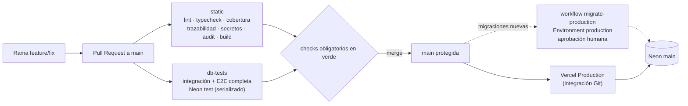
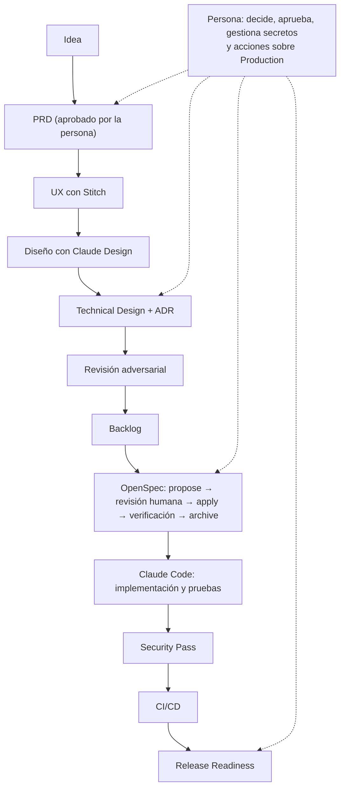

# Diagramas de FIXORA

> Índice de los diagramas del proyecto. **Los diagramas de arquitectura, estados y datos no se duplican aquí**: su fuente lógica es el Technical Design (Mermaid, se renderiza en GitHub). Este documento enlaza esos diagramas y aloja los dos que no pertenecen al Technical Design: el flujo de CI/CD y el pipeline AI-First.

## Diagramas del Technical Design (fuente lógica)

| Diagrama | Dónde |
|---|---|
| Arquitectura general y separación público/administrador | [TECHNICAL-DESIGN.md §2](../03-arquitectura/TECHNICAL-DESIGN.md) |
| Capas y dependencias permitidas | [TECHNICAL-DESIGN.md §5](../03-arquitectura/TECHNICAL-DESIGN.md) |
| Repair Lifecycle (máquina de estados) | [TECHNICAL-DESIGN.md §7.2](../03-arquitectura/TECHNICAL-DESIGN.md) |
| Modelo de datos | [TECHNICAL-DESIGN.md §10](../03-arquitectura/TECHNICAL-DESIGN.md) |
| Flujos de registro y consulta pública (secuencia) | [TECHNICAL-DESIGN.md §12](../03-arquitectura/TECHNICAL-DESIGN.md) y siguientes |
| Navegación y flujos de pantallas | [UX-EXPLORATION.md](../02-diseno/UX-EXPLORATION.md) |

El README principal reproduce el diagrama de arquitectura y el de estados; si el Technical Design cambia, prevalece el Technical Design.

## Flujo de CI/CD y entrega

Fuente: `.github/workflows/ci.yml`, `.github/workflows/migrate-production.yml` y [CI-QUALITY-GATES.md](../07-testing/CI-QUALITY-GATES.md).

La aplicación nunca migra la base: las migraciones de Production solo las aplica `migrate-production`, ligado al SHA y a la identidad del contenido de `prisma/migrations/`.

## Pipeline AI-First

Fuente: [docs/README.md](../README.md) y [OPENSPEC-STRATEGY.md](../04-planificacion/OPENSPEC-STRATEGY.md).

